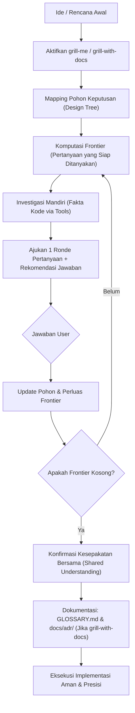

# Panduan Lengkap Skill Grill-Me & Grill-With-Docs

Panduan ini mendokumentasikan skill **`grill-me`**, **`grilling`**, **`grill-with-docs`**, dan **`domain-modeling`** yang terpasang di dalam `.agents/skills/`.

---

## 1. Filosofi & Tujuan Utama

Skill keluarga **Grill** diciptakan untuk menyelesaikan salah satu masalah terbesar dalam rekayasa perangkat lunak berbasis AI: **asumsi prematur dan rencana yang belum matang**.

Alih-alih langsung mengeksekusi kode berdasarkan instruksi yang masih kabur, skill ini mengubah AI menjadi **interviewer yang kritis dan tak kenal lelah (relentless)** untuk menguji (*stress-test*), menantang batas asumsi, mempertajam model domain, dan mendokumentasikan keputusan arsitektural sebelum sebaris kode pun ditulis.



---

## 2. Struktur Modul di `.agents/skills/`

Empat modul modular yang saling melengkapi terpasang di `.agents/skills/`:

| Modul Skill | Lokasi | Peran Utama |
| :--- | :--- | :--- |
| **`grill-me`** | [`.agents/skills/grill-me/`](file:///d:/Projekan/Clarafin/.agents/skills/grill-me/) | Entry point ringkas untuk wawancara stress-test ide / rencana teknis. Mendelegasikan eksekusi ke `grilling`. |
| **`grilling`** | [`.agents/skills/grilling/`](file:///d:/Projekan/Clarafin/.agents/skills/grilling/) | Mesin utama *interview loop*: memetakan pohon keputusan, mengelola *frontier*, dan mengajukan pertanyaan berbasis rekomendasi per ronde. |
| **`grill-with-docs`** | [`.agents/skills/grill-with-docs/`](file:///d:/Projekan/Clarafin/.agents/skills/grill-with-docs/) | Menjalankan *grilling* sekaligus menghasilkan dokumentasi formal domain (`GLOSSARY.md`) dan keputusan arsitektur (`docs/adr/`). |
| **`domain-modeling`** | [`.agents/skills/domain-modeling/`](file:///d:/Projekan/Clarafin/.agents/skills/domain-modeling/) | Mengelola terminologi domain, menantang istilah ambigu, dan menyusun template ADR serta Glosarium terstandar. |

---

## 3. Protokol & Mekanisme Kerja "Grilling"

### 3.1 Konsep Design Tree & Frontier
- **Pohon Keputusan (Design Tree)**: Setiap keputusan besar memicu anak-keputusan yang bergantung padanya.
- **Frontier**: Kumpulan pertanyaan yang prasyaratnya sudah terjawab/selesai dan bisa ditanyakan **sekarang** tanpa harus menebak jawaban berikutnya.
- **Satu Ronde, Seluruh Frontier**: Agen menghitung seluruh *frontier* saat ini dan mengajukannya sekaligus dalam 1 ronde. Pertanyaan yang masih bergantung pada jawaban ronde tersebut disimpan untuk ronde berikutnya.

### 3.2 Format Pertanyaan Standar
Setiap pertanyaan dirumuskan sedemikian rupa sehingga jawaban **"ya"** otomatis menerima rekomendasi agen:

```markdown
❓ **Q1** - **<Judul Keputusan/Pertanyaan>**: <Penjelasan konteks, implikasi, dan opsi pilihan>

➡️ <Rekomendasi jawaban terbaik dari Agen berserta alasannya>

---

❓ **Q2** - **<Judul Keputusan/Pertanyaan>**: <Penjelasan konteks>

➡️ <Rekomendasi jawaban terbaik dari Agen>
```

### 3.3 Aturan Absolut: Fakta vs Keputusan
1. **Mencari Fakta adalah Tugas Agen**: Agen dilarang menanyakan hal yang bisa dicek sendiri di repositori (file structure, dependency versi pubspec, isi database, atau implementasi kode lama). Agen wajib menggunakan tools (`read_file`, `grep`, `run_command`, subagent) untuk memverifikasi fakta.
2. **Mengambil Keputusan adalah Hak User**: Agen merekomendasikan opsi terbaik dengan analisis trade-off, namun user yang memegang kendali keputusan akhir.
3. **Kondisi Selesai**: Sesi wawancara selesai hanya ketika **frontier kosong** (seluruh cabang keputusan telah tuntas dan tidak ada asumsi terselubung) dan user menyetujui ringkasan akhir.

---

## 4. Pencatatan Otomatis pada `grill-with-docs`

Saat menggunakan `grill-with-docs`, agen secara proaktif memvalidasi bahasa dan mendokumentasikan hasil keputusan:

### 4.1 Pemeliharaan `GLOSSARY.md` (Domain Modeling)
- **Tantang Bahasa Samar**: Jika user menggunakan istilah ambigu (misal "akun", apakah Akun Bank, User ID, atau Profil Portofolio?), agen akan langsung meminta klarifikasi dan menetapkan istilah kanonik.
- **Update Inline**: Begitu suatu istilah disepakati, agen langsung memperbarui `GLOSSARY.md` tanpa menunggu akhir sesi.
- **Bebas Implementasi**: Glosarium murni memuat definisi bisnis domain, bukan detail koding (tidak mencantumkan nama variabel/tipe data Flutter).

### 4.2 Pembuatan ADR (`docs/adr/NNNN-slug.md`)
ADR dibuat secara **hemat (sparingly)** hanya jika memenuhi **3 Kriteria Wajib**:
1. **Hard to reverse**: Biaya untuk membatalkan keputusan di masa depan sangat mahal.
2. **Surprising without context**: Developer lain di masa depan akan bertanya-tanya *"mengapa dibuat begini?"* tanpa dokumentasi ini.
3. **Real trade-off**: Ada alternatif nyata yang dipertimbangkan dan dipilih karena alasan spesifik.

Format ADR:
```markdown
# {Nomor dan Judul Keputusan}

{1-3 kalimat ringkas: apa konteksnya, apa yang diputuskan, dan mengapa keputusan ini diambil.}
```

---

## 5. Cara Penggunaan & Trigger

### Kapan Menggunakan `grill-me`?
- Menghadapi task arsitektur baru atau refactor besar.
- Menguji ketahanan rencana sebelum migrasi state management atau database offline.
- Perintah / prompt trigger:
  - `/grill-me`
  - *"Grill me on this feature plan"*
  - *"Uji rencanaku untuk arsitektur sinkronisasi offline"*

### Kapan Menggunakan `grill-with-docs`?
- Saat fitur yang direncanakan melibatkan terminologi bisnis penting yang rawan miskomunikasi.
- Saat keputusan teknis memiliki dampak jangka panjang pada struktur repositori atau pola data model.
- Perintah / prompt trigger:
  - *"Grill with docs"*
  - *"Uji desain ini dan buatkan ADR serta perbarui GLOSSARY.md"*

---

## 6. Sinergi dengan Ekosistem Halofin

Di repositori Halofin:
- **Sebelum Koding**: Jalankan `grill-me` atau `grill-with-docs` untuk memvalidasi rencana.
- **Selama Koding**: Terapkan `antislop-ui`, `DESIGN_SYSTEM.md` (Neo-Brutalism), dan `CODE_GUIDELINES.md` (< 200 baris per file).
- **Integritas Output**: Pastikan `full-output-enforcement` aktif sehingga seluruh file diimplementasikan utuh tanpa placeholder.
