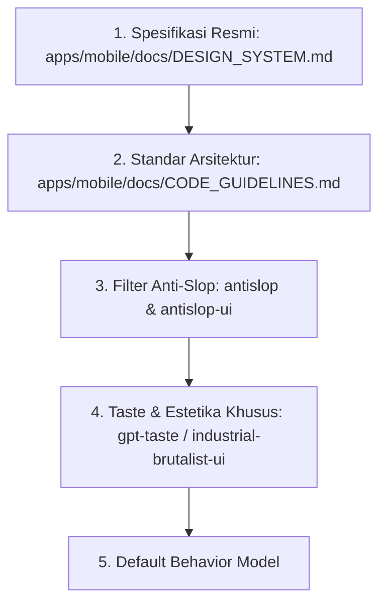

# Panduan Penggunaan Skill Antigravity (Skills Guidelines)

Dokumen ini adalah panduan resmi yang menjelaskan **kapan, mengapa, dan bagaimana** agen AI Antigravity harus menggunakan 19 custom skills yang terpasang di dalam workspace `.agents/skills/` agar menghasilkan kode Flutter dan desain antarmuka berstandar tinggi (*designer-crafted*), bebas klise AI (*anti-slop*), dan berkinerja tinggi.

---

## 1. Ikhtisar & Struktur Skill Workspace

Repositori Halofin dilengkapi dengan 19 skills modular yang terbagi menjadi 4 pilar fungsional:

```
.agents/skills/
├── [Pilar 1: Filter Anti-Slop & Integritas Output]
│   ├── antislop                     # Filter inti penangkal UI generik AI
│   ├── antislop-ui                  # Standar elemen visual, kontras, & hierarki
│   ├── antislop-copywriting         # Copywriting manusiawi, bebas jargon AI
│   ├── antislop-human               # Aksesibilitas (WCAG), fokus keyboard, touch targets
│   ├── antislop-layoutmobile        # Responsivitas mobile, overflow prevention
│   ├── antislop-code                # Pembersihan komentar kode dari AI boilerplate
│   └── full-output-enforcement      # Pencegahan pemotongan kode / truncation
│
├── [Pilar 2: Estetika & Visual Craftsmanship]
│   ├── gpt-taste                    # Eliminasi gaya default AI, layout asimetris berkarakter
│   ├── high-end-visual-design       # Sentuhan desain premium, micro-interactions, depth
│   ├── industrial-brutalist-ui      # Estetika teknikal, grid tegas, gaya Swiss / Neo-Brutalisme
│   ├── minimalist-ui                # Desain minimalis dengan ruang negatif terstruktur
│   └── design-taste-frontend        # Standar rekayasa frontend modern berkelas
│
├── [Pilar 3: Penerjemahan & Generasi Visual]
│   ├── image-to-code                # Konversi presisi screenshot/mockup ke kode Flutter
│   ├── imagegen-frontend-mobile     # Generasi konsep/aset visual antarmuka mobile
│   ├── imagegen-frontend-web        # Generasi konsep/aset visual antarmuka web
│   └── stitch-design-taste          # Pembuatan spesifikasi DESIGN.md & prompting Google Stitch
│
└── [Pilar 4: Evolusi Proyek & Brand Identity]
    ├── redesign-existing-projects   # Metodologi upgrade UI lama tanpa merusak logika bisnis
    └── brandkit                     # Ekstraksi & penataan token brand, palet, & tipografi
```

---

## 2. Matriks Penggunaan: Kapan Waktu yang Tepat Menggunakan Setiap Skill?

### 2.1 Pilar 1: Filter Anti-Slop & Integritas Output

| Skill Name | Waktu Tepat Menggunakan (Trigger) | Kapan DILARANG Digunakan (Anti-Trigger) | Kombinasi Sinergis |
| :--- | :--- | :--- | :--- |
| **`antislop`** | Setiap kali mendesain, membuat, atau mengaudit antarmuka UI baru. Digunakan sebagai **filter dasar** agar tidak timbul elemen generik AI tanpa fungsi nyata. | Tidak digunakan saat hanya memperbaiki logic backend, query database murni, atau unit test tanpa UI. | `antislop-ui`, `DESIGN_SYSTEM.md` |
| **`antislop-ui`** | Saat menyusun elemen visual: warna, bayangan, tombol, cards, radius, dan badge. Memastikan setiap teknik visual memiliki *written purpose*. | Jangan gunakan untuk override aturan `DESIGN_SYSTEM.md` proyek (Halofin border 2px & hard shadow tetap nomor 1). | `gpt-taste`, `DESIGN_SYSTEM.md` |
| **`antislop-copywriting`** | Saat menulis teks pada antarmuka: judul hero, headline, call-to-action (CTA), onboarding, error message, dan microcopy. | Tidak digunakan untuk nama variabel kode atau teks teknis dokumentasi API internal. | `antislop` |
| **`antislop-human`** | Saat mengaudit aksesibilitas UI: kontras warna teks (WCAG AA min 4.5:1), ukuran area sentuh (min 44×44 pt), navigasi keyboard, dan screen reader. | Jangan gunakan untuk animasi dekoratif murni yang tidak memiliki elemen interaktif. | `flutter_a11y_agent` |
| **`antislop-layoutmobile`** | Saat menyusun antarmuka mobile di Flutter agar terhindar dari *RenderFlex overflow*, terpotong di layar kecil, atau layout rusak pada orientasi berbeda. | Tidak perlu diaktifkan untuk tugas CLI atau script backend tanpa UI. | `CODE_GUIDELINES.md` |
| **`antislop-code`** | Saat melakukan code review, refactoring, atau pembersihan komentar kode agar tidak ada komentar AI yang jelas redundan (contoh: `// return total`). | Jangan hapus dokumentasi API publik (`/// doc comments`) atau komentar rasional arsitektural yang penting. | `dart-write-documentation` |
| **`full-output-enforcement`** | **Wajib aktif** saat menulis atau mengedit file kode utuh, screen orchestrator, atau komponen UI penting agar agen **tidak pernah** menghasilkan placeholder (`// TODO`, `// rest of code`). | Tidak diperlukan jika user secara eksplisit hanya meminta cuplikan baris kode tertentu (*diff snippet*). | `CODE_GUIDELINES.md` |

---

### 2.2 Pilar 2: Estetika & Visual Craftsmanship

| Skill Name | Waktu Tepat Menggunakan (Trigger) | Kapan DILARANG Digunakan (Anti-Trigger) | Kombinasi Sinergis |
| :--- | :--- | :--- | :--- |
| **`industrial-brutalist-ui`** | Sangat selaras dengan **Halofin Neo-Brutalism**. Gunakan untuk kartu metrik finansial, tabel data berdensitas tinggi, telemetry visual, dan grid struktural tegas. | Jangan gunakan untuk UI yang meminta gaya pastel lembut, rounded glassmorphism, atau skeuomorphic 3D. | `DESIGN_SYSTEM.md` |
| **`gpt-taste`** | Saat UI terasa membosankan, terlalu simetris seperti template Bootstrap/Tailwind bawaan AI, atau butuh ritme visual yang dinamis dan berkarakter. | Jangan gunakan jika desain sudah memiliki panduan grid yang sangat ketat dan wajib simetris. | `antislop-ui`, `high-end-visual-design` |
| **`high-end-visual-design`** | Saat menyusun kartu premium, hero section, detail konsultasi eksklusif, atau elemen fintech tingkat tinggi yang membutuhkan polish visual maksimal. | Jangan gunakan jika konteksnya adalah form input teknikal sederhana atau halaman pengaturan biasa. | `brandkit`, `gpt-taste` |
| **`minimalist-ui`** | Saat merancang halaman yang membutuhkan fokus tinggi dan minim distraksi, seperti halaman input transaksi manual, dialog konfirmasi, atau autentikasi. | Jangan gunakan jika halaman membutuhkan visual data yang padat dan banyak metrik perbandingan. | `antislop-ui` |
| **`design-taste-frontend`** | Saat menyusun hierarki komponen web/mobile, kurva micro-interaksi, dan layouting modern dengan standar engineering tinggi. | Tidak digunakan untuk tugas non-UI. | `DESIGN_SYSTEM.md` |

---

### 2.3 Pilar 3: Penerjemahan & Generasi Visual

| Skill Name | Waktu Tepat Menggunakan (Trigger) | Kapan DILARANG Digunakan (Anti-Trigger) | Kombinasi Sinergis |
| :--- | :--- | :--- | :--- |
| **`image-to-code`** | **Wajib diaktifkan** ketika user memberikan gambar screenshot mockup, wireframe, atau contoh desain dari Stitch/Figma dan meminta dibuatkan kodenya. | Jangan gunakan jika user meminta desain dari nol tanpa ada referensi visual sama sekali. | `antislop-ui`, `antislop-layoutmobile` |
| **`imagegen-frontend-mobile`** | Saat user meminta konsep visual baru dalam bentuk mockup gambar sebelum masuk ke tahap koding mobile. | Jangan gunakan jika user meminta kode langsung, bukan gambar. | `generate_image` tool |
| **`imagegen-frontend-web`** | Saat membuat konsep visual antarmuka web, landing page, atau desktop dashboard. | Tidak digunakan untuk platform mobile natif. | `generate_image` tool |
| **`stitch-design-taste`** | Saat membuat prompt untuk Google Stitch atau membuat file semantik `DESIGN.md` yang akan diunggah ke Google Stitch. | Jangan gunakan jika tidak menggunakan platform Google Stitch. | `StitchMCP` tools |

---

### 2.4 Pilar 4: Evolusi Proyek & Brand Identity

| Skill Name | Waktu Tepat Menggunakan (Trigger) | Kapan DILARANG Digunakan (Anti-Trigger) | Kombinasi Sinergis |
| :--- | :--- | :--- | :--- |
| **`redesign-existing-projects`** | **Wajib diaktifkan** saat merombak halaman yang sudah ada (seperti yang dilakukan pada Wallet & Budget Screen). Memastikan fitur dan data lama tidak hilang saat visual diupgrade. | Jangan gunakan saat membangun fitur yang 100% baru dari nol tanpa ada kode lama. | `CODE_GUIDELINES.md`, `antislop` |
| **`brandkit`** | Saat mendefinisikan sistem warna baru, membuat token institusi baru, atau memperluas palet warna tema Halofin. | Tidak perlu jika sistem token brand sudah lengkap dan tidak ada penambahan warna baru. | `DESIGN_SYSTEM.md` |

---

## 3. Aturan Precedence (Hierarki Aturan Proyek)

Jika terjadi pertentangan antara aturan skill umum dengan spesifikasi proyek:



1. **`DESIGN_SYSTEM.md` (Level Tertinggi)**:
   - Border wajib 2.0px hitam pekat (`#000000`).
   - Drop shadow wajib *hard-drop* tanpa blur (`blurRadius: 0`, offset 2px hingga 4px).
   - Tipografi wajib `Plus Jakarta Sans` untuk antarmuka dan `Quicksand` untuk wordmark brand.
   - Palet brand utama: Clarafin Lime (`#9ADC09`), Neon Lime (`#CCFF00`), Deep Teal (`#0F758A`), Mint (`#E5F9E0`), dan Kanvas Putih.
2. **`CODE_GUIDELINES.md` (Level Arsitektur)**:
   - File screen di bawah `presentation/screens/` hanya bertindak sebagai orchestrator (< 200 baris).
   - Seluruh widget detail wajib diekstrak ke dalam `presentation/widgets/`.
   - Logika kalkulasi bisnis tidak boleh di dalam `build()`, melainkan di Riverpod Notifier.
   - Wajib `const` constructor dan zero analyzer warning.
3. **Filter `antislop` (Level Kualitas)**:
   - Melarang tombol mati (*dead controls*) tanpa aksi nyata.
   - Melarang klaim data palsu tanpa sumber.
   - Melarang efek gradien atau glow ungu generik AI tanpa fungsi visual yang jelas.
4. **`full-output-enforcement` (Level Eksekusi)**:
   - Dilarang memberikan kode setengah jadi atau placeholder komentar.

---

## 4. Playbook Eksekusi untuk Skenario Kerja Nyata

### Skenario A: Menerjemahkan Mockup Gambar ke Kode Flutter Baru
1. Aktifkan: `image-to-code`, `antislop-ui`, `antislop-layoutmobile`, `full-output-enforcement`.
2. Inspect gambar referensi menggunakan `view_file` (periksa detail border, radius, warna, posisi elemen).
3. Buat file modular di `presentation/widgets/` terlebih dahulu sebelum membuat screen orchestrator.
4. Terapkan token dari `DESIGN_SYSTEM.md`.
5. Uji responsivitas pada resolusi emulator dan jalankan `flutter analyze`.

### Skenario B: Redesign Halaman yang Sudah Ada (Existing Screen)
1. Aktifkan: `redesign-existing-projects`, `antislop`, `CODE_GUIDELINES.md`.
2. Identifikasi seluruh data model, provider, dan callback interaksi pada file lama (pastikan tidak ada logika bisnis yang terhapus).
3. Pecah file lama yang membengkak (> 200 baris) menjadi sub-widget modular.
4. Terapkan elemen Neo-Brutalisme (header gradient, pembatas putih melengkung radius 28px dengan border 2px, kartu dengan hard shadow).
5. Lakukan Hot Reload via `dtd` dan capture screenshot di emulator untuk verifikasi visual.

### Skenario C: Audit Kualitas Desain (Anti-Slop Delivery Gate)
Sebelum menyatakan suatu fitur selesai, lakukan verifikasi mandiri terhadap 4 blok delivery gate:
- [x] **Block 1 (Hard Gate)**: Tidak ada overflow layout pada mobile? Semua tombol interaktif memiliki handler/navigasi nyata? Kontras teks memenuhi standar WCAG AA?
- [x] **Block 2 (Purpose Gate)**: Apakah setiap warna aksen dan bayangan memiliki alasan fungsi yang jelas sesuai desain sistem Halofin?
- [x] **Block 3 (Liveliness)**: Apakah antarmuka memiliki karakter kuat, fokal poin yang jelas, dan ritme visual yang hidup?
- [x] **Block 4 (Code Quality)**: Apakah file screen < 200 baris? Apakah `flutter analyze` 100% bersih tanpa issue?

---

*Dokumen ini wajib dijadikan acuan referensi otomatis oleh Antigravity pada setiap giliran percakapan.*
