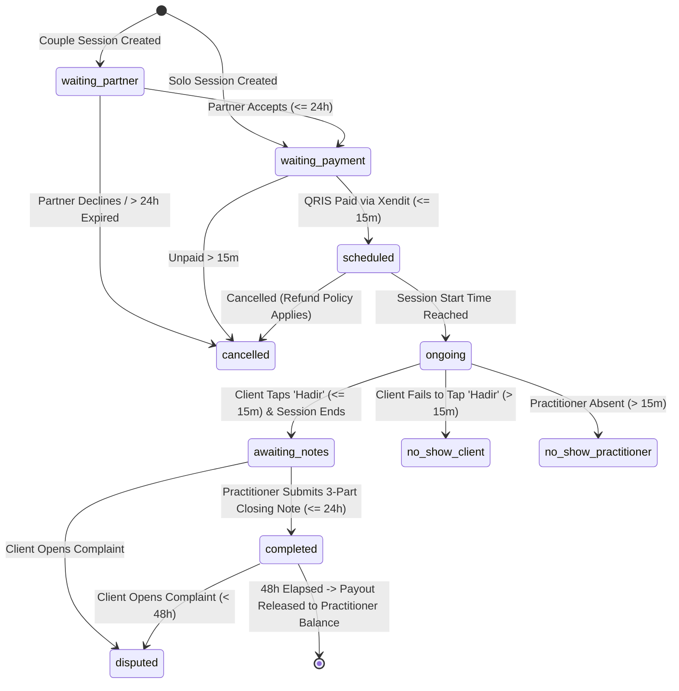
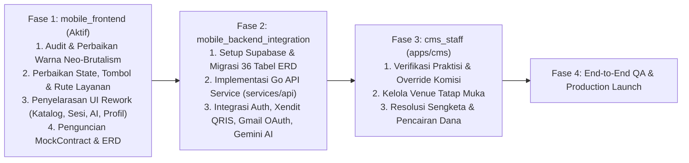

# Product Requirements Document (PRD) — Clarafin

| Field | Value |
| --- | --- |
| Product Name | **Clarafin** (sebelumnya HaloFin pada prototipe awal) |
| Document Version | 3.0 (Rework Aligned + Frontend-First & Bottom Nav Override) |
| Status | Active Baseline |
| Last Updated | 2026-11-01 |
| Target Market | Indonesia (Bahasa Indonesia, Mata Uang Tunggal IDR, Zona Waktu WIB `UTC+7` untuk aturan bisnis) |

## Change Summary

| Date | Change |
| --- | --- |
| 2026-11-01 | Rework menyeluruh mengacu pada `docs-rework-clarafin` (`01-keputusan.md` s/d `06-sistem.md`): penyederhanaan katalog menjadi Basic/Medium/Premium (1 Orang & Couple), aturan harga transparan (potongan komisi default 20%, rentang override 10%–35%), siklus hidup sesi (QRIS 15m, Couple invite 24h, tombol `Hadir` 15m, Catatan Penutup 3 bagian 24h, cair 48h), batas ketat AI + kuota (40 gratis / 400 Pro Rp49rb), koneksi Gmail OAuth 30 hari, dan izin dompet per sesi. Mempertahankan override user: **Navigasi Bawah Eksisting (`Home`, `Consult`, `FAB (+)`, `Wallet`, `Budget` + Floating Session)** dan **Strategi Delivery Frontend-First**. |
| 2026-03-11 | Expanded PRD v2.0 with user stories, MoSCoW prioritization, and feature clusters. |

---

## 1. Visi Produk & Model Bisnis

**Clarafin** adalah platform manajemen keuangan personal dan marketplace konsultasi keuangan bersertifikat di Indonesia.

Clarafin berdiri di atas tiga pilar produk yang saling terhubung:
1. **Marketplace Konsultasi Keuangan Bersertifikat (Sumber Pendapatan Utama):** Menghubungkan pengguna (individu maupun pasangan) dengan praktisi keuangan terverifikasi (`CFP`, `QWP`, `AEPP`, `Brevet Pajak`, Akuntan/Perencana Keuangan) melalui sesi **Chat (3 Hari)**, **Virtual (60 Menit via Google Meet)**, dan **Tatap Muka (90 Menit di Venue Terkurasi)**.
2. **Pencatat Keuangan Personal Gratis (Retensi Harian):** Menyediakan alat pencatatan multi-dompet (`Wallet`), anggaran (`Budget`), target tabungan (`Goals`), pengingat tagihan (`Bills`), laporan arus kas (`Report`), serta sinkronisasi draf transaksi dari email mutasi/resi via **Gmail Read-Only OAuth (30 Hari)** secara gratis.
3. **Asisten AI Finansial Berkuota (Pendapatan Pendukung via Clarafin Pro):** Memudahkan pencatatan transaksi lewat bahasa natural (teks, suara, foto struk OCR) dan menjawab pertanyaan seputar data keuangan pengguna dengan kuota **40 aksi gratis/bulan** atau langganan **Clarafin Pro (Rp 49.000 / 30 hari untuk 400 aksi)**.

---

## 2. Keputusan Produk Terkunci (Locked Decisions)

| Aspek | Keputusan Terkunci |
| --- | --- |
| **Aplikasi Pengguna (`apps/mobile`)** | Satu aplikasi mobile Flutter (`apps/mobile`) untuk Android & iOS yang **murni dikhususkan bagi Klien / Pengguna**. Tidak ada form pengajuan praktisi maupun *Mode Praktisi* di dalam aplikasi mobile. |
| **Ekosistem Web 3-Pintu (`apps/web` / `apps/cms`)** | Platform web terbagi menjadi 3 modul: (1) **Public Landing Page** yang memuat informasi produk serta **Formulir Pendaftaran Calon Praktisi**, (2) **Web Portal Praktisi (Advisor Dashboard)** untuk konsultan terverifikasi mengelola jadwal, melayani sesi, mengisi Catatan Penutup 3 Bagian, dan memantau pencairan dana, serta (3) **Web Internal Staff / Admin CMS** untuk verifikasi praktisi, pengaturan tier & komisi, pengelolaan venue/voucher, dan penyelesaian sengketa. |
| **Strategi Delivery** | **Frontend-First (`mobile_frontend`):** Seluruh UI/UX, navigasi, komponen Neo-Brutalism, dan state lokal di aplikasi mobile diselesaikan dan dikunci terlebih dahulu sebelum memulai implementasi backend (`mobile_backend_integration`) dan platform web. |
| **Navigasi Bawah Mobile** | Mempertahankan struktur navigasi bawah eksisting yang sudah berjalan: **`Home`**, **`Consult`**, **`FAB (+)`** (Quick Action / Input Transaksi), **`Wallet`**, dan **`Budget`** (memuat tab *Goals*, *Budget*, *Bills*), ditambah **Floating Session Button** di kanan bawah `Home` menuju **`/session`**. |
| **Kelayakan Pengguna (Inklusif Remaja)** | **Tidak ada pembatasan usia minimal 18 tahun.** Remaja/pelajar (misalnya usia 16 tahun yang sudah memiliki penghasilan/uang saku mandiri dan ingin belajar mengelola keuangan) dapat mendaftar dan menggunakan Clarafin secara penuh. |
| **Bahasa & Mata Uang** | Antarmuka menggunakan **Bahasa Indonesia**. Seluruh pencatatan dompet, transaksi, anggaran, dan pembayaran sesi menggunakan **Rupiah (`IDR`)** dalam tipe bilangan bulat (`BIGINT`). |
| **Harga, Platform Fee, & Voucher** | Rincian pembayaran saat checkout adalah **`Total Bayar = Harga Paket (x Sesi) + Platform Fee (Rp 15.000) - Diskon Voucher Promo`**. Tidak ada *Transaction Fee* (`2.5%` dihapus). Komisi platform dari harga paket praktisi tetap berlaku (default **20%**, rentang **10%–35%**). |
| **Metode Pembayaran Peluncuran** | **QRIS via Xendit** dengan batas waktu bayar **15 menit**, mendukung penggunaan **Voucher / Kode Promo** marketing. |

---

## 3. Katalog Layanan, Kualifikasi Praktisi, & Harga Resmi

Spesifikasi lengkap katalog mengacu pada dokumen kanonis **[`docs/katalog-paket-dan-harga.md`](./katalog-paket-dan-harga.md)**.

### 3.1 Aturan Mode Layanan (`Online` vs `Offline`) & Bundling Sesi
1. **Layanan `Online` (All-in-One Method):**
   - Saat klien memilih tab **`Online`**, setiap paket **otomatis mencakup akses ke 3 metode komunikasi sekaligus: `Voice Call`, `Video Call`, dan `Chat`** (durasi standar **60 menit/sesi**).
   - **Tidak ada perbedaan harga** antara Call, Video Call, maupun Chat.
2. **Layanan `Offline` (Tatap Muka):**
   - Sesi konsultasi langsung (60–90 menit) di lokasi/venue terkurasi dengan tarif Offline tersendiri per tier.
3. **Pilihan Jumlah Sesi (`Pilih Paket`):**
   - Mendukung pembelian **1 Sesi**, **2 Sesi**, **3 Sesi (Lebih Hemat — Diskon 7%)**, dan **8 Sesi (Program Pendampingan — Diskon 12%)**.

### 3.2 Matriks Kualifikasi Praktisi per Tier (`Basic`, `Medium`, `Premium`)
- **Tier 1 — `Basic` (*Associate Financial Planner*):** Sertifikasi `AWP®` / `RFP®` / `QWP®` / `Brevet AB`, pengalaman **1–2 tahun**, jumlah klien yang pernah ditangani **`< 300 orang`**.
- **Tier 2 — `Medium` (*Senior Financial Planner*):** Sertifikasi `CFP®` / `CPA` / `BKP`, pengalaman **2–5 tahun**, jumlah klien yang pernah ditangani **`301 – 500 orang`**.
- **Tier 3 — `Premium` (*Principal / Wealth & Business Advisor*):** Sertifikasi `CFP® Senior` / `CFA®` / `AEPP®` / `M.M.`, pengalaman **`> 5 tahun`**, jumlah klien yang pernah ditangani **`> 500 orang`**.

### 3.3 Ringkasan Paket & Harga Per Sesi (5 Kategori Layanan)

| Kategori | Tag UI (`categoryTag • tierBadge`) | Nama Paket Utama (`packageTitle` — Hook) | Harga Online (1 Sesi) | Harga Offline (1 Sesi) |
| --- | --- | --- | --- | --- |
| **1. Individu** | `Personal Advisory • Basic` | **Fondasi Arus Kas & Utang** | **Rp 199.000** | **Rp 349.000** |
| **1. Individu** | `Personal Advisory • Medium` | **Optimalisasi Aset & Proteksi** | **Rp 299.000** | **Rp 449.000** |
| **1. Individu** | `Personal Advisory • Premium` | **Menuju Kebebasan Finansial** | **Rp 399.000** | **Rp 599.000** |
| **2. Couple & Keluarga** | `Couple Advisory • Pre-Marriage` | **Siap Menikah Tanpa Drama Finansial** | **Rp 349.000** | **Rp 529.000** |
| **2. Couple & Keluarga** | `Couple Advisory • Marriage` | **Satu Visi Bangun Aset Keluarga** | **Rp 399.000** | **Rp 599.000** |
| **2. Couple & Keluarga** | `Couple Advisory • Premium` | **Mapan Finansial Lintas Generasi** | **Rp 549.000** | **Rp 799.000** |
| **3. UMKM & Bisnis** | `UMKM Advisory • Basic` | **Omzet Ramai, Untung Nyata di Rekening** | **Rp 349.000** | **Rp 549.000** |
| **3. UMKM & Bisnis** | `UMKM Advisory • Medium` | **Ekspansi Cabang & Aman Pajak Bisnis** | **Rp 549.000** | **Rp 799.000** |
| **3. UMKM & Bisnis** | `UMKM Advisory • Premium` | **Perpanjang Runway & Siap Pendanaan Investor** | **Rp 849.000** | **Rp 1.199.000** |
| **4. Corporate** | `Corporate Wellness • Basic` | **Karyawan Produktif Bebas Jerat Pinjol** | **Rp 2.500.000** | **Rp 4.500.000** |
| **4. Corporate** | `Corporate Wellness • Medium` | **Klinik Finansial Privat & Retensi Talenta** | **Rp 1.490.000** | **Rp 2.250.000** |
| **4. Corporate** | `Corporate Advisory • Premium` | **Optimalisasi Kas Korporasi & Pajak Eksekutif** | **Rp 1.490.000** | **Rp 2.190.000** |
| **5. Tes Finansial** | `Financial Check-Up • Basic` | **Bongkar Bocor Halus & Skor Keuanganmu** | **Rp 149.000** | **Rp 279.000** |
| **5. Tes Finansial** | `Financial Check-Up • Medium` | **Bedah Tuntas Portofolio & Polis Asuransi** | **Rp 279.000** | **Rp 429.000** |
| **5. Tes Finansial** | `Financial Check-Up • Premium` | **Peta Jalan Kekayaan & Pensiun Dini (360°)** | **Rp 499.000** | **Rp 699.000** |

---

## 4. Siklus Hidup Sesi, Kehadiran, & Aliran Uang

### 4.1 Pemesanan Solo vs Couple
- **Sesi 1 Orang (Solo):**
  1. Klien memilih praktisi, paket layanan, slot waktu, dan (opsional) mencentang dompet yang ingin dibagikan.
  2. Slot langsung dikunci selama **15 menit** (`waiting_payment`) dan tagihan QRIS Xendit ditampilkan.
  3. Jika lunas dalam 15 menit -> status berubah menjadi `scheduled`. Jika lewat 15 menit -> `cancelled` dan slot dibuka kembali.
- **Sesi Pasangan (Couple):**
  1. Pembuat sesi memilih praktisi, paket Couple, slot waktu, dan memasukkan email akun Clarafin pasangannya (`partner_user_id`).
  2. Slot ditahan selama **24 jam** (`waiting_partner`). Pasangan menerima notifikasi undangan dan dapat memilih dompet miliknya sendiri yang ingin dibagikan ke praktisi.
  3. Begitu pasangan menekan **Terima**, waktu tunggu pembayaran **15 menit** (`waiting_payment`) dimulai untuk pembuat sesi.
  4. Jika pasangan menolak atau tidak merespons dalam 24 jam, sesi otomatis menjadi `cancelled`.

### 4.2 Bukti Kehadiran (`Hadir`) & Ketidakhadiran (`No-Show`)
- Begitu waktu mulai sesi tiba, tombol **`Hadir`** aktif di halaman sesi/ruang sesi klien selama **15 menit pertama**.
- **Klien menekan `Hadir` (<= 15 menit):** Kehadiran tercatat (`attendance_confirmed_at`).
- **Klien tidak menekan `Hadir` (> 15 menit):** Sesi otomatis berstatus `no_show_client`. Praktisi tetap menerima **50%** dari hak bersihnya, dan **50%** biaya sesi dikembalikan ke klien.
- **Praktisi tidak hadir (> 15 menit setelah klien klik `Hadir`):** Klien dapat melaporkan ketidakhadiran praktisi (`no_show_practitioner`), dan klien menerima pengembalian dana **100%**.

### 4.3 Catatan Penutup Wajib 3 Bagian (`ClosingNote`) & Pencairan (`Payout`)
- Setelah sesi berakhir (`awaiting_notes`), praktisi memiliki waktu **24 jam** untuk mengisi **Catatan Penutup 3 Bagian**:
  1. **Inti Masalah (`core_issue`):** Ringkasan kondisi dan akar masalah keuangan klien.
  2. **3 Langkah 30 Hari ke Depan (`action_steps`):** Tiga tindakan konkret dan terukur yang harus dilakukan klien.
  3. **1 Aturan Jangan Dilakukan (`dont_rule`):** Satu pantangan finansial spesifik yang wajib dihindari klien.
- Begitu catatan dikirim, status sesi menjadi `completed` dan penghitung waktu **48 jam** (`payout_ready_at = completed_at + 48 jam`) dimulai.
- Jika dalam 48 jam tidak ada keluhan terbuka (`disputed`), dana bersih sesi (`price_paid * (100 - platform_cut_pct) / 100`) masuk ke saldo siap cair praktisi dan dicairkan melalui antrean `payouts`.
- Jika praktisi belum mengirim catatan lewat 24 jam, pencairan ditahan dan pengingat dikirim ke praktisi serta staff CMS.

### 4.4 Penjadwalan Ulang (Reschedule), Pembatalan, Keluhan, & Ulasan
- **Reschedule:** Maksimal **1 kali** per sesi, wajib diajukan minimal **24 jam** sebelum jadwal mulai (`reschedule_count < 1`).
- **Pembatalan oleh Klien:**
  - **>= 24 jam sebelum sesi mulai:** Refund **100%**.
  - **< 24 jam sebelum sesi mulai:** Refund **50%** (praktisi menerima 50% dari haknya).
- **Pembatalan oleh Praktisi:** Klien selalu menerima refund **100%** kapan pun praktisi membatalkan.
- **Keluhan (`SessionComplaint`):** Klien dapat mengajukan keluhan selama sesi berlangsung hingga sebelum batas 48 jam pencairan berakhir. Keluhan mengubah status menjadi `disputed` hingga Staff CMS memutuskan (`release_to_practitioner`, `full_refund`, atau `partial_refund`).
- **Ulasan (`SessionReview`):** Setelah sesi `completed`, klien dapat memberikan rating bintang **1–5** dan ulasan teks satu kali per sesi.

---

## 5. Aturan Asisten AI, Kuota, & Data Klien

### 5.1 Batas Kepatuhan AI (*Helpful Hint* Netral & *Soft Boundary*)
AI Clarafin dirancang sebagai **asisten pencatatan, pembacaan data, dan edukator awal yang netral**, bukan penasihat keuangan yang memberi instruksi mengikat:

| Boleh Dilakukan AI | Dilarang Keras Dilakukan AI |
| --- | --- |
| Mencatat pemasukan/pengeluaran dari teks, suara, atau foto struk menjadi draf transaksi (`pending_review`) dengan kategori kanonis `TransactionCategories`. | Menetapkan strategi/urutan pelunasan utang mengikat untuk dijalankan pengguna (namun boleh menjelaskan konsep umum *Snowball vs Avalanche* secara netral dan seimbang sebagai *helpful hint*). |
| Menjawab pertanyaan faktual tentang saldo dompet, pengeluaran per kategori, sisa anggaran, dan progres target tabungan pengguna. | Menghitung dan memaksakan target dana darurat/runway mengikat yang harus diambil pengguna. |
| Memberikan ***helpful hint* edukatif secara netral, seimbang, dan tidak berlebihan** (tanpa memihak pilihan atau menggantikan konsultasi) dan menutup dengan **1–3 card praktisi relevan**. | Merekomendasikan produk investasi, saham, reksa dana (RDPU/RDPT), kripto, asuransi, atau pinjaman spesifik. |
| Mengarahkan pengguna ke **paket katalog & 1–3 praktisi relevan** setelah memberi *helpful hint* awal. | Memberikan nasihat pajak atau hukum yang bersifat mengikat. |

> **Perilaku *Helpful Hint* + *Soft Boundary*:** Ketika pengguna menanyakan strategi pelunasan utang, proteksi, atau investasi mendalam, AI tetap memberikan **helpful hint edukatif yang netral dan tidak berlebihan** terlebih dahulu (disertai fakta angka user bila relevan), lalu menutup dengan *soft boundary* dan menampilkan rekomendasi paket + **1–3 card praktisi bersertifikat** agar pengguna terdorong berkonsultasi langsung.

### 5.2 Model Bisnis Kuota AI (`Free`, `Pro Bulanan`, `Unlimited` & Opsi *Consult-to-Unlock*)
Spesifikasi lengkap mengacu pada **[`docs/model-bisnis-ai-dan-saas.md`](./model-bisnis-ai-dan-saas.md)**:
- **Opsi 1 — Model SaaS Berjenjang (Dikunci untuk Implementasi Saat Ini):**
  1. **Free Plan (Rp 0):** Mendapat **40 aksi AI gratis per bulan** (reset tanggal 1 pukul 00:00 WIB). Fitur Gmail Auto-Sync & Auto-Sync Wallet terkunci (menampilkan tombol **`Upgrade Plan`**).
  2. **Clarafin Pro Bulanan (Rp 49.000 / 30 hari):** Mendapat **400 aksi AI** selama 30 hari + aktivasi penuh **Gmail Read-Only Auto-Sync & Auto-Sync Wallet** mengikuti siklus bulanan.
  3. **Clarafin Unlimited (Rp 99.000 / 30 hari):** Mendapat **Unlimited (Tanpa Batas) aksi AI** + aktivasi penuh **Gmail Read-Only Auto-Sync & Auto-Sync Wallet** mengikuti siklus Unlimited.
- **Opsi 2 — Model *Consult-to-Unlock* (Dokumentasi Ekspansi):**
  - Pengguna memperoleh tambahan kuota AI dan masa aktif Auto-Sync otomatis setiap kali memesan sesi konsultasi bersama Advisor nyata sesuai tingkat paket (`Basic` +200 aksi, `Medium` +350 aksi, `Premium` +500 aksi, `Couple` +400 s/d Unlimited, dst.).
- **Apa yang Dihitung 1 Aksi AI (pada Free & Pro Bulanan):**
  1. Satu pesan tanya-jawab ke AI Chat yang berhasil dijawab.
  2. Satu input teks/suara pencatatan transaksi cepat via AI yang berhasil diekstrak menjadi draf.
  3. Satu pemindaian foto struk (OCR) yang berhasil diekstrak menjadi draf.

### 5.3 Koneksi Gmail Read-Only & Keterkaitan dengan Tombol On/Off Auto-Sync Dompet
- **Keterkaitan Langsung (`ProfileScreen` <-> `AddWalletInstitutionScreen` & `WalletDetailScreen`):**
  - Saat pengguna berada di **Free Plan**, tombol On/Off pada Kartu Koneksi Gmail di `ProfileScreen` maupun pada baris institusi di `AddWalletInstitutionScreen` diganti menjadi tombol **`Upgrade Plan`**.
  - Saat pengguna berada di **Pro Bulanan** atau **Unlimited**, tombol berubah menjadi toggle **`ON / OFF`** aktif (mengikuti masa aktif plan bulanan atau unlimited).
  - Menyalakan (`ON`) toggle Auto-Sync pada institusi dompet di `AddWalletInstitutionScreen` saat Gmail belum aktif akan memicu aktivasi Kartu Koneksi Gmail di `ProfileScreen`. Sebaliknya, mematikan (`OFF`) Kartu Koneksi Gmail di `ProfileScreen` akan otomatis mengubah seluruh dompet Auto-Sync menjadi `OFF (Manual)`.
- Sistem hanya memindai email notifikasi transaksi bank dan resi pembayaran digital dari **30 hari terakhir** untuk diubah menjadi draf transaksi (`source = 'gmail'`, `status = 'pending_review'`). Isi mentah email tidak pernah disimpan ke database.

### 5.4 Persetujuan Syarat & Data Terpadu serta Penghapusan Akun
- **Persetujuan Terpadu di Alur Pemesanan (`BookingTermsCard`):** Untuk menjaga pengalaman pemesanan tetap ringkas dan tidak *over-engineered*, klien tidak dibebani dengan daftar centang per-dompet (`CheckboxListTile`). Persetujuan atas aturan konsultasi dan izin pembacaan ringkasan profil finansial klien oleh praktisi selama sesi berlangsung langsung disatukan ke dalam **1 kotak centang Syarat & Ketentuan Layanan Clarafin** pada saat pemesanan sesi.
- **Penghapusan Akun (`Delete Account`):** Pengguna dapat menghapus akunnya dari menu Profil (kecuali masih ada sesi yang sedang aktif/belum selesai). Saat akun dihapus:
  - Seluruh data dompet, transaksi, anggaran, target, tagihan, draf AI, dan token Gmail dihapus permanen.
  - Catatan pembayaran sesi yang pernah terjadi dipindahkan ke tabel arsip `deleted_account_payment_archives` tanpa identitas pribadi langsung selama **5 tahun** untuk kepatuhan perpajakan dan audit keuangan.

---

## 6. Peta Layar Mobile & Strategi Delivery

### 6.1 Peta Navigasi Bawah Mobile (User Override — Dipertahankan)
Sesuai keputusan arsitektur proyek, aplikasi mobile mempertahankan struktur navigasi bawah eksisting:
1. **Tab 1 — `Home` (`/home`):** Ringkasan total saldo & portofolio, deretan layanan cepat (*Quick Actions* & *Semua Layanan*), kartu sesi aktif, *Sorotan Untukmu* (*Match Expert*, rekomendasi), ringkasan anggaran bulan ini, transaksi terkini, tombol **AI** di kanan atas header (`/ai-chat`), tombol **Notifikasi** (`/notifications`), dan **Floating Session Button** di kanan bawah menuju **`/session`**.
2. **Tab 2 — `Consult` (`/consult`):** Marketplace penemuan praktisi dengan pencarian, filter spesialisasi/kategori, banner *Match Expert*, dan kartu praktisi menuju detail praktisi (`/consult/:id`) & alur pemesanan (`/booking/:id` -> `/booking/:id/payment`).
3. **Center Action — `FAB (+)`:** Membuka *Quick Action Bottom Sheet* (Input Manual `/transaction/add`, Input Teks/Suara AI, Scan Struk OCR) serta peninjauan draf AI (`/transaction/draft-review`).
4. **Tab 3 — `Wallet` (`/wallet`):** Ringkasan distribusi aset (Donut Chart), pengurutan nilai aset (*Sort by Value*), filter tipe dompet, dan daftar kartu dompet menuju detail dompet (`/wallet/:id`) atau tambah dompet (`/wallet/add` -> `/wallet/add/manual`).
5. **Tab 4 — `Budget` (`/budget`):** Pusat perencanaan keuangan dengan 3 sub-tab terintegrasi:
   - **Sub-tab 0 (`Goals`):** Daftar target tabungan (`/goal/:id`, `/goal/add`).
   - **Sub-tab 1 (`Budget`):** Total anggaran bulanan dan progres anggaran per kategori (`/budget/add`).
   - **Sub-tab 2 (`Bills`):** Pengingat tagihan jatuh tempo dan riwayat tagihan lunas (`/bill/add`).

### 6.2 Urutan Fase Delivery (`Frontend-First`)

