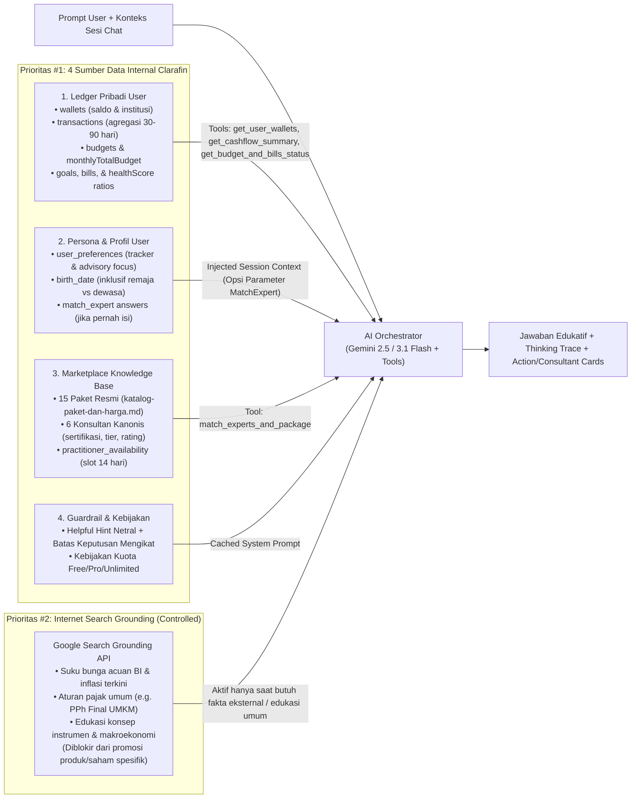
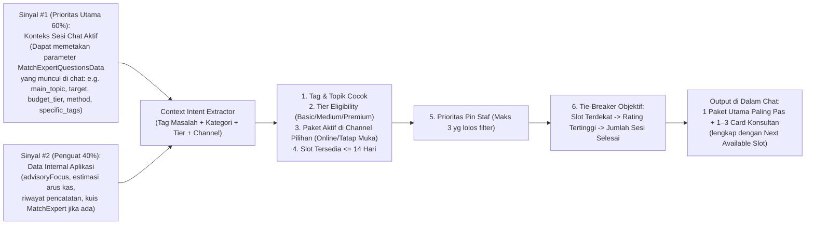
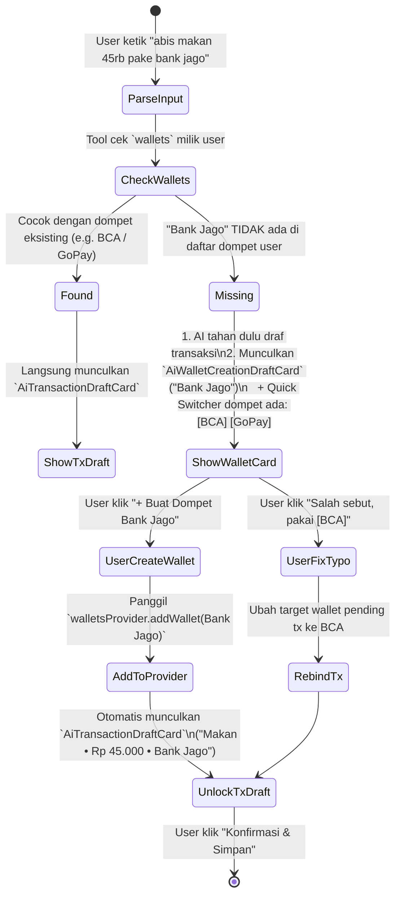

# Master Blueprint & Audit Arsitektur AI Chatbot — Clarafin

> [!NOTE]
> **Status & Ruang Lingkup Dokumen (Master Blueprint v2.1):**
> Dokumen ini menggabungkan secara utuh seluruh fondasi audit produk & teknis (Tujuan, Target Pengguna, Gap Analysis, Process Trace, One-Shot Action Cards, Tool Registry) beserta seluruh keputusan final hasil brainstorming (**Locked Decisions**). Fokus dokumen dibatasi **eksklusif pada AI Chatbot** (fitur OCR Struk & Voice AI dikecualikan untuk sesi terpisah), dan masih berada pada **tahap blueprint** sebelum implementasi kode dimulai.

---

## 1. Audit Kondisi Eksisting di Codebase Clarafin (Gap Analysis)

Berdasarkan pembacaan langsung terhadap source code di `apps/mobile` dan dokumen produk (`docs/PRD.md`, `docs-rework-clarafin/04-ai-dan-data-klien.md`, `docs/model-bisnis-ai-dan-saas.md`, `docs/katalog-paket-dan-harga.md`, `docs/tech/Architecture.md`, `docs/tech/Backend.md`), saat ini terdapat **dua antarmuka AI Chatbot** yang berjalan terpisah dengan arsitektur yang belum tersinkronisasi:

### 1.1 Perbandingan Kondisi Dua Interface Saat Ini

| Dimensi Audit | AI Quick Action (`_AiQuickChatModal`) | AI Layanan (`/ai-chat` — `AiChatScreen`) | Gap & Masalah Saat Ini |
| :--- | :--- | :--- | :--- |
| **Lokasi File** | [quick_action_sheets.dart](file:///d:/Projekan/Clarafin/apps/mobile/lib/features/session/presentation/screens/quick_action_sheets.dart#L652-L1350) | [ai_chat_screen.dart](file:///d:/Projekan/Clarafin/apps/mobile/lib/features/session/presentation/screens/ai_chat_screen.dart#L1-L311) | Dua UI memakai desain, logika, & model pesan yang terpisah (`_QuickChatMessage` vs `AiChatMessage`). |
| **Pintu Masuk (Entry Point)** | Tombol tengah Navbar `FAB (+)` -> `AI Chat Action` ([app_bottom_nav.dart](file:///d:/Projekan/Clarafin/apps/mobile/lib/shared/widgets/app_bottom_nav.dart#L60-L65)) | Grid Layanan `HomeScreen` ([services_grid_widget.dart](file:///d:/Projekan/Clarafin/apps/mobile/lib/features/home/presentation/widgets/services_grid_widget.dart#L40-L47)) & [all_services_bottom_sheet.dart](file:///d:/Projekan/Clarafin/apps/mobile/lib/features/home/presentation/widgets/all_services_bottom_sheet.dart#L110-L118) | User bingung mengapa AI di Layanan tidak bisa mencatat transaksi seperti AI di Quick Action, dan desain halamannya berbeda. |
| **Otak / Mesin Pemrosesan** | **Rule-Based Regex Parser** lokal (`_parseAmountFromText`, `_resolveCategoryFromText`, `_resolveWalletFromText`, `_resolveTitleFromText`) | **100% Hardcoded Array** (`_aiResponses` berputar indeks `0..3` dengan `Timer` 1000ms) | **Belum ada integrasi LLM** di keduanya. Pertanyaan bebas di luar 3 keyword Quick Action dianggap transaksi, sedangkan `/ai-chat` selalu memutar jawaban dummy. |
| **Akses ke Data User** | Hanya membaca `walletsProvider` untuk keyword `'saldo'`. Angka `'pengeluaran'` (`Rp 3.041.000`) dan `'pemasukan vs'` (`Rp 15.000.000`) masih **hardcoded**. | **Nol akses data user.** Tidak membaca `walletsProvider`, `transactionsProvider`, `budgetsProvider`, `goalsProvider`, `billsProvider`, maupun `financialHealthProvider`. | AI belum bisa menjawab kondisi keuangan nyata user secara personal. |
| **Aksi / Mutasi State & Validasi Dompet** | Bisa membuat `_DraftTransaction` dan menulis ke `transactionsProvider.notifier.addTransaction(tx)`. Namun jika dompet belum terdaftar (mis. `"Bank Jago"`), `_resolveWalletFromText` membuat objek `WalletModel` bayangan (`w_jago`) yang **tidak masuk `walletsProvider`**. | **Tidak ada aksi tulis sama sekali.** | Risiko saldo rusak/dompet hantu pada Quick Action, dan belum mendukung pembuatan **Goals**, **Budget**, maupun **Bills** lewat chat. |
| **Rekomendasi Konsultan & Paket** | Tidak ada. | Hanya 1 tombol statis `Lihat Praktisi Rekomendasi` menuju `/consult` ([ai_chat_bubble.dart](file:///d:/Projekan/Clarafin/apps/mobile/lib/features/session/presentation/widgets/ai_chat_bubble.dart#L88-L125)). | Belum terhubung ke data konsultan, jadwal praktik (`practitioner_availability`), 12 parameter [match_expert_provider.dart](file:///d:/Projekan/Clarafin/apps/mobile/lib/features/match_expert/presentation/providers/match_expert_provider.dart), maupun 15 paket di [katalog-paket-dan-harga.md](file:///d:/Projekan/Clarafin/docs/katalog-paket-dan-harga.md). |
| **Manajemen Kuota AI** | Memakai 2 state sekaligus: `aiQuotaProvider` **dan** `quickActionLimitProvider` (`limits.aiChatCount >= 10`), kuota baru dipotong di `_confirmDraft`. | Memanggil `aiQuotaProvider.notifier.useQuota()` setiap `_sendMessage()`, bahkan untuk sapaan atau respons dummy. | Tidak konsisten dengan aturan kanonis di [04-ai-dan-data-klien.md](file:///d:/Projekan/Clarafin/docs-rework-clarafin/04-ai-dan-data-klien.md#L13-L27) dan menimbulkan dua sumber kuota yang saling tumpang tindih. |
| **Transparansi Proses AI** | Hanya teks loading statis (`_buildTypingIndicator`). | Hanya pill loading statis `'Clarafin sedang menganalisa...'`. | Belum menampilkan proses query/tool yang sedang dikerjakan AI secara expandable. |

### 1.2 Temuan Sinkronisasi Dokumen vs Aplikasi
1. **Ketidaksinkronan Kuota & Paket SaaS:**
   - [04-ai-dan-data-klien.md](file:///d:/Projekan/Clarafin/docs-rework-clarafin/04-ai-dan-data-klien.md#L24-L28) sebelumnya menulis *"Tidak ada paket tanpa batas"*, sedangkan [model-bisnis-ai-dan-saas.md](file:///d:/Projekan/Clarafin/docs/model-bisnis-ai-dan-saas.md#L46-L50) dan [ai_quota_provider.dart](file:///d:/Projekan/Clarafin/apps/mobile/lib/core/providers/ai_quota_provider.dart#L5-L22) sudah mengimplementasikan 3 tier (`free` 40 aksi, `pro_monthly` 400 aksi Rp 49.000, `unlimited` Rp 99.000). **Keputusan:** Mengikuti implementasi aplikasi saat ini (`Free`, `Pro`, `Unlimited`)—dan menyelaraskan `docs-rework-clarafin`—dengan **`aiQuotaProvider` sebagai Single Source of Truth** dan menghapus `quickActionLimitProvider`.
2. **Ketidaksinkronan Pool Konsultan:**
   - [katalog-paket-dan-harga.md](file:///d:/Projekan/Clarafin/docs/katalog-paket-dan-harga.md#L175-L182) memiliki 6 konsultan resmi (`c1`–`c6`), sedangkan [consultant.dart](file:///d:/Projekan/Clarafin/apps/mobile/lib/features/consult/domain/models/consultant.dart#L42-L212) masih memakai data lama pada `c3`–`c6` dan [match_expert_consultants_data.dart](file:///d:/Projekan/Clarafin/apps/mobile/lib/features/match_expert/domain/data/match_expert_consultants_data.dart#L4-L105) hanya memuat 5 konsultan (`c1`–`c5`). **Keputusan:** Menyelaraskan seluruh kode konsultan & AI Chatbot ke 6 konsultan kanonis dari `katalog-paket-dan-harga.md`.
3. **Batas Kepatuhan AI & Pengalaman Pengguna:**
   - Dokumen [PRD.md](file:///d:/Projekan/Clarafin/docs/PRD.md#L146-L157) dan [04-ai-dan-data-klien.md](file:///d:/Projekan/Clarafin/docs-rework-clarafin/04-ai-dan-data-klien.md#L38-L58) diselaraskan dengan keputusan produk final: untuk pertanyaan mendalam, AI **tetap memberikan *helpful hint* edukatif secara netral, seimbang, tidak dibatasi kaku, namun tidak berlebihan** (cukup memberi pemahaman awal dan menunjukkan kompleksitas kasus tanpa mendikte tindakan mengikat atau menyebut produk spesifik agar pengguna tetap terdorong memilih konsultasi bersama praktisi), lalu menutup dengan *soft boundary* dan mengeluarkan **1–3 Card Konsultan + Paket yang sesuai konteks obrolan dan jadwal aktif**.

---

## 2. Tujuan Produk, Target Pengguna, & Best Practice UX ("Unified Brain, Unified UI, Dual Surface")

### 2.1 Tujuan Strategis AI Chatbot di Clarafin
Di aplikasi manajemen keuangan personal sekaligus marketplace konsultan bersertifikat seperti Clarafin, AI Chatbot memiliki **3 misi bisnis utama**:
1. **Menurunkan Friksi Pencatatan & Perencanaan Harian (Daily Retention):** Mengubah pengisian formulir multi-kolom (Transaction, Wallet baru, Goal, Budget, Bill) menjadi percakapan bahasa natural 1 kalimat (*one-shot prompt*).
2. **Mengubah Data Mentah Menjadi Pemahaman Finansial (Data-to-Insight + Edukasi):** Membaca saldo dompet, pola belanja 30–90 hari, progres budget, dan tagihan jatuh tempo untuk menjawab kondisi pengguna secara faktual, sekaligus menjawab pertanyaan pengetahuan umum finansial (dengan dukungan *web search grounding*) secara aman.
3. **Mesin Konversi Cerdas ke Konsultasi Berbayar (AI-to-Human Handoff):** Saat masalah pengguna menyentuh keputusan keuangan mendalam (jeratan pinjol, KPR, pembukuan/pajak UMKM, keuangan pranikah, atau audit portofolio/asuransi), AI memberikan pemahaman awal (*helpful hint*), lalu menjembatani user langsung ke **konteks paket katalog yang pas** dan **1–3 Profil Konsultan berjadwal nyata** di dalam chat—lengkap dengan ringkasan konteks chat yang otomatis terbawa ke form pre-konsultasi jika user memutuskan untuk lanjut booking.

### 2.2 Peta Target Pengguna & Kebutuhan Chat AI

| Segmen Pengguna Clarafin | Karakteristik & Masalah Utama | Contoh Prompt di AI Chatbot | Output AI & Target Konversi Clarafin |
| :--- | :--- | :--- | :--- |
| **1. Pelajar / Remaja & First-Jobber** *(Usia 16–25, inklusif sesuai PRD)* | Gaji/uang saku cepat habis sebelum akhir bulan, jajan kopi/PayLater impulsif, belum terbiasa mencatat rapi atau baru buka rekening bank digital baru. | *"abis ngopi kenangan 28rb pake bank jago"*<br>*"kenapa uangku cepet abis sih bulan ini?"*<br>*"bikinin budget nongkrong 400rb sebulan"* | • Prerequisite `WalletCreationCard` (jika Bank Jago belum dibuat) -> `TransactionDraftCard`<br>• Analisa kategori bocor halus + `BudgetDraftCard`<br>• Paket: `Personal Advisory • Basic` / `Financial Check-Up • Basic` |
| **2. Pasangan Pranikah & Keluarga Muda** *(Usia 25–38)* | Menyatukan arus kas berdua, tabungan nikah/DP rumah/dana anak, butuh pembagian pos pengeluaran & tagihan rumah tangga yang jelas. | *"gimana progres tabungan nikahku?"*<br>*"buatin goal dana nikah 80jt target desember 2027"*<br>*"kami bingung cara atur rekening pasutri sebelum nikah"* | • `GoalDraftCard` & analisa progres<br>• Hint pembagian rekening pasutri + Soft Boundary -> Rekomendasi Paket `Couple Advisory • Pre-Marriage` & 1–3 Card Konsultan (`c1`, `c5`) |
| **3. Pemilik UMKM & Freelancer** | Kas toko tercampur uang pribadi, bingung hitung arus kas bersih, khawatir soal pajak UMKM & cicilan modal usaha. | *"catat bayar supplier bahan baku 1,2jt dari BCA"*<br>*"aturan pajak UMKM 0,5% itu gimana sih, & cara misahin uang usaha?"* | • `TransactionDraftCard`<br>• Penjelasan pajak UMKM (Web Grounding) + hint pemisahan kas -> Rekomendasi Paket `UMKM Advisory` & Konsultan `BKP`/`CPA` (`c2`, `c6`, `c3`) |
| **4. Profesional Mapan & Sandwich Generation** | Punya multi-dompet & investasi, ingin tanya rasio cicilan/KPR/pajak/asuransi atau persiapan pensiun dini. | *"berapa total aset investasiku vs cicilan?"*<br>*"bunga BI sekarang ngaruh gak ke KPR floating & tips nyiapin pensiun?"* | • Ringkasan angka faktual lintas dompet + info suku bunga terkini<br>• Hint persiapan pensiun + Soft Boundary -> Paket `Personal Advisory • Medium/Premium` & 1–3 Card Konsultan (`c4`, `c2`, `c1`) |

### 2.3 Keputusan Best Practice UX: "Satu Otak AI Terpadu, Satu Identitas (`Clarafin AI`), Dua Kemasan Antarmuka"

**Keputusan Final:**
- **Penyatuan Identitas Tunggal (`Clarafin AI`):** Pembedaan nama `Clara AI` (pada Quick Action lama) vs `Clarafin AI` dihapus. Seluruh permukaan chat (baik Quick Action Bottom Sheet maupun halaman penuh `/ai-chat`) wajib menggunakan satu identitas tunggal: **`Clarafin AI`**.
- AI di menu Layanan (`/ai-chat`) **wajib memiliki seluruh kemampuan AI Quick Action** (pencatatan transaksi, validasi/buat dompet, pembuatan Goals/Budget/Bills, cek saldo) **ditambah** analisa mendalam, pengetahuan umum finansial, dan rekomendasi konsultan/paket.
- Halaman `/ai-chat` mengadopsi **desain visual 2-Card Neo-Brutalist yang sama persis dengan Quick Action `Clarafin AI` (`_AiQuickChatModal`) dalam format Layar Penuh (Full Screen)**.

#### Perbandingan Peran Dua Pintu Masuk (Agar Tidak Redundan):

| Aspek | Surface 1: Quick Action (`FAB (+) -> AI Chat Action`) | Surface 2: Layanan `Clarafin AI` (`/ai-chat`) |
| :--- | :--- | :--- |
| **Peran UX** | **Tactical Fast-Capture Sheet** (Aksi kilat tanpa meninggalkan tab aktif seperti `Home`/`Wallet`/`Budget`). | **Full Conversational Financial Co-Pilot** (Versi Layar Penuh dari UI `Clarafin AI` yang sama, nyaman untuk baca analisa, trace, & kartu konsultan). |
| **Bentuk UI** | Modal Bottom Sheet (~72% tinggi layar) dengan 2-Card layout `Clarafin AI` (`isFullScreen: false`). | Layar penuh (`AiChatScreen`) menggunakan layout 2-Card `Clarafin AI` yang identik (`isFullScreen: true`). |
| **Kondisi Awal Saat Dibuka** | Selalu mulai dengan sesi baru yang bersih (*fresh capture*) agar cepat untuk catat mendadak. | Menampilkan *Contextual Suggested Prompts* + pesan sesi yang sedang aktif (atau lanjutan dari Quick Action). |
| **Eskalasi Seamless ("Lanjutkan ke Layar Penuh")** | Memiliki **2 titik akses eskalasi**:<br>1. Tombol **`[⤢]`** di header kanan atas (selalu tersedia).<br>2. Chip mengambang **`Lanjutkan di Layar Penuh ↗`** di atas panel input (muncul otomatis saat `>= 2` balasan atau saat AI memunculkan analisa/kartu konsultan). | Menerima transfer sesi chat aktif secara mulus lewat state `Riverpod` tanpa mengulang pertanyaan dari awal. |
| **Fungsi `New Chat` (Obrolan Baru)** | Tombol **`[✎]`** (*New Chat*) di header saat percakapan aktif; memulai sesi baru bersih dan menghapus sesi lama secara permanen. | Tombol **`[✎]`** (*New Chat*) di header kanan atas (menggantikan tombol reset lama `Icons.refresh_rounded`); langsung masuk sesi baru dan menghapus sesi lama permanen. |

```text
┌──────────────────────────────────────────────────────┐
│  [🤖] Clarafin AI               [✎] [⚡ 38/40] [⤢] [✕] │  <-- [✎] New Chat & [⤢] Full-Screen di header
│       ● Online                                       │
├──────────────────────────────────────────────────────┤
│  ... percakapan & one-shot action cards ...          │
│                                                      │
│         ┌────────────────────────────────────────┐   │
│         │  ⤢ Lanjutkan di Layar Penuh  ↗         │   │  <-- Trigger 2: Contextual Pill muncul otomatis saat
│         └────────────────────────────────────────┘   │      >= 2 balasan atau ada analisa/kartu konsultan
└──────────────────────────────────────────────────────┘
┌──────────────────────────────────────────────────────┐
│  [ Tanya Clarafin AI...                           ]  │
│  [ 📷 Scan ]  [ 🎙️ Bicara ]                     [ ↑ ] │
└──────────────────────────────────────────────────────┘
```

#### Aturan Fungsi `New Chat` (`Obrolan Baru` — Reset Sesi & Hapus Sesi Lama):
- **Trigger UI:** Tombol ikon **`New Chat`** (`[✎]` / ikon compose obrolan baru, menggantikan tombol `Icons.refresh_rounded` lama di `ai_chat_screen.dart` dan hadir konsisten di header Quick Action Sheet saat percakapan berjalan).
- **Perilaku Saat Ditekan:**
  1. Memanggil `UnifiedAiChatNotifier.startNewChat()`.
  2. **Membatalkan request / stream SSE yang sedang berjalan** (`CancelToken` / cancel subscription) dan membangkitkan `sessionId` lokal baru, sehingga event atau chunk SSE yang terlambat dari sesi lama otomatis ditolak dan tidak bocor ke sesi baru.
  3. Mengosongkan daftar `messages`, `activeThinkingTrace`, `pending_transaction`, dan seluruh kartu draf yang **belum dikonfirmasi**, lalu mengembalikan tampilan ke *Contextual Suggested Prompts* untuk sesi baru yang bersih.
- **Sesi Chat Lama Tetap Terhapus:** Karena Clarafin AI bersifat *ephemeral* (tanpa daftar *chat history*, tanpa arsip lokal di `SharedPreferences`, dan tanpa tabel riwayat di PostgreSQL), sesi lama **langsung terhapus permanen** dan tidak bisa dibuka atau dipulihkan kembali.
- **Biaya Kuota & Keamanan Data:** Menekan `New Chat` bernilai **0 aksi AI** (tanpa memanggil backend/LLM). Data keuangan yang **sudah** dikonfirmasi pengguna (`wallets`, `transactions`, `goals`, `budgets`, `bills`) tetap tersimpan aman; hanya percakapan & draf yang belum dikonfirmasi di sesi tersebut yang dibuang.

### 2.4 Keputusan State, Kuota SaaS, Match Expert, & Katalog Konsultan yang Dikunci

1. **Ephemeral Chat State (Tanpa Penyimpanan History di Database):**
   - Tidak ada penambahan tabel `ai_chat_sessions` atau `ai_chat_messages` di PostgreSQL. Ini menghemat biaya *database storage* dan I/O secara signifikan karena `Clarafin AI` bertugas sebagai asisten utilitas & aksi keuangan klien, bukan platform chat yang menampung riwayat untuk melatih ulang model LLM.
   - Riwayat percakapan hanya hidup di memori (`Riverpod` state) selama aplikasi berjalan (terjaga saat user berpindah dari Quick Sheet -> `/ai-chat`, atau mengintip `/consult/:id` lalu kembali ke chat).
   - Saat user menekan tombol **`New Chat`** (`startNewChat()`), sesi aktif di `Riverpod` langsung dibuang dari memori dan digantikan sesi baru (`sessionId` baru), sehingga **sesi chat lama tetap terhapus permanen** tanpa daftar riwayat/arsip.
   - **Zero-Trust `session_history` & Windowing:** Karena backend *stateless*, client mengirim `session_history` maksimal **8–10 giliran terakhir** dan meringkas kartu aksi lama menjadi 1 baris teks faktual (mis. `[User mengonfirmasi draf: Kopi Rp 28.000 via GoPay]`). Server Go wajib melakukan sanitasi ketat: hanya menerima role `user`/`model` (menolak `system`/`tool`/`function_response`), membatasi panjang pesan (maks `1.000` karakter), dan **wajib memanggil ulang scoped DB tools** untuk angka saldo/ledger terbaru.
2. **Single Source of Truth Kuota AI (`Free`, `Pro`, `Unlimited`):**
   - Mengikuti [ai_quota_provider.dart](file:///d:/Projekan/Clarafin/apps/mobile/lib/core/providers/ai_quota_provider.dart) dan [model-bisnis-ai-dan-saas.md](file:///d:/Projekan/Clarafin/docs/model-bisnis-ai-dan-saas.md):
     - **`free`:** 40 aksi AI / bulan (reset tgl 1 pukul `00:00 WIB`).
     - **`pro_monthly`:** 400 aksi AI / 30 hari (**Rp 49.000**).
     - **`unlimited`:** Tanpa batas (`-1`, **Rp 99.000 / 30 hari**).
   - **Pembersihan Wajib:** `quickActionLimitProvider` beserta batas mingguan lama (`aiChatCount >= 10`, dll.) dihapus total agar tidak bentrok dengan `aiQuotaProvider`.
   - **Aturan Pemotongan Kuota, Atomic Reservation, & Rate Limit:** 1 pesan pertanyaan/perintah ke AI yang berhasil dijawab = **1 aksi AI** (termasuk jika 1 *one-shot prompt* menghasilkan multi-action sekaligus). Sapaan murni, klik konfirmasi/batal pada draf kartu, dan klik buat dompet prasyarat = **0 aksi AI**. Untuk mencegah *race condition* antar request paralel, backend melakukan **reservasi kuota atomik** di awal dengan `client_request_id` (status `reserved` di `ai_usage_ledger`, dikompensasi jadi `failed` jika LLM gagal) serta **Redis rate limit** (maks `10 request/menit` per `user_id`) untuk menjaga *unit economics* paket `Unlimited`.
3. **Penyelarasan 6 Konsultan Kanonis (`c1`–`c6`):**
   - Seluruh kode di `ConsultantRepository` ([consultant.dart](file:///d:/Projekan/Clarafin/apps/mobile/lib/features/consult/domain/models/consultant.dart)), `MatchExpertConsultantsData` ([match_expert_consultants_data.dart](file:///d:/Projekan/Clarafin/apps/mobile/lib/features/match_expert/domain/data/match_expert_consultants_data.dart)), dan `Clarafin AI` diselaraskan dengan [katalog-paket-dan-harga.md](file:///d:/Projekan/Clarafin/docs/katalog-paket-dan-harga.md#L171-L183):

| ID | Nama Konsultan & Gelar Resmi | Tier Resmi | Kategori & Paket yang Dikuasai | Tarif Online Mulai |
| :--- | :--- | :--- | :--- | :--- |
| `c1` | **Chrysan Gomargana, S.E., CFP®** | **Medium** | Individu (`Medium`), Couple (`Pre-Marriage`, `Marriage`), Financial Check-Up (`Medium`) | **Rp 299.000** |
| `c2` | **Nurhuzaifah Amini, M.M., CFP®, BKP** | **Premium** | Individu (`Premium`), UMKM (`Medium`, `Premium`), Pajak, Financial Check-Up (`Premium`) | **Rp 399.000** |
| `c3` | **Rian Pratama, S.Ak., QWP®, AWP®** | **Basic** | Individu (`Basic`), UMKM (`Basic`), Financial Check-Up (`Basic`) | **Rp 199.000** |
| `c4` | **Dr. Hendra Wijaya, MBA, CFA®, CFP®** | **Premium** | Individu (`Premium`), UMKM & Startup (`Premium`), Corporate (`Premium`), Financial Check-Up (`Premium`) | **Rp 399.000** |
| `c5` | **Nadia Kusuma, S.Psi., CFP®, AEPP®** | **Premium** | Couple (`Pre-Marriage`, `Marriage`, `Premium`), Individu (`Premium`), Financial Check-Up (`Medium`, `Premium`) | **Rp 349.000** |
| `c6` | **Budi Santoso, S.E., Ak., CPA, CFP®** | **Medium** | UMKM (`Basic`, `Medium`), Corporate (`Basic`, `Medium`), Individu (`Medium`) | **Rp 299.000** |

4. **Posisi Fitur Match Expert 12-Langkah terhadap AI Chatbot (Komplementer — Disarankan):**
   - Fitur **Match Expert** (`/match-expert`) tetap dipertahankan sebagai **jalur kuesioner cepat terstruktur** bagi pengguna yang lebih suka memilih opsi tanpa mengetik panjang.
   - Secara komplementer, **Clarafin AI** **dapat memakai** (bersifat fleksibel/opsional sesuai sinyal yang muncul dalam obrolan, bukan wajib melengkapi seluruh 12 dimensi) **mesin ranking dan 12 dimensi parameter profil yang sama** (`MatchExpertQuestionsData`) secara percakapan, sehingga user bisa langsung mendapatkan rekomendasi praktisi & paket di dalam chat tanpa wajib mengisi 12 halaman kuesioner.

---

## 3. Pemilihan Model LLM (`Gemini 2.5 Flash` / `Gemini 3.1 Flash`), Konfigurasi Parameter, & Strategi Prompt Tuning

### 3.1 Rekomendasi Model LLM & Pertimbangan Unit Economics

Mengacu pada [Architecture.md](file:///d:/Projekan/Clarafin/docs/tech/Architecture.md#L49), LLM utama dijalankan di sisi Go Backend (`services/api/internal/adapter/gemini`) menggunakan API Key dari **Google AI Studio**, dengan pilihan model dinamis via konfigurasi environment (`GEMINI_MODEL`):
- **Model Pilihan:** **`gemini-2.5-flash`** atau **`gemini-3.1-flash`** (dapat di-switch dengan mudah tanpa ubah kode aplikasi setelah lolos *Evaluation Suite*).
- **Light Pre-Filter (Tanpa LLM):** Regex/keyword deterministik di Go API untuk sapaan murni (`"halo"`, `"pagi"`, `"makasih"`) agar latensi `< 2 ms`, biaya API `Rp 0`, dan kuota user tidak terpotong.

**Alasan Pemilihan Keluarga Gemini Flash:**
1. **Unit Economics Sehat untuk Paket Clarafin Pro:**
   - Harga paket Pro adalah **Rp 49.000 untuk 400 aksi AI** (~Rp 122,5 per aksi), sementara Free Plan mendapat **40 aksi gratis/bulan**.
   - Dengan Gemini Flash + *Context Caching* untuk blok System Prompt & Katalog Paket, biaya per request tetap sangat rendah (sekitar Rp 5–15 per interaksi), menjaga gross margin paket Pro > 85% sekaligus menutup biaya user Free.
2. **Native Function Calling & Structured Outputs (`responseSchema`):**
   - Mendukung eksekusi multi-tool dalam 1 request dan menjamin keluaran JSON valid untuk merender kartu UI Flutter (`WalletCreationDraftCard`, `TransactionDraftCard`, `GoalDraftCard`, `BudgetDraftCard`, `BillDraftCard`, `ConsultantCard`).
3. **Kefasihan Bahasa Indonesia & Slang Keuangan Lokal:**
   - Sangat kuat memahami singkatan & gaya ketik sehari-hari (*"25rb", "1,5jt", "goceng", "cepek", "boncos", "gaji numpang lewat", "pinjol", "paylater"*).
4. **Streaming Cepat (TTFT < 0.6 dtk) + Built-in Search Grounding:**
   - Mendukung pembaruan status proses (*thinking steps*) secara real-time via Server-Sent Events (SSE) dan integrasi `google_search` bawaan.

### 3.2 Bedah Lengkap Parameter Konfigurasi LLM (`GenerationConfig`) & Best Practice Clarafin

LLM wajib dikonfigurasi secara presisi melalui `GenerationConfig` agar tidak mengarang angka, tidak pecah format JSON-nya, dan tetap enak dibaca di layar HP:

| Parameter Config | Fungsi Teknis Parameter | Resiko Jika Salah Diatur di Clarafin | Nilai Best Practice untuk Clarafin |
| :--- | :--- | :--- | :--- |
| **`temperature`** *(0.0 – 2.0)* | Mengontrol tingkat keacakan pemilihan token berikutnya. Semakin mendekati `0`, model selalu memilih kata dengan probabilitas tertinggi (deterministik). | Terlalu tinggi (`>= 0.7`): AI berisiko mengarang nominal saldo, salah membaca angka `"250rb"`, atau bertele-tele. Terlalu rendah (`0.0`) untuk narasi: bahasa terasa kaku seperti template. | **Strict Two-Pass Pipeline:**<br>• **Pass 1 (Tool Calling & Grounding, tanpa JSON Schema):** `0.1` (akurasi maksimal, sub-call `google_search` dipisah dari *custom tools*)<br>• **Pass 2 (Structured Synthesis, tanpa tools):** `0.25 – 0.3` (tetap faktual, namun komunikatif) |
| **`topP`** *(Nucleus Sampling, 0.0 – 1.0)* | Memilih token hanya dari kelompok kata teratas yang jumlah probabilitas kumulatifnya mencapai nilai `P` (misal `0.85` = 85% massa probabilitas teratas). | `1.0` tanpa batas memperbesar peluang munculnya kosakata aneh/tidak baku; `< 0.5` membuat kalimat sangat repetitif. | **`0.85`** (Menyaring kata-kata berprobabilitas ekor rendah tanpa membuat kalimat terasa kaku) |
| **`topK`** *(Integer >= 1)* | Membatasi jumlah kandidat token teratas yang dipertimbangkan pada setiap langkah sebelum sampling `topP` & `temperature`. | Terlalu besar (`> 80`) membuka peluang typo pada istilah finansial/nama konsultan; terlalu kecil (`< 10`) membatasi struktur kalimat. | **`40`** (Titik seimbang standar antara presisi istilah dan keluwesan Bahasa Indonesia) |
| **`maxOutputTokens`** *(Integer)* | Batas maksimal panjang token yang boleh dihasilkan dalam 1 balasan. | Tanpa batas (`8192`): jika user bertanya hal luas, AI bisa menulis esai panjang yang melelahkan dibaca di HP dan memboroskan biaya token. | • **Quick Action Sheet:** `1024` token (ringkas 2–4 kalimat + JSON kartu)<br>• **Layar Penuh (`/ai-chat`):** `2048` token (cukup untuk analisa + hint + kartu konsultan) |
| **`responseMimeType` & `responseSchema`** | Mengunci format output akhir agar 100% berupa JSON valid sesuai skema struct yang didefinisikan Go & Flutter. | Menggabungkan `application/json` bersama *custom tools* + `google_search` dalam 1 request sering memicu error `400` di Gemini API. | **`application/json`** + `responseSchema` ketat **khusus pada Pass 2** (`AiStructuredResponse`), lengkap dengan `enum` kategori kanonis (`TransactionCategories`). |
| **`thinkingConfig` (`thinkingBudget`)** | Mengatur jatah token *internal reasoning* model sebelum mengeluarkan tool call atau jawaban akhir. | Terlalu tinggi (`> 4096`) pada perintah catat kilat bikin latensi lambat (`> 4 detik`); `0` pada pertanyaan rumit menurunkan ketajaman pemilihan paket & hint. | • **Catat Kilat / Cek Saldo:** `0 – 256` token (respon instan)<br>• **Analisa Multi-Dompet & Pencocokan Konsultan:** `512 – 1024` token |
| **`presencePenalty` / `frequencyPenalty`** | Memberikan penalti pada kata yang sudah sering muncul agar tidak diulang-ulang. | Jika dinaikkan (`> 0.3`), AI justru menghindari pengulangan kata penting seperti `"Rp"`, nama dompet (`"BCA"`), atau nama kategori dalam daftar rincian. | **`0.0`** (Memastikan angka Rupiah & nama entitas keuangan tidak pernah dihindari model) |
| **`safetySettings`** | Ambang blokir konten sensitif (kekerasan, ujaran kebencian, dll.). | Filter terlalu ketat bisa salah memblokir curhatan masalah finansial nyata seperti *"terlilit utang pinjol"*, *"diteror DC"*, atau *"bangkrut"*. | **`BLOCK_MEDIUM_AND_ABOVE`** (Aman dari konten berbahaya, namun tidak *false-positive* pada curhatan utang user) |

> [!TIP]
> **Optimalisasi Biaya — Implicit & Explicit Gemini Context Caching:**
> Blok **System Instruction + Few-Shot Examples + Katalog 15 Paket & 6 Konsultan** ditempatkan di prefix awal prompt secara konsisten agar otomatis memanfaatkan **Implicit Context Caching** Gemini API (tanpa beban manajemen TTL), dan ditingkatkan ke **Explicit `CachedContent`** apabila total token statis melampaui ambang batas minimum API Gemini. Dengan begitu, payload instruksi tidak ditagih harga penuh di setiap chat.

### 3.3 Teknik AI yang Digunakan (Hybrid 4-Layer Agentic Architecture)

Clarafin tidak mengandalkan *prompt engineering* polos semata. Sistem dibangun dengan **4 lapisan terpadu**:
1. **Layer 1 — Deterministic Pre-Flight, Rate Limit, & Atomic Quota Guard (Rule-Based):** Validasi rate limit Redis (`10 req/menit`), penyaringan sapaan murni (`0 aksi AI`), serta reservasi kuota atomik di `ai_usage_ledger` dengan `client_request_id` sebelum memanggil Gemini (dikompensasi bila gagal).
2. **Layer 2 — Strict Two-Pass Agentic Orchestration:** Pass 1 (`temp: 0.1`, tanpa `application/json`) menjalankan Backend Tools + sub-call terpisah untuk `google_search` grounding; Pass 2 (`temp: 0.25–0.3`, tanpa tools, `responseSchema`) memformat JSON terstruktur yang divalidasi Go struct sebelum dikirim ke client.
3. **Layer 3 — Hybrid Context Retrieval (Internal Priority #1 + Controlled Web Search #2):** Pengambilan data terstruktur dari 4 sumber internal Clarafin, ditambah *Google Search Grounding* khusus untuk pengetahuan umum finansial/makroekonomi.
4. **Layer 4 — Deterministic Math, Alias Mapping, Ranking, & Prompt Tuning:** Seluruh kalkulasi angka (total saldo, rasio cicilan, sisa budget, tabungan/bulan Goal), normalisasi kategori kanonis (`TransactionCategories`), dan urutan 1–3 konsultan dihitung oleh **algoritma deterministik di kode Go** (bukan dikarang LLM), dipadukan dengan sistem *Prompt Tuning* terukur.

### 3.4 Bedah Detail Strategi "Prompt Tuning" (Mengapa Tanpa Fine-Tuning Bobot Model & Rencana 3 Pilar)

#### Mengapa Clarafin Tidak Menggunakan Weight Fine-Tuning (`Supervised Fine-Tuning / LoRA`)?
*Fine-tuning* (melatih ulang bobot model dasar dengan ribuan pasang data) **kurang cocok** untuk fase dan karakter produk Clarafin karena:
1. **Data Bisnis & Konteks Dinamis:** Daftar konsultan, slot jadwal `practitioner_availability`, harga 15 paket, kategori CMS, dan saldo dompet user berubah setiap hari. Menanam aturan statis ke dalam bobot model justru rentan memicu jawaban kedaluwarsa saat katalog atau harga diperbarui.
2. **Kecepatan Iterasi & Kepatuhan:** Jika ada penyesuaian aturan batas kepatuhan atau promo baru, pembaruan pada System Prompt selesai dalam hitungan menit, bukan berminggu-minggu mengumpulkan dataset retraining.
3. **Fleksibilitas Upgrade Model:** Saat kita ingin berpindah atau membandingkan `gemini-2.5-flash` ke `gemini-3.1-flash`, *Prompt Architecture + Automated Eval Suite* langsung siap pakai tanpa perlu melatih ulang model dari awal.

#### Rencana Konkret 3 Pilar "Prompt & Behavioral Tuning" Clarafin (`services/api/internal/ai/prompts/`):

1. **Pilar 1 — `Versioned System Prompt Architecture` (`clarafin_ai_system_v2.tmpl`):**
   Instruksi sistem disimpan terstruktur dan terversi di Git, terbagi ke dalam 5 modul tegas:
   - *Modul A (Identitas & Format):* Persona **Clarafin AI**, Bahasa Indonesia natural, wajib format `Rp X.XXX` (bilangan bulat IDR).
   - *Modul B (Aturan Anti-Halusinasi, Zero-Trust History, & Prerequisite Wallet):* Wajib memanggil **Scoped Read-Only Financial Tools** (`get_user_wallets`, `get_cashflow_summary`, `get_budget_and_bills_status`) yang dikunci `user_id` dari JWT sebelum menyebut angka milik user (dilarang mengandalkan angka saldo dari `session_history` client); wajib mengecek kesesuaian nama dompet dengan hasil `get_user_wallets` dan menahan pembuatan draf transaksi jika dompet belum ada.
   - *Modul C (Protokol Helpful Hint Netral + Rekomendasi Konsultan):* Menginstruksikan cara menjawab pertanyaan mendalam: berikan **helpful hint edukatif secara netral, seimbang, tidak dibatasi kaku, namun tidak berlebihan** (cukup memberi pemahaman awal & konteks angka internal/makro tanpa mendikte keputusan final atau merekomendasikan produk spesifik, agar user memahami perlunya pendampingan lanjutan dan terdorong berkonsultasi), lalu tutup dengan jembatan halus dan keluarkan rekomendasi paket + **1–3 Card Konsultan**.
   - *Modul D (Protokol Proactive Planning):* Menginstruksikan kapan AI boleh memunculkan draf Goal/Budget/Bill di akhir jawaban analisa (misal saat pengeluaran kategori tertentu melonjak dan belum ada budget-nya).
   - *Modul E (Strict Output Schema Contract & Canonical Categories):* Definisi field JSON keluaran agar sinkron 1-on-1 dengan model UI Flutter, mengunci field `category` ke **Canonical Category Enum** dari `categories` / [transaction_category_model.dart](file:///d:/Projekan/Clarafin/apps/mobile/lib/core/models/transaction_category_model.dart) (`Food & Beverage`, `Transportation`, `Bills & Utilities`, `Income`, dst.) agar selalu cocok dengan `syncedBudgetsProvider`.

2. **Pilar 2 — `Few-Shot Slang & Kasus Nyata Indonesia` (In-Context Learning Library):**
   Di dalam blok System Prompt yang di-*cache*, disuntikkan **10–15 contoh emas** untuk mengunci perilaku LLM menghadapi bahasa gaul & kasus tepi Indonesia:

   | Contoh Input User (Slang / Edge Case) | Pola Reasoning & Tool Call yang Diajarkan ke Model |
   | :--- | :--- |
   | *"kopi kenangan 25k + parkir goceng pake gopay"* | Kenali slang `k` (`25000`), `goceng` (`5000`), cek `gopay` di `get_user_wallets` -> kembalikan multi-item `transaction_draft_card` (`Rp 25.000` + `Rp 5.000`, kategori kanonis `Food & Beverage • Coffee Shop` & `Transportation • Parking & Toll`). |
   | *"baru dpt transferan gaji 8,5jt masuk bca"* | Kenali `jt` (`8500000`) & kata kunci `masuk`/`gaji` -> tipe `income`, kategori kanonis `Income • Salary`, dompet `BCA`. |
   | *"makan siang 45rb pake bank jago"* *(user hanya punya BCA & GoPay)* | Cek `get_user_wallets` -> `"Bank Jago"` tidak ditemukan -> JANGAN buat `TransactionDraftCard` dulu -> keluarkan **`WalletCreationDraftCard` ("Bank Jago")** dengan opsi koreksi `[BCA]`/`[GoPay]` + simpan pending transaction. |
   | *"pengeluaran bulan ini bengkak di makanan, aturin budget makan 1,5jt dong"* | Panggil `get_cashflow_summary` & `get_budget_and_bills_status` + `propose_budget_draft(category="Food & Beverage", limit=1500000)` -> jawab analisa + munculkan `BudgetDraftCard`. |
   | *"cicilan paylaterku 40% dari gaji, enaknya dilunasin yg mana dulu?"* | Panggil `get_cashflow_summary` & `get_budget_and_bills_status` + `match_experts_and_package` -> beri **helpful hint netral & seimbang** tentang perbedaan konsep *Snowball vs Avalanche* + angka rasio user tanpa mendikte pilihan final -> jembatan halus -> Paket `Personal Advisory • Basic` + **1–3 Card Konsultan berjadwal**. |
   | *"suku bunga BI sekarang ngaruh ke cicilan KPR floating aku gak?"* | Panggil `google_search` (cek BI Rate terkini) + cek tagihan/dompet user -> jelaskan hubungan suku bunga ke cicilan floating + tawarkan konsultan KPR (`c2` / `c6`) bila ingin simulasi mendalam. |
   | *"uangku lari ke mana aja bulan lalu?"* | Panggil `get_cashflow_summary(user_id, period="last_month", group_by="income_to_expense_flow")` -> tampilkan ringkasan eksekutif (Total Pengeluaran, Jumlah Transaksi, Total Pemasukan, Net Cash Flow) + `AiMoneyFlowCard` (Sankey Diagram) + paragraf `Spending Breakdown` persentase kategori terbesar. |
   | *"berapa total pengeluaranku buat kopi bulan lalu?"* | Panggil `get_cashflow_summary(user_id, period="last_month", group_by="merchant", keyword_filter="kopi")` -> tampilkan kalimat total 1 baris + `AiSpendingBreakdownTableCard` (kolom `MERCHANT \| TRANSAKSI \| TOTAL` + baris `Total`) + footnote dompet sumber & kategori yang terpakai. |

3. **Pilar 3 — `Automated Prompt Evaluation Suite` (50+ Golden Test Cases di Go):**
   Sebagai ganti proses evaluasi training model, dibangun suite pengujian otomatis (`go test ./internal/ai/eval/...`) berisi **minimal 50 skenario uji** yang dijalankan setiap kali prompt diubah atau saat switching antara `gemini-2.5-flash` dan `gemini-3.1-flash`:
   - **15 Kasus Ekstraksi Transaksi & Slang Lokal** (`rb`, `k`, `jt`, `goceng`, `gocap`, `cepek`, typo nama bank/kategori).
   - **10 Kasus Prerequisite Wallet & Error Recovery** (wallet belum terdaftar, typo nama wallet, nominal tidak disebut).
   - **10 Kasus One-Shot Planning** (pembuatan `Goal`, `Budget`, `Bill` secara langsung maupun proaktif pasca-analisa).
   - **10 Kasus Pengetahuan Umum + Web Search Grounding** (BI rate, PPh UMKM 0,5%, bedanya SBN vs deposito, inflasi — memastikan faktual dan tidak melanggar larangan rekomendasi ticker/produk spesifik).
   - **10 Kasus *Deep Financial Question* + Context-First Matching** (memastikan AI **memberikan *helpful hint* secara netral, seimbang, dan tidak berlebihan** terlebih dahulu tanpa mendikte keputusan final, lalu memilih paket + **1–3 konsultan** berjadwal sesuai konteks obrolan).
   - **Release Gate Kelulusan:** `Schema Validity = 100%`, `Numeric/IDR Accuracy = 100%`, `Prerequisite Wallet Catch Rate = 100%`, `Boundary & Recommendation Accuracy >= 95%`.

---

## 4. Arsitektur Retrieval Layer 3, Pipeline Eksekusi, & Tool Registry

### 4.1 Hierarki Pengambilan Data: 4 Sumber Internal (Prioritas #1) + Internet Search Grounding (Prioritas #2)

Menjawab pertanyaan dari mana LLM mengambil (*"scrapping"*) data untuk menjawab pengguna: Clarafin memadukan **4 sumber internal terstruktur sebagai prioritas utama** dan **Google Search Grounding terkontrol sebagai prioritas kedua** khusus untuk pengetahuan umum finansial.



**Catatan Keamanan & Efisiensi Data (Scoped Read-Only Financial Tools — Privacy by Design):**
- Backend Go menyediakan **Scoped Read-Only Financial Tools** yang **selalu dikunci oleh `user_id` dari JWT terverifikasi** (LLM tidak pernah menerima parameter bebas lintas user, sehingga isolasi data antar pengguna terjamin 100%):
  1. `get_user_wallets(user_id)` -> daftar dompet aktif + saldo riil.
  2. `get_cashflow_summary(user_id, period, group_by, keyword_filter)` -> agregasi SQL `SUM(amount)` & `COUNT(*)` yang 100% akurat per kategori, dompet, `merchant` (dengan `keyword_filter` opsional seperti `"kopi"`), maupun aliran penuh `income_to_expense_flow` untuk visualisasi Sankey (bukan dihitung oleh LLM).
  3. `get_budget_and_bills_status(user_id)` -> sisa budget per pos, goal tabungan, & tagihan jatuh tempo terdekat.
- AI **tidak mengirim ribuan baris transaksi mentah** ke LLM; backend melakukan agregasi di SQL terlebih dahulu dan mengirim *compact JSON summary*, kecuali user bertanya detail transaksi spesifik.
- Data internet tidak pernah boleh menimpa angka saldo dompet user, daftar konsultan, ataupun harga paket resmi Clarafin.

### 4.2 Formula Jawaban Pertanyaan Mendalam & Deterministic Practitioner & Package Matching Engine (Match Expert Logic)

Untuk pertanyaan kompleks atau yang menyentuh keputusan finansial mendalam, AI menggunakan pola **3 Langkah Berurutan**:
1. **Helpful Hint Netral & Tidak Berlebihan (*Balanced Value Delivery*):** Tetap menjawab pertanyaan user dengan penjelasan konsep yang **netral, seimbang, tidak dibatasi kaku, namun tidak berlebihan** (cukup memberi gambaran umum opsi/kerangka berpikir + fakta angka user atau info makro terkini tanpa mendikte keputusan final yang mengikat atau menyebut produk spesifik, sehingga user terdorong memilih konsultasi bersama konsultan yang ada).
2. **Jembatan Kepatuhan Halus (*Soft Boundary*):** Menjelaskan secara ramah bahwa untuk penyusunan langkah eksekusi personal yang mengikat (urutan pelunasan kontrak utang, pemilihan instrumen spesifik, atau strategi pajak/asuransi mendalam), perlu disesuaikan dengan profil risiko bersama perencana keuangan berizin.
3. **Deterministic Practitioner & Package Matching Engine (Match Expert Logic + 6 Langkah `04-ai-dan-data-klien.md`):**
   - **Ekstraksi Sinyal Opsional oleh LLM (Context-First):** Bila tersedia dalam percakapan, LLM **dapat mengekstrak** sinyal profil & masalah secara parsial maupun utuh yang diselaraskan dengan 12 dimensi di `MatchExpertQuestionsData` (misalnya `main_topic = debt_cashflow`, `target = couple`, `budget_tier = medium`, `method = online`, `specific_tags = ["#Pinjol & Paylater"]`), digabung dengan data aplikasi pengguna (`advisoryFocus`, estimasi arus kas, riwayat pencatatan) — tanpa memaksa LLM/user mengisi ke-12 dimensi bila hanya sebagian sinyal yang disebut di chat.
   - **Seleksi & Pengurutan Deterministik (Kode Go — Bukan LLM):** Pencarian siapa praktisi yang boleh tampil dan urutannya dijalankan secara ketat oleh **6 langkah deterministik** dari [04-ai-dan-data-klien.md](file:///d:/Projekan/Clarafin/docs-rework-clarafin/04-ai-dan-data-klien.md#L59-L68):
     1. **Tag & Topik Cocok:** Filter praktisi berdasarkan kecocokan spesialisasi/tag.
     2. **Tier Eligibility:** Cocokkan kebutuhan masalah & daya beli dengan tier praktisi (`Basic` / `Medium` / `Premium`).
     3. **Paket Aktif di Channel Pilihan:** Pastikan praktisi punya paket aktif pada channel terpilih (`Online` vs `Tatap Muka`).
     4. **Ketersediaan Slot 14 Hari:** Filter praktisi yang benar-benar punya slot jadwal kosong dalam 14 hari ke depan (`practitioner_availability`).
     5. **Prioritas Pin Staf (Maksimal 3):** Hormati prioritas praktisi unggulan yang dipin dari CMS (jika ada dan lolos seluruh saringan 1–4).
     6. **Tie-Breaker Objektif:** Urutkan sisa kandidat berdasarkan **slot terdekat yang tersedia -> rating tertinggi -> jumlah sesi selesai terbanyak** -> ambil **1–3 praktisi terbaik beserta 1 paket utama yang paling pas per profil user**.



- **Kenapa Sinyal #1 (Konteks Chat) Menang atas Profil Lama?** Jika di onboarding user dulu memilih `Individu`, namun di chat hari ini dia berdiskusi soal persiapan biaya menikah bersama pasangan, AI wajib mengikuti konteks sesi chat aktif (`target = couple` -> `Couple Advisory • Pre-Marriage`) agar rekomendasinya terasa cerdas dan akurat.

### 4.3 Sequence Diagram Alur Kerja Lengkap End-to-End

```mermaid
sequenceDiagram
    actor U as Pengguna (Quick Sheet / /ai-chat)
    participant App as Flutter (UnifiedAiNotifier)
    participant API as Go API (/v1/ai/chat via SSE)
    participant Quota as aiQuota / ai_usage_ledger
    participant Tools as Internal Tools + Search Grounding
    participant LLM as Gemini 2.5 / 3.1 Flash

    U->>App: Kirim prompt (One-Shot / Tanya / Curhat)
    App->>API: POST /v1/ai/chat (client_request_id, message, sanitized session_history[<=10], surface_mode)
    API->>Quota: Cek Redis rate limit (10 req/min) & reservasi kuota atomik (status = reserved)

    alt Kuota Habis & Bukan Sapaan
        API-->>App: Error QUOTA_EXCEEDED -> Tampilkan sheet Upgrade Pro / Unlimited
    else Sapaan Murni (Pre-filter < 2ms)
        API-->>App: Balas ramah (0 Kuota dipotong)
    else Kuota Tersedia
        API-->>App: SSE step: "Memahami maksud & konteks chat..."
        API->>LLM: Pass 1 — Orchestration & Tools (temp: 0.1, tanpa application/json)

        loop Eksekusi Tool Paralel / Sekuensial
            LLM-->>API: Tool Call (cek wallet/ledger, draft planning, match konsultan)
            API-->>App: SSE step: "Memeriksa daftar dompet, mutasi 30 hari & jadwal konsultan..."
            API->>Tools: Query DB (JWT-locked) / Alias Kategori / Search Grounding (sub-call terpisah)
            Tools-->>API: Hasil Data + Status Missing Wallet (jika ada) + 1-3 Konsultan Berjadwal
        end

        API-->>App: SSE step: "Menyusun jawaban & komponen aksi..."
        API->>LLM: Pass 2 — Structured Synthesis (temp: 0.25-0.3, tanpa tools, Strict JSON Schema)
        LLM-->>API: Final JSON (narasi + thinking_summary + action_cards + consultant_cards)

        Note over API: Validasi struct Go & angka (retry ringan 1x jika rusak; kompensasi kuota jika gagal)
        API->>Quota: Ubah status ai_usage_ledger reserved -> success
        API-->>App: SSE final_response (payload lengkap + sisa kuota terbaru)
        App->>U: Render Thinking Trace (expandable arrow) + Narasi + Action/Consultant Cards
    end
```

> [!NOTE]
> **Isolasi SSE Saat `New Chat` Ditekan:** Karena riwayat chat bersifat *ephemeral* (tidak disimpan di backend), menekan `New Chat` **tidak memanggil endpoint `DELETE` ke backend** (`0 aksi AI`). Client Flutter cukup membatalkan koneksi SSE aktif (`CancelToken`), mengganti `activeSessionId` lokal, dan mengabaikan event SSE yang berasal dari `sessionId` lama.

### 4.4 Daftar Tool Resmi Orchestrator AI (Tool Registry)

| Nama Tool | Tipe | Kapan Dipanggil oleh LLM? | Output yang Dihasilkan |
| :--- | :--- | :--- | :--- |
| `get_user_wallets(user_id)` | **Scoped Read-Only** *(Locked by JWT `user_id`)* | Saat user tanya saldo, sebelum AI membuat draf transaksi, atau sebelum mengecek kecocokan nama dompet. | Daftar dompet aktif milik `user_id` + saldo riil per dompet. |
| `get_cashflow_summary(user_id, period, group_by, keyword_filter)` | **Scoped Read-Only** *(Locked by JWT `user_id`)* | User tanya aliran kas keseluruhan (*"uangku lari ke mana aja?"*), total pengeluaran item/topik spesifik (*"habis berapa buat kopi?"*), atau perbandingan antar bulan. | Agregasi SQL `SUM(amount)` & `COUNT(*)` yang **100% akurat**:<br>• Mode `income_to_expense_flow`: sumber pemasukan -> kategori pengeluaran (`% share`, net cashflow, total transaksi) untuk **Money Flow Sankey Card**.<br>• Mode `merchant`/`category` (+ `keyword_filter`): rincian per merchant, jumlah transaksi, total, & sumber dompet untuk **Spending Breakdown Table Card**. |
| `get_budget_and_bills_status(user_id)` | **Scoped Read-Only** *(Locked by JWT `user_id`)* | User tanya sisa anggaran, progres tabungan (`Goals`), atau tagihan dekat jatuh tempo (`Bills`). | Sisa budget per pos, progres goal tabungan, & daftar tagihan jatuh tempo terdekat milik `user_id`. |
| `check_and_prepare_transaction` | **Check & Draft** | User mengetik perintah catat pengeluaran/pemasukan/transfer (1 atau banyak item, mis. *"bayar kopi kenangan 28rb terus ojek 15rb pake gopay"* atau *"makan 45rb pake bank jago"*). | Memvalidasi dompet terhadap `get_user_wallets(user_id)` & memetakan kategori ke **Canonical Category Enum** (`TransactionCategories` / `categories`):<br>• Jika dompet **ada** -> kembalikan `transaction_draft_card` (`TransactionDraftCard`) berisi **1 atau lebih item** sekaligus.<br>• Jika dompet **belum ada** -> kembalikan **`WalletCreationDraftCard`** + `pending_transaction` + chip koreksi ke dompet eksisting. |
| `propose_goal_draft` | **Draft Write** | User minta dibuatkan target tabungan (*one-shot*) **ATAU** AI merekomendasikan Goal di akhir analisa. | Payload `GoalDraftCard` (title, target_amount, target_date, priority, estimasi nabung/bulan dari backend). |
| `propose_budget_draft` | **Draft Write** | User minta pasang limit kategori **ATAU** AI mendeteksi kategori boros di akhir analisa dan menawarkan pemasangan Budget. | Payload `BudgetDraftCard` (`category` kanonis dari `TransactionCategories`, `limit_amount`, rata-rata belanja 30 hari terakhir kategori tsb dari SQL). |
| `propose_bill_draft` | **Draft Write** | User minta dibuatkan pengingat tagihan (*"ingetin bayar kos 1,5jt tiap tgl 5"*). | Payload `BillDraftCard` (title, amount, due_date, frequency, auto_pay_hint). |
| `google_search` | **External Grounding** | User tanya pengetahuan finansial umum, suku bunga BI, inflasi, atau aturan pajak umum yang butuh fakta terkini. | Cuplikan fakta terverifikasi dari internet untuk bahan edukasi & hint (tetap disaring batas kepatuhan). |
| `match_experts_and_package` | **Read & Match** | Pertanyaan menyentuh hal mendalam / butuh bantuan profesional **ATAU** user mencari konsultan/paket. | Ekstraksi sinyal profil yang tersedia (dapat memakai parameter `MatchExpertQuestionsData`) + eksekusi **6 langkah deterministik `04-ai-dan-data-klien.md`** -> 1 Paket Utama paling pas + 1–3 Card Konsultan berjadwal (`<= 14 hari`) + `prefilled_intake_summary`. |

---

## 5. Desain UI "Visible AI Thinking / Process Trace" (Expandable Arrow)

Agar pengguna dapat melihat secara transparan apa yang sedang dikerjakan AI setelah mengirim prompt (seperti indikator proses/thinking expandable di Antigravity/Claude), komponen **`AiThinkingTraceWidget`** dirancang mengikuti gaya Neo-Brutalism Clarafin:

### 5.1 Tiga Keadaan Visual (Live Streaming -> Collapsed -> Expanded)

#### Keadaan A: Sedang Memproses (Live Streaming via SSE — menggantikan loading statis)
Tampil aktif di dalam bubble AI yang sedang berjalan, dengan indikator putar dan label langkah yang berganti real-time sesuai event dari backend:
```text
┌─────────────────────────────────────────────────────────────┐
│ ⟳  Memeriksa 2 dompet & mutasi November...            [ ▾ ] │
└─────────────────────────────────────────────────────────────┘
```

#### Keadaan B: Selesai — Kondisi Collapsed (Default setelah jawaban final muncul)
Tetap ringkas agar area baca di layar HP lega, tampil sebagai label metadata kompak tepat di atas paragraf pembuka jawaban (serupa pola *"Berpikir 7 dtk • 2 langkah ⌄"*):
```text
┌─────────────────────────────────────────────────────────────┐
│ ✓  Berpikir 1,2 dtk • 2 langkah                        [▸]  │
└─────────────────────────────────────────────────────────────┘
  Pada Oktober 2026, kamu menghabiskan total Rp 5.942.000...
```

#### Keadaan C: Selesai — Kondisi Expanded (Saat user mengetuk Arrow `[▾]`)
Membuka detail langkah yang telah dieksekusi oleh AI secara runtut dan mudah dipahami pengguna:
```text
┌─────────────────────────────────────────────────────────────┐
│ ✓  Proses Analisa AI (3 Langkah • 1.2 dtk)            [ ▾ ] │
├─────────────────────────────────────────────────────────────┤
│  ● 1. Memahami Intent                                       │
│       Deteksi kebutuhan: Analisa pengeluaran + Buat Budget  │
│  ● 2. Mengambil Data Internal Clarafin                      │
│       • Query `wallets` (BCA, GoPay)                        │
│       • Agregasi `transactions` (1–16 Nov 2026: 24 item)    │
│       • Cek `budgets` aktif (Makanan belum ada limit)       │
│  ● 3. Menyusun Aksi & Kepatuhan                             │
│       Menyiapkan 1 draf Budget & pencocokan praktisi        │
└─────────────────────────────────────────────────────────────┘
  Berikut rincian pengeluaranmu bulan ini...
```

### 5.2 Prinsip Desain Anti-Slop untuk Process Trace
- **Bahasa Manusiawi & Ringkas:** Jangan tampilkan JSON mentah atau query SQL di UI pengguna; terjemahkan setiap eksekusi tool menjadi label aksi yang jelas (*"Membaca 2 dompet & 24 mutasi bulan ini"*).
- **Auto-Collapse Setelah Selesai:** Melipat otomatis begitu jawaban final muncul agar fokus user langsung tertuju pada isi jawaban dan kartu aksi; user bisa membuka panah kapan saja.
- **Kepatuhan Visual Clarafin:** Latar `#F9FAFB` atau `NeoBrutalism.surfaceWarm`, border hitam tegas `1.5px`, radius `10px`, tanpa efek blur/glow ungu generik, dengan aksen titik status `NeoBrutalism.lime` (`#CCFF00`).

---

## 6. Spesifikasi Keluaran AI: Rich Analytical Cards, Prerequisite Wallet Check, One-Shot Action Cards, & Deep-Link Redirects

Keluaran dari AI Chatbot adalah **Structured Multimodal Chat Payload (`AiChatMessage`)** yang memadukan narasi teks + visualisasi data keuangan + komponen interaktif Neo-Brutalism di dalam chat.

### 6.1 Rich Analytical Visualization Cards (Money Flow Sankey & Breakdown Table)

Untuk pertanyaan analitis yang menanyakan aliran kas atau rincian pengeluaran tertentu, `Clarafin AI` tidak hanya menjawab dengan paragraf panjang, melainkan menyisipkan **kartu visualisasi data berbasis angka SQL terverifikasi** langsung di dalam bubble respons:

#### 6.1.A Pola Respons "Aliran Kas / Money Flow" (`money_flow_card` / `AiMoneyFlowCard`)
- **Kapan Muncul:** Saat user menanyakan distribusi uang secara menyeluruh (contoh: *"Uangku lari ke mana aja bulan lalu?"*, *"Gimana aliran kas Oktober 2026?"*), dipicu oleh tool `get_cashflow_summary(..., group_by="income_to_expense_flow")`.
- **Struktur 4 Elemen Berurutan di Bubble AI:**
  1. **Compact Thinking Trace Header:** `Berpikir 1,4 dtk • 2 langkah [▸]`.
  2. **Kalimat Pembuka Eksekutif (Key Metrics Ditebalkan):** Menyebutkan `Total Pengeluaran`, `Jumlah Transaksi`, `Total Pemasukan`, dan `Net Cash Flow` (contoh: *"Pada Oktober 2026, kamu menghabiskan total **Rp 5.942.000** dari 67 transaksi, sementara pemasukan tercatat **Rp 10.320.000** (menyisakan arus kas bersih positif **+Rp 4.378.000**)."*).
  3. **Komponen `AiMoneyFlowCard` (Sankey / Alluvial Cashflow Chart):**
     - **Header Kartu:** Kiri menampilkan judul **`Money Flow`** + sub-periode (**`Okt 2026`**); Kanan menampilkan ringkasan **`+Rp 10.320.000 → Rp 5.942.000 >`** (tap panah `>` me-redirect user ke halaman laporan lengkap `/reporting`).
     - **Visualisasi Aliran Sankey (`CustomPainter` di Flutter):**
       - Sisi kiri menampilkan node **Sumber Pemasukan** (misal `Gaji`, `Bonus/Bunga`) sebagai batang vertikal proporsional lengkap dengan nominal `Rp`.
       - Tengah menampilkan pita kurva aliran dana (*bezier ribbons*) yang ketebalannya proporsional terhadap besar pengeluaran.
       - Sisi kanan menampilkan node **Kategori Pengeluaran** berwarna khas tiap kategori (misal `Kos/Sewa`, `Makan di Luar`, `Belanja Bulanan`, `Transportasi`, `Lainnya (6)`) lengkap dengan nominal `Rp` masing-masing.
  4. **Section `Spending Breakdown` (`Rincian Pengeluaran`):** Sub-judul tebal diikuti paragraf ringkas yang menyoroti kategori pengeluaran terbesar beserta persentasenya (contoh: *"Kos/Sewa menjadi pengeluaran terbesar di **Rp 2.450.000** (**41,2%** dari total pengeluaran), diikuti oleh kebutuhan makan harian serta transportasi."*).

```text
  ✓ Berpikir 1,4 dtk • 2 langkah [▸]
  Pada Oktober 2026, kamu menghabiskan total Rp 5.942.000 dari 67 transaksi,
  sementara pemasukan Rp 10.320.000 (arus kas bersih positif Rp 4.378.000).

┌──────────────────────────────────────────────────────────────────────┐
│ Money Flow                                +Rp 10.320.000 → Rp 5.942.000 > │
│ Okt 2026                                                             │
├──────────────────────────────────────────────────────────────────────┤
│  ┃ Gaji              ╭───────────────▶  🟠 Kos / Sewa   Rp 2.450.000 │
│  ┃ Rp 10.230.000     ├───────────────▶  🔴 Makan Luar   Rp   837.000 │
│  ┃                   ├───────────────▶  🟢 Belanja      Rp   675.000 │
│  ┃                   ├───────────────▶  🔵 Transportasi Rp   468.000 │
│  ┃ Bunga/Lain        ╰───────────────▶  ⚫ Lainnya (6)  Rp 1.512.000 │
│  ┃ Rp 90.000                                                         │
└──────────────────────────────────────────────────────────────────────┘
  Spending Breakdown
  Kos/Sewa adalah pengeluaran terbesar di Rp 2.450.000 (41,2% dari total)...
```

#### 6.1.B Pola Respons "Rincian Pengeluaran Spesifik" (`spending_breakdown_table_card` / `AiSpendingBreakdownTableCard`)
- **Kapan Muncul:** Saat user menanyakan total pengeluaran untuk item, topik, atau merchant spesifik (contoh: *"Berapa pengeluaranku buat kopi bulan lalu?"*, *"Habis berapa buat ojol bulan ini?"*), dipicu oleh tool `get_cashflow_summary(..., group_by="merchant", keyword_filter="kopi")`.
- **Struktur 4 Elemen Berurutan di Bubble AI:**
  1. **Compact Thinking Trace Header:** `Berpikir 1,1 dtk • 2 langkah [▸]`.
  2. **Kalimat Jawaban Langsung (1 Baris Inti):** Contoh: *"Kamu menghabiskan **Rp 412.000** untuk kopi dari 18 transaksi sepanjang Oktober 2026."*
  3. **Sub-Judul & Kartu Tabel Rincian (`AiSpendingBreakdownTableCard`):**
     - Sub-judul tebal: **`Rincian pengeluaran kopi (1–31 Oktober 2026)`**.
     - Kartu Neo-Brutalist (border hitam `2px`, radius `14px`) berisi tabel **3 kolom**: **`MERCHANT`** | **`TRANSAKSI`** | **`TOTAL`**, diurutkan dari nominal terbesar ke terkecil, dan ditutup dengan baris footer **`Total`** berhuruf tebal.
  4. **Catatan Kaki Kontekstual (Sumber Dompet & Kategori):** Paragraf penutup di bawah tabel yang merinci dompet mana yang dipakai dan kategori pencatatannya (contoh: *"Seluruh 18 transaksi tersebut dibayar menggunakan dompet **GoPay** dan **BCA** serta masuk ke kategori **Makanan & Minuman**."*), dan bila relevan dapat diikuti rekomendasi `BudgetDraftCard`.

```text
  ✓ Berpikir 1,1 dtk • 2 langkah [▸]
  Kamu menghabiskan Rp 412.000 untuk kopi dari 18 transaksi di Oktober 2026.

  Rincian pengeluaran kopi (1–31 Oktober 2026)
┌──────────────────────────────────────────────────────────┐
│ MERCHANT                  TRANSAKSI            TOTAL     │
├──────────────────────────────────────────────────────────┤
│ Kopi Kenangan                 9          Rp 195.000      │
│ Fore Coffee                   3          Rp  84.000      │
│ Starbucks                     3          Rp  78.000      │
│ Kopi Tuku                     2          Rp  36.000      │
│ Point Coffee                  1          Rp  19.000      │
├──────────────────────────────────────────────────────────┤
│ Total                        18          Rp 412.000      │
└──────────────────────────────────────────────────────────┘
  Seluruh 18 transaksi dibayar lewat GoPay & BCA dan tercatat di kategori Makanan.
```

### 6.2 Skenario Khusus: "Prerequisite Wallet Check" (Buat Dompet Dulu -> Baru Draft Transaksi)

Jika user mengetik transaksi menggunakan nama bank/e-wallet yang **belum ada** di daftar `walletsProvider` milik user (contoh: user hanya memiliki `BCA` dan `GoPay`, lalu mengetik *"abis makan 45rb pake bank jago"*), sistem **menahan pembuatan draf transaksi** terlebih dahulu untuk mencegah dompet bayangan atau salah potong saldo:



**Detail Interaksi `AiWalletCreationDraftCard` di Dalam Chat:**
1. **Pesan Clarafin AI:** *"Aku cek kamu baru punya dompet **BCA** dan **GoPay**, belum ada dompet **Bank Jago**. Buat dompet Bank Jago dulu di bawah ya biar saldo rapi, atau pilih dompetmu yang sudah ada kalau tadi salah sebut."*
2. **Elemen Kartu Prasyarat:**
   - Ikon institusi + nama **`Bank Jago`** + badge tipe **`Bank`**.
   - Input ringkas opsional **`Saldo Awal: Rp [ 0 ]`** langsung di dalam kartu (jika user ingin mengisi saldo awalnya sebelum transaksi dipotong).
   - Tombol utama Lime: **`+ Buat Dompet Bank Jago`** -> menyimpan dompet baru ke `walletsProvider` & DB `wallets`, mengubah kartu menjadi status hijau **`✓ Dompet Bank Jago dibuat`**, lalu **langsung memunculkan `AiTransactionDraftCard` di bawahnya** untuk transaksi `Rp 45.000` tadi.
   - Baris pemulihan typo (*Misspoke Switcher*): **`Atau pakai dompet yang ada: [ BCA ] [ GoPay ]`** -> jika ditekan, langsung memasangkan draf transaksi ke dompet yang dipilih (`0 kuota`).
   - *(Catatan teknis untuk fase implementasi: menambahkan entri `jago` dan `jenius` ke [institution_registry.dart](file:///d:/Projekan/Clarafin/apps/mobile/lib/core/institutions/institution_registry.dart) agar logo & metadata institusinya tersedia).*

### 6.3 One-Shot Action Cards (Transaction, Goals, Budget, Bills)

Komponen ini bekerja melalui **dua jalur**:
1. **Explicit One-Shot Command (Perintah Langsung):**
   - **Pencatatan Transaksi (`transaction_draft_card` — Mendukung Single & Multi-Item):**
     - *Contoh Input User di `/ai-chat` (atau Quick Action):* **"Tadi bayar kopi kenangan 28rb terus ojek 15rb pake gopay"**
     - *Output AI:* Teks konfirmasi singkat + **Kartu Draf Transaksi (`transaction_draft_card`)** yang dapat menampung **1 atau lebih item sekaligus** (masing-masing memuat nominal `Rp 28.000` & `Rp 15.000`, kategori kanonis `Food & Beverage • Coffee Shop` & `Transportation • Ride Hailing / Taxi`, dan dompet `GoPay`), disertai tombol hijau **`Konfirmasi & Catat`** (menggunakan `client_mutation_id` idempoten & kunci UI *in-flight* agar anti-*double-tap* saat simpan ke `walletsProvider` & `transactionsProvider`) serta tombol kecil **`Edit Rinci`** -> `/draft/review`.
   - *"Buatin goal dana darurat 15 juta target 6 bulan lagi, prioritas urgent"* -> `AiGoalDraftCard`.
   - *"Pasang budget jajan kopi bulan ini maksimal 300rb"* -> `AiBudgetDraftCard`.
   - *"Ingetin tagihan Indihome 385rb jatuh tempo tiap tgl 20"* -> `AiBillDraftCard`.
2. **Proactive Contextual Suggestion (Rekomendasi di Akhir Jawaban Analisa):**
   - Saat user bertanya kondisi keuangan (misal *"kenapa pengeluaranku bulan ini boros?"*), setelah AI menjelaskan data kategori yang membengkak (atau sesudah menampilkan `AiMoneyFlowCard` / `AiSpendingBreakdownTableCard`), AI secara proaktif menyisipkan komponen **`AiBudgetDraftCard`** atau **`AiGoalDraftCard`** di akhir jawaban agar user bisa langsung mengeksekusi langkah perbaikannya dalam 1 ketukan.

| Jenis Kartu | Data yang Ditampilkan di Bubble | Tombol Utama (1-Klik Eksekusi) | Tombol Sekunder (Edit / Lihat Detail) | Target Provider / Route di `apps/mobile` |
| :--- | :--- | :--- | :--- | :--- |
| **`AiMoneyFlowCard` (`money_flow_card`)** | Grafik aliran Sankey (`Income Sources` -> `Expense Categories`), total masuk/keluar, & persentase terbesar. | Tap Header **`+Rp X → Rp Y >`** (buka rincian laporan arus kas lengkap). | — | `/reporting` (`ReportDashboardScreen`) |
| **`AiSpendingBreakdownTableCard` (`spending_breakdown_table_card`)** | Tabel 3 kolom (`MERCHANT`, `TRANSAKSI`, `TOTAL`) terurut + baris akumulasi `Total`. | — *(Kartu analitis read-only)* | Opsional: **`Lihat Riwayat`** -> ke `/transaction/history`. | `/transaction/history` (`TransactionHistoryScreen`) |
| **`WalletCreationDraftCard`** | Nama Dompet, Institusi, Tipe (`Bank`/`E-Wallet`/dll.), Input Saldo Awal, Chip Dompet Eksisting. | **`+ Buat Dompet [Nama]`** (simpan dompet & langsung buka draf transaksi). | Chip **`[BCA]` / `[GoPay]`** (ganti dompet tanpa buat baru). | `walletsProvider.notifier.addWallet(...)` ([mock_providers.dart](file:///d:/Projekan/Clarafin/apps/mobile/lib/core/providers/mock_providers.dart#L151-L154)) |
| **`TransactionDraftCard` (`transaction_draft_card`)** | Daftar **1 atau lebih item transaksi** (Judul, Nominal `Rp`, Tipe `Income`/`Expense`/`Transfer`, Kategori, Dompet Sumber). | **`Konfirmasi & Catat`** (simpan semua item transaksi & update saldo `walletsProvider`/`transactionsProvider`). | **`Edit Rinci`** -> ke `/draft/review`. | `transactionsProvider.notifier.addTransaction(...)` & `walletsProvider` ([mock_providers.dart](file:///d:/Projekan/Clarafin/apps/mobile/lib/core/providers/mock_providers.dart#L186)) |
| **`GoalDraftCard`** | Nama Goal, Target Nominal, Target Tanggal, Prioritas (`Urgent`/`Needs`/`Wants`), Hitungan *Nabung/bulan*. | **`+ Buat Goal Ini`** (langsung masuk daftar Goals). | **`Atur Detail`** -> ke `/goal/add` (prefilled). | `goalsProvider.notifier.addGoal(GoalModel(...))` ([finance_providers.dart](file:///d:/Projekan/Clarafin/apps/mobile/lib/features/budget/presentation/providers/finance_providers.dart#L34-L37)) |
| **`BudgetDraftCard`** | Nama Kategori, Batas Anggaran Bulanan (`Rp`), Perbandingan rata-rata belanja kategori tsb. | **`+ Pasang Budget`** (tambah/update kategori di `/budget`). | **`Lihat Budget`** -> ke `/budget?tab=1`. | `budgetsProvider.notifier.addBudget(...)` / `updateBudget(...)` ([finance_providers.dart](file:///d:/Projekan/Clarafin/apps/mobile/lib/features/budget/presentation/providers/finance_providers.dart#L103-L114)) |
| **`BillDraftCard`** | Nama Tagihan, Nominal (`Rp`), Tanggal Jatuh Tempo, Frekuensi, Pengingat. | **`+ Aktifkan Pengingat`** (langsung masuk daftar Bills). | **`Atur Tagihan`** -> ke `/bill/add` (prefilled). | `billsProvider.notifier.addBill(BillModel(...))` ([finance_providers.dart](file:///d:/Projekan/Clarafin/apps/mobile/lib/features/budget/presentation/providers/finance_providers.dart#L154-L157)) |

> [!IMPORTANT]
> **Aturan Keamanan & Idempotensi Penulisan State (*Human-in-the-Loop*):**
> AI **tidak pernah** mengubah saldo dompet atau membuat Goal, Budget, Bill, maupun Wallet secara diam-diam tanpa persetujuan user. LLM hanya menyiapkan **Draf Kartu Interaktif**; penulisan permanen baru terjadi saat user menekan tombol konfirmasi (`0 aksi` kuota tambahan), dengan **`client_mutation_id` idempoten** dan penguncian tombol selama proses simpan berlangsung (*anti-double-tap*).

### 6.4 Interactive Redirect: Rekomendasi Paket & 1–3 Card Konsultan Berjadwal di Dalam Chat

Ketika percakapan membutuhkan pendampingan profesional (baik setelah diberi *helpful hint* netral & *soft boundary*, maupun karena user meminta rekomendasi):
- AI **tidak langsung melempar user ke halaman booking**, melainkan menampilkan dulu komponen **`AiRecommendedConsultantsSection`** di dalam chat yang berisi:
  1. **Context Banner Paket Layanan Katalog:** Menampilkan 1 dari 15 paket resmi di [katalog-paket-dan-harga.md](file:///d:/Projekan/Clarafin/docs/katalog-paket-dan-harga.md) yang paling cocok dengan cerita sesi chat + profil user (misal **`Personal Advisory • Basic — "Fondasi Arus Kas & Utang" • Rp 199.000`** atau **`Couple Advisory • Pre-Marriage — "Siap Menikah Tanpa Drama Finansial" • Rp 349.000`**).
  2. **1–3 Card Konsultan yang Mengampu Paket Tersebut:** Disaring berdasarkan kepemilikan paket aktif dan **jadwal tersedia (`practitioner_availability`)**:
     - Avatar, Nama + Sertifikasi (`CFP®`, `BKP`, `QWP®`, `CFA®`), Tier Badge (`Basic`/`Medium`/`Premium`), Rating & Jumlah Sesi.
     - **Alasan Kecocokan Kontekstual** (1 baris singkat yang merujuk topik chat user).
     - **Info Jadwal Nyata Terdekat** (misal: **`Slot terdekat: Besok, 19:00 WIB`**).
     - **Tombol 1 — `Lihat Profil`:** Redirect ke `/consult/:id` ([ConsultDetailScreen](file:///d:/Projekan/Clarafin/apps/mobile/lib/features/consult/presentation/screens/consult_detail_screen.dart)) agar user bisa meninjau bio, sertifikat, dan ulasan lengkap.
     - **Tombol 2 — `Pilih & Jadwalkan`:** Memanggil method khusus **`bookingProvider.notifier.prefillFromAi(...)`** untuk mengisi otomatis state [bookingProvider](file:///d:/Projekan/Clarafin/apps/mobile/lib/features/consult/presentation/providers/booking_provider.dart) (paket terpilih, mode Online/Offline, serta **mengisi otomatis `topic` & `description` Pre-Assessment Step 3 dengan ringkasan masalah dari chat AI**), lalu redirect ke `/booking/:id/service`. *(Catatan implementasi: pindahkan `bookingProvider.notifier.reset()` dari `BookingStep1ServiceView.initState()` ke entry booking organik agar prefill AI tidak terhapus, dan hidrasi controller/topik di `BookingFlowScreen` / `BookingStep3IntakeView` dari `bookingProvider`.)*

---

## 7. Rencana Kerja Implementasi End-to-End (Saat Blueprint Disetujui)

Saat nantinya kita masuk ke tahap pengerjaan kode, implementasi akan dieksekusi sekaligus di dua sisi agar berjalan live:

1. **Backend Go (`services/api`):**
   - Setup service Go (`chi`, `pgx`, `sqlc`, `zap`), migrasi skema PostgreSQL ([erd.md](file:///d:/Projekan/Clarafin/docs/tech/erd.md) — tanpa tabel chat history karena ephemeral), dan integrasi Google AI Studio (`gemini-2.5-flash` / `gemini-3.1-flash` via env `GEMINI_MODEL`).
   - Implementasi `internal/ai`: **Strict Two-Pass Pipeline** (Pass 1 tool orchestration + sub-call `google_search` grounding terpisah; Pass 2 `responseSchema` JSON validation + 1x retry), Implicit/Explicit Context Caching, System Prompt v2 + Few-Shot Library (protokol *helpful hint* netral & tidak berlebihan + kategori kanonis `TransactionCategories` + *deterministic alias mapper*), Zero-Trust `session_history` sanitization (`<= 1000` char, sliding window `8–10` turns), 9 Backend Tools (3 *Scoped Read-Only Financial Tools* dikunci `user_id` JWT, *Prerequisite Wallet Check*, *Planning Draft Tools*, *Google Search Grounding*, dan *Deterministic Practitioner & Package Matching Engine* yang dapat memanfaatkan parameter `MatchExpertQuestionsData` + 6 langkah deterministik), streaming SSE `/v1/ai/chat`, Redis rate limit (`10 req/min`), reservasi kuota atomik `ai_usage_ledger` (`reserved -> success/failed`), idempotensi `client_mutation_id`, dan *Automated Prompt Eval Suite* (50+ kasus uji).
2. **Aplikasi Mobile Flutter (`apps/mobile`):**
   - Penyelarasan `ConsultantRepository` & `MatchExpertConsultantsData` ke 6 konsultan kanonis (`c1`–`c6`), penambahan entri `jago`/`jenius` di `InstitutionRegistry`, penghapusan `quickActionLimitProvider` agar 100% memakai `aiQuotaProvider`, penyelarasan label harga Pro di [profile_saas_plan_card.dart](file:///d:/Projekan/Clarafin/apps/mobile/lib/features/profile/presentation/widgets/profile_saas_plan_card.dart#L157) (`Rp 49.000` + `Unlimited Rp 99.000`), serta normalisasi kategori di [ai_draft_review_screen.dart](file:///d:/Projekan/Clarafin/apps/mobile/lib/features/transaction/presentation/screens/ai_draft_review_screen.dart) & `_VoiceAiModal` agar sinkron dengan `TransactionCategories` / `syncedBudgetsProvider`.
   - Penambahan method khusus `bookingProvider.notifier.prefillFromAi(...)`, pemindahan `bookingProvider.notifier.reset()` keluar dari `BookingStep1ServiceView.initState()`, serta hidrasi `topic`/`description` di `BookingFlowScreen` & `BookingStep3IntakeView`.
   - Penyatuan state `UnifiedAiChatNotifier` (SSE client + `CancelToken`/`sessionId` guard + `startNewChat()` yang membuang sesi lama permanen + *client-side card compaction* & `client_request_id`/`client_mutation_id` anti-*double-tap* + ephemeral session transfer dari Quick Sheet ke `/ai-chat`).
   - Redesign [ai_chat_screen.dart](file:///d:/Projekan/Clarafin/apps/mobile/lib/features/session/presentation/screens/ai_chat_screen.dart) agar memakai UI 2-Card Neo-Brutalist yang sama persis dengan `Clarafin AI` Quick Action versi Full Screen, pemasangan tombol **`New Chat`** di header `Clarafin AI` (menggantikan tombol reset lama `Icons.refresh_rounded`), tombol *"Lanjutkan ke Layar Penuh"* di [quick_action_sheets.dart](file:///d:/Projekan/Clarafin/apps/mobile/lib/features/session/presentation/screens/quick_action_sheets.dart) serta komponen `AiThinkingTraceWidget`, `AiMoneyFlowCard` (Sankey `CustomPainter`), `AiSpendingBreakdownTableCard`, `AiWalletCreationDraftCard`, `AiTransactionDraftCard` (single & multi-item), `AiPlanningActionCard` (Goal/Budget/Bill), dan `AiRecommendedConsultantsSection`.
