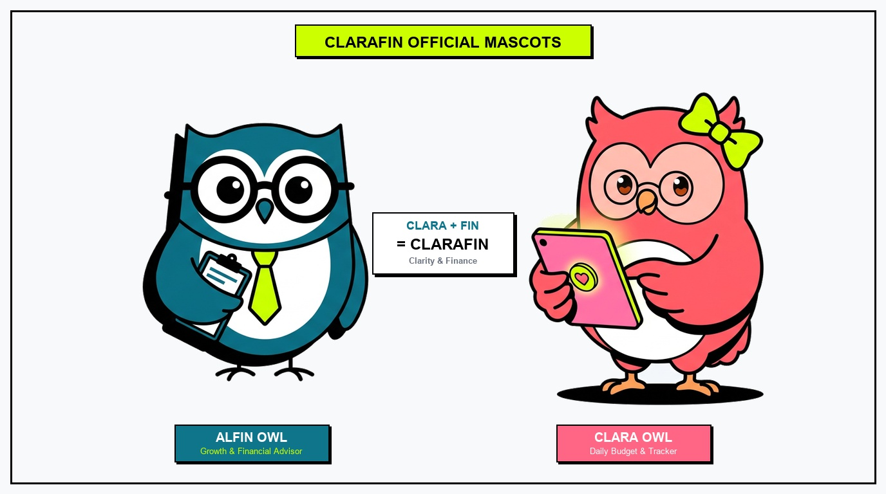
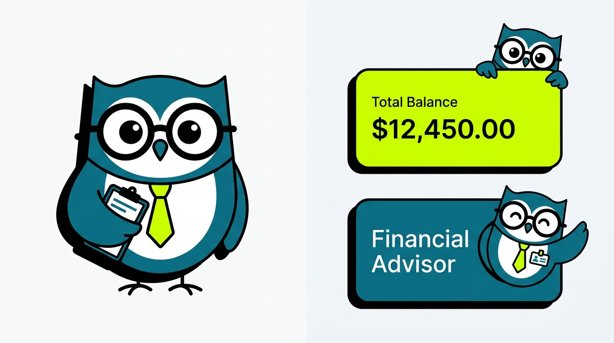
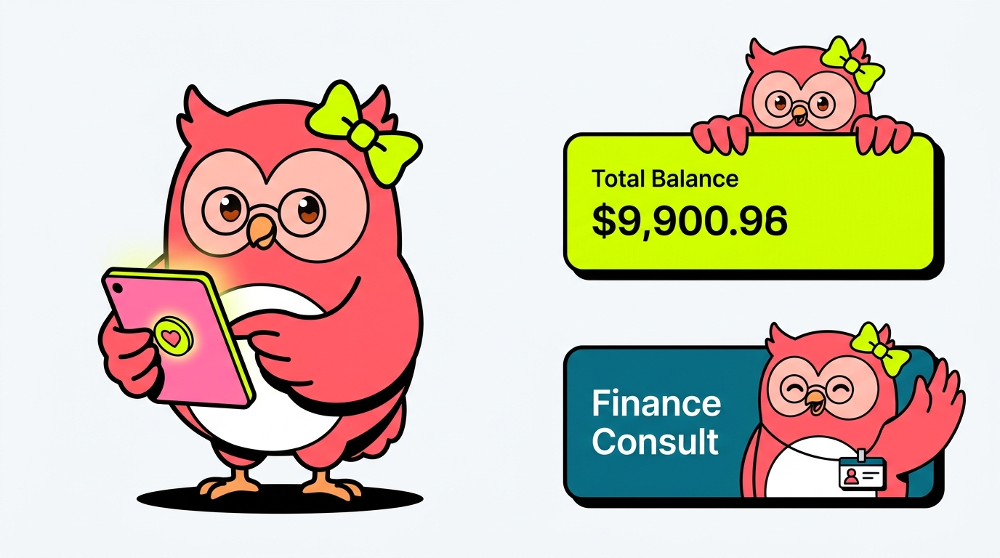

# Clarafin Official Mascots: Alfin Owl & Clara Owl 🦉✨

Dokumentasi spesifikasi desain, filosofi karakter, pedoman penempatan antarmuka (UI Placement), dan integrasi kode Flutter untuk aset maskot resmi aplikasi **Clarafin**.

---

## 1. Filosofi & Asal-Usul Nama (Brand Synergy)

Nama aplikasi **Clarafin** lahir dari dua pilar nilai utama:
$$\text{Clara (Clarity / Kejelasan)} + \text{Fin (Financial / Keuangan)} = \textbf{Clarafin}$$

Untuk merefleksikan dua pilar tersebut ke dalam identitas visual yang ramah (*approachable*) dan hidup, Clarafin menghadirkan sepasang maskot burung hantu kembar:

```
                  ┌─────────────────────────────────────────┐
                  │        CLARAFIN OFFICIAL MASCOTS        │
                  └────────────────────┬────────────────────┘
                                       │
            ┌──────────────────────────┴──────────────────────────┐
            ▼                                                     ▼
    ┌───────────────────────┐                             ┌───────────────────────┐
    │       ALFIN OWL       │                             │       CLARA OWL       │
    │  (Fin / Keuangan)     │                             │ (Clara / Transparansi)│
    ├───────────────────────┤                             ├───────────────────────┤
    │ • Deep Teal (#0F758A) │                             │ • Coral Pink (#FF6584)│
    │ • Kacamata + Dasi Lime│                             │ • Kacamata + Pita Lime│
    │ • Advisor & Growth    │                             │ • Budget & Cashflow   │
    └───────────────────────┘                             └───────────────────────┘
```



Burung hantu dipilih karena merupakan simbol universal dari:
- **Kebijaksanaan & Insight**: Pengambil keputusan finansial yang matang dan terencana.
- **Penglihatan Tajam (24/7 Vigilance)**: Mengawasi setiap rupiah yang keluar-masuk dengan teliti tanpa ada transaksi yang terlewat.

---

## 2. Profil Karakter Maskot

### 2.1 Alfin Owl (Maskot Pria — The Growth & Financial Advisor)
*Representasi dari pilar "Fin" (Wealth, Advisory, & Investment)*



- **Kepribadian**: Analitis, tenang, berwibawa, namun hangat dan suportif. Alfin selalu membawa *financial clipboard* berisi grafik pertumbuhan (*Growth*).
- **Ciri Visual**:
  - Warna Bulu: **Deep Teal (`#0F758A`)** khas brand Clarafin.
  - Perut: Putih bersih (`#FFFFFF`) dengan aksen tekstur bulu minimalis.
  - Aksesori: Kacamata bulat tebal berbingkai hitam `2px` dan dasi segitiga **Lime Neon (`#CCFF00`)**.
  - Sepatu/Kaki: Kaki burung hantu hitam bergaya Neo-Brutalism dengan bayangan *hard-drop*.
- **Peran di Aplikasi**:
  - Menemani sesi **Financial Consultation** dan pemilihan konsultan keuangan.
  - Memberikan insight pada **Wealth / Portofolio Report** dan target investasi (*Goals*).

---

### 2.2 Clara Owl (Maskot Wanita — The Daily Budget & Tracker)
*Representasi dari pilar "Clara" (Clarity, Expense Logging, & Healthy Budget)*



- **Kepribadian**: Ceria, teliti, disiplin, dan penyemangat harian. Clara selalu menggenggam kalkulator/tablet anggaran interaktif untuk memastikan budget pengguna tetap aman (*on-track*).
- **Ciri Visual**:
  - Warna Bulu: **Soft Coral Pink (`#FF6584`)** yang energik dan ramah, berpadu kontras dengan warna kanvas aplikasi.
  - Perut: Putih bersih (`#FFFFFF`) dengan corak bulu pastel lembut.
  - Aksesori: Kacamata bulat cerdas dengan pita **Lime Neon (`#CCFF00`)** di telinga kirinya.
  - Gadget: Tablet kalkulator budget dengan tombol warna lime & display pengeluaran.
- **Peran di Aplikasi**:
  - Mengawasi kartu **Total Balance** dan transaksi harian.
  - Memberikan notifikasi pengingat jatuh tempo tagihan (*Bills*) dan batas pengeluaran kategori (*Budget Limit*).

---

## 3. Aturan Desain & Palet Warna (Neo-Brutalism Specs)

Kedua maskot wajib mematuhi panduan [Clarafin Design System](design-system.md):

| Elemen Desain | Standar Spesifikasi | Keterangan |
| :--- | :--- | :--- |
| **Outline Width** | `2.0px` solid black (`#000000`) | Garis tepi tegas dan seragam di seluruh lekukan bodi. |
| **Drop Shadow** | `Offset(0, 3)` atau `Offset(0, 4)`, `blurRadius: 0` | Bayangan tegas hitam 100% tanpa translusensi atau blur miring. |
| **Shading Style** | Flat Cel-Shading (2 Nada Warna) | Dilarang menggunakan gradien 3D mengkilap (*no 3D glossy slop*). |
| **Primary Alfin** | Deep Teal `#0F758A` & White `#FFFFFF` | Mengikuti token `NeoBrutalism.darkTeal`. |
| **Primary Clara** | Coral Pink `#FF6584` & Soft Cream `#FCF9F8` | Kontras komplementer terhadap kanvas hijau/teal. |
| **Universal Accent** | Lime Neon `#CCFF00` | Digunakan pada dasi Alfin, pita Clara, dan highlight gadget. |

---

## 4. Pola Penempatan Antarmuka (UI Placement & Interaction)

Mengadopsi keunggulan interaksi dari **Finku** dan **Oyenza**, maskot Clarafin diletakkan dengan teknik **"Breaking the Frame" (Mengintip / Peeking)**:

### 4.1 Total Balance Card (`TotalBalanceHeroCard`)
- **Maskot Aktif**: **Clara Owl** (atau Alfin & Clara bergantian sesuai preferensi user).
- **Teknik Tampilan**: Maskot mengintip (*peeking*) dari tepi kanan atas kartu Lime Neon (`#CCFF00`).
- **Sentuhan Fisik**: Sayap/cakar kecilnya mencengkeram garis border hitam `2.0px` bagian atas kartu.
- **Reaksi PnL Harian**:
  - *PnL Positif*: Mata melengkung tersenyum gembira (`^ ^`).
  - *PnL Negatif / Overbudget*: Mata membulat waspada sambil memegang dahi/kalkulator.

```
┌─────────────────────────────────────────────────────────( ^.^) ─┐ ◄── Clara Owl Peeking
│ TOTAL BALANCE                                            (爪 爪) │
│ Rp 12.450.000                                                   │
│ [▲ Hari ini +Rp 150.000]                                        │
└─────────────────────────────────────────────────────────────────┘
```

### 4.2 Finance Consultation Hero Card (`ConsultationHeroCard`)
- **Maskot Aktif**: **Alfin Owl**.
- **Teknik Tampilan**: Berdiri atau melambaikan sayap di sisi kanan kartu Deep Teal (`#0F758A`).
- **Aksesori Khusus**: Mengenakan ID Badge konsultan atau membawa map konsultasi.
- **Interaksi**: Saat tombol **MULAI** atau kartu ditekan, Alfin memberikan animasi mikro anggukan (*nod*) atau kedipan mata.

```
┌─────────────────────────────────────────────────────────────────┐
│ Atur uangmu                   ┌────────┐                        │
│ bareng ahlinya.               │ (•ө•)  │ ◄── Alfin Owl Advisor  │
│                               │ /|▓|\  │     (Badge Konsultan)  │
│ [ MULAI ]                     └────────┘                        │
└─────────────────────────────────────────────────────────────────┘
```

---

## 5. Rencana Integrasi Kode Flutter

### 5.1 Struktur Aset Proyek
File gambar vektor/PNG transparan maskot disimpan pada:
```text
apps/mobile/assets/images/mascot/
├── alfin_peeking.png          # Alfin pose mengintip (untuk balance card)
├── alfin_advisor.png          # Alfin pose konsultan (untuk consult card)
├── clara_peeking.png          # Clara pose mengintip (untuk balance card)
├── clara_budget.png           # Clara pose kalkulator (untuk budget card)
└── duo_welcome.png            # Alfin & Clara bersama (untuk onboarding / empty state)
```

File aset dokumentasi lokal:
- [`assets/mascot/clarafin_duo_mascots.jpg`](./assets/mascot/clarafin_duo_mascots.jpg)
- [`assets/mascot/alfin_owl_sheet.jpg`](./assets/mascot/alfin_owl_sheet.jpg)
- [`assets/mascot/clara_owl_sheet.jpg`](./assets/mascot/clara_owl_sheet.jpg)

### 5.2 Integrasi Animasi Scroll Collapsing
Pada `TotalBalanceHeroCard` dan `ConsultationHeroCard` di dalam `HomeHeroHeaderDelegate`:
- Saat scroll di posisi teratas (`progress == 0.0`), maskot tampil penuh dengan skala 1.0.
- Saat header mengecil menjadi sticky card (`progress > 0.5`), maskot dianimasikan menyusut halus atau turun ke balik batas kartu bersama layer tirai (`curtainTranslationY` & `curtainOpacity`) sehingga tidak menutupi label saldo mini dan tombol *Portfolio*.

---

*Dokumen ini merupakan bagian dari standar identitas visual aplikasi Clarafin.*
