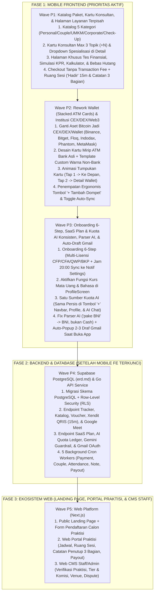
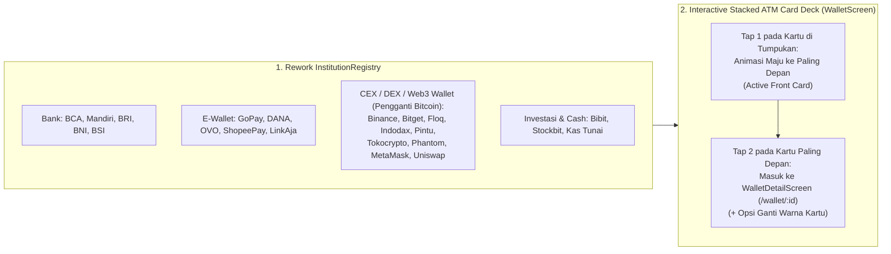

# Clarafin Prioritized Implementation Plan

| Field | Value |
| --- | --- |
| Project | **Clarafin** (`apps/mobile`, `services/api`, `apps/web` [Landing Page + Advisor Portal + Staff CMS], `docs/`) |
| Strategy | **Frontend Mobile First (`mobile_frontend`)** -> **Backend & DB (`mobile_backend_integration`)** -> **Web Ecosystem (`Landing Page + Advisor Portal + Staff CMS`)** |
| Navigation Baseline | **Locked Existing Bottom Nav:** `Home`, `Consult`, `FAB (+)`, `Wallet`, `Budget` (*Goals*, *Budget*, *Bills*) + Floating Session Button (`/session`) |
| Catalog & Pricing Spec | [Katalog Paket, Kualifikasi Praktisi, & Harga (`docs/katalog-paket-dan-harga.md`)](file:///d:/Projekan/Clarafin/docs/katalog-paket-dan-harga.md) |
| AI & SaaS Business Model | [Model Bisnis AI, SaaS Plan, & Koneksi Gmail (`docs/model-bisnis-ai-dan-saas.md`)](file:///d:/Projekan/Clarafin/docs/model-bisnis-ai-dan-saas.md) |
| Onboarding Rework Spec | [Spesifikasi Rework Onboarding 6-Step (`docs/rework-onboarding.md`)](file:///d:/Projekan/Clarafin/docs/rework-onboarding.md) |
| Design System | [Clarafin Neo-Brutalism (`apps/mobile/docs/DESIGN_SYSTEM.md`)](file:///d:/Projekan/Clarafin/apps/mobile/docs/DESIGN_SYSTEM.md) |
| Database Specification | [Unified ERD (`docs/tech/erd.md`)](file:///d:/Projekan/Clarafin/docs/tech/erd.md) |

---

## 1. Ringkasan Arsitektur & Scope Eksekusi yang Dikunci

Seluruh pekerjaan yang telah selesai dikeluarkan dari rencana ini agar fokus 100% pada scope pengembangan aktif:

1. **Aplikasi Mobile (`apps/mobile`) Fokus Murni untuk Klien / Pengguna (Inklusif Tanpa Batas Usia 18+):**
   - Remaja/pelajar di bawah 18 tahun (misal usia 16 tahun yang sudah memiliki penghasilan/uang saku dan ingin belajar mengelola keuangan) dapat mendaftar dan menggunakan Clarafin tanpa blokir umur.
   - Seluruh fitur pendaftaran praktisi dan *Mode Praktisi* ditempatkan di platform **Web**.
2. **Katalog Layanan 5 Kategori, Kartu Konsultan Ringkas (`Max 3 Topik +N`), Dropdown Spesialisasi, & Halaman Layanan Terpisah (`Wave P1`):**
   - Mengimplementasikan katalog [`docs/katalog-paket-dan-harga.md`](file:///d:/Projekan/Clarafin/docs/katalog-paket-dan-harga.md) (`Personal Advisory`, `Couple Advisory`, `UMKM Advisory`, `Corporate Wellness`, `Financial Check-Up`; tier `Basic`/`Medium`/`Premium`; `Online` otomatis Call/Video/Chat vs `Offline`), menghapus hanya `Transaction Fee` di `BookingPaymentScreen` (mempertahankan `Platform Fee Rp 15.000` & `Voucher`), dan persetujuan tunggal di `BookingTermsCard`.
   - **Kartu Katalog Konsultan (`ConsultCard`):** Membatasi *pill* topik keahlian yang tampil maksimal **3 *pill*** dan menampilkan badge **`+N`** (contoh: `+3`) jika konsultan memiliki lebih dari 3 topik agar kartu tidak penuh sesak.
   - **Detail Konsultan (`ConsultDetailScreen`):** Mengubah seksi **Spesialisasi & Keahlian** menjadi **Dropdown / Accordion (`ExpansionTile`)** seragam dengan *Sertifikasi & Lisensi*, *Pengalaman & Rekam Jejak*, dan *Kerahasiaan & Kebijakan Reschedule*.
   - **Pemisahan Halaman Layanan (`AllServicesBottomSheet` & `ServicesGridWidget`):**
     - **`Tes Finansial` (`/financial-test`):** Punya halaman khusus tersendiri yang menampilkan **Katalog Tes Finansial (`Financial Check-Up • Basic / Medium / Premium`)** terhubung ke alur booking tes finansial (terpisah dari halaman **`ClaraScore` `/score`**).
     - **`Simulasi KPR` (`/tools/kpr`), `Kalkulator Finansial` (`/tools/calculator`), dan `Bebas Hutang` (`/tools/debt-payoff`):** Masing-masing dibuatkan halaman/alat khusus tersendiri sesuai fungsinya (tidak lagi membuka popup yang sama).
3. **Rework Halaman `WalletScreen` (Tumpukan Kartu ATM Beranimasi) & Institusi CEX/DEX/Web3 Wallet (`Wave P2`):**
   - **Daftar Institusi Kripto (`AddWalletInstitutionScreen`):** Menghapus item aset koin individual (`Bitcoin Crypto`) dan menggantinya dengan skala platform/dompet penyimpanan: **CEX (`Binance`, `Bitget`, `Floq`, `Indodax`, `Pintu`, `Tokocrypto`)**, **DEX (`Uniswap`)**, dan **Web3 Wallet (`Phantom`, `MetaMask`, `Trust Wallet`)**.
   - **Visual Kartu ATM & Tumpukan Kartu Beranimasi (`WalletScreen`):**
     - Mengubah tampilan daftar dompet di bawah Donut Chart dari Grid 2 Kolom menjadi **Interactive Stacked ATM / Physical Cards (Tumpukan Kartu Beranimasi)**.
     - Dompet **Bank** (`BCA`, `BNI`, `Mandiri`, `BRI`, `BSI`) didesain menyerupai kartu ATM bank aslinya (chip EMV, nomor ter-masking, logo jaringan, palet khas bank), sedangkan dompet **Non-Bank** (`E-Wallet`, `CEX/DEX/Web3`, `Investasi`, `Cash`) memiliki template kartu khusus yang **bisa diganti-ganti warnanya oleh user**.
     - **Interaksi 2-Tap:** Tap ke-1 pada kartu di dalam tumpukan menganimasikan kartu tersebut maju ke **Paling Depan (*Active Front Card*)**; Tap ke-2 pada kartu paling depan membuka halaman **`WalletDetailScreen` (`/wallet/:id`)**.
     - **Tombol `+ Tambah Dompet`:** Ditempatkan secara ergonomis sebagai tombol pill tegas di header seksi `"Dompet & Kartu Saya"` serta slot `+ Tambah Kartu Baru` di dasar tumpukan.
4. **Rework Onboarding 6-Step, Pengaturan Kurs & Bahasa Aktif, Kuota AI Konsisten, Perbaikan Parser AI, & Auto-Popup Draf Gmail Saat Buka App (`Wave P3`):**
   - **Step 1 Onboarding:** Menyebutkan konsultan lintas lisensi resmi (**`CFP®`, `CFA®`, `QWP®`, `AWP®`, `AEPP®`, `CPA`, & `BKP` Pajak**), bukan hanya `CFP®`.
   - **Pengaturan Kurs & Bahasa di `ProfileScreen`:** Mengaktifkan perubahan nyata untuk **Kurs Mata Uang (`IDR`, `USD`, `SGD`, `MYR`, `EUR`, `JPY`)** pada pemformat nilai uang di seluruh aplikasi dan **Bahasa (`Bahasa Indonesia` / `English`)** pada label antarmuka utama.
   - **Satu Sumber Kuota AI (`aiQuotaProvider`) yang Konsisten:** Angka sisa kuota AI (`40` Free, `400` Pro Bulanan, `Unlimited`) beserta tanggal pembaruan/masa aktif disatukan antara **Tombol `+` di Bottom Navbar (`QuickActionSheets`)**, **Kartu Status Plan SaaS di `ProfileScreen`**, dan **Header `AiChatScreen`** sehingga tidak pernah berbeda angka.
   - **Perbaikan Parser Metode Pembayaran / Dompet pada AI Chat, Voice, & OCR:** Memperbaiki ekstraksi teks/suara AI sehingga ketika user mengetik atau mengucapkan *"beli kopi 50.000 pake BNI"*, draf konfirmasi AI yang keluar **otomatis memilih metode/dompet `BNI`** (bukan lagi salah jatuh ke `Cash`).
   - **Auto-Popup Konfirmasi Draf Transaksi Gmail Saat Buka Aplikasi:** Ketika fitur Auto-Sync Gmail aktif dan pembacaan email mendeteksi **2–3 transaksi baru** dari resi/mutasi Gmail, saat user membuka aplikasi Clarafin akan langsung muncul prompt/sheet konfirmasi berisi tepat sejumlah transaksi hasil *scrape* Gmail tersebut untuk dikonfirmasi user.

---

## 2. Matriks Skala Prioritas Implementasi (Wave P1 – P5)

| Prioritas | Gelombang | Fokus Utama | Status |
| --- | --- | --- | --- |
| **P1 (Tertinggi — Mobile FE)** | **Wave P1: Katalog 5 Kategori, Kartu Konsultan (`3 Pill +N`), Dropdown Spesialisasi, & Halaman Layanan Mandiri (`Tes Finansial`, `KPR`, `Kalkulator`, `Bebas Hutang`)** | Implementasi katalog [`docs/katalog-paket-dan-harga.md`](file:///d:/Projekan/Clarafin/docs/katalog-paket-dan-harga.md), pembatasan *pill* topik di kartu konsultan maksimal 3 (`+N`), pengubahan *Spesialisasi & Keahlian* di `ConsultDetailScreen` menjadi *Accordion Dropdown*, pemisahan halaman **Tes Finansial** (`/financial-test` berisi katalog paket *Financial Check-Up*) dari **ClaraScore** (`/score`), pembuatan halaman mandiri untuk **Simulasi KPR**, **Kalkulator Finansial**, & **Bebas Hutang**, serta penyelarasan Checkout & Ruang Sesi. | **Siap Dieksekusi (Wave P1)** |
| **P2 (Tinggi — Mobile FE)** | **Wave P2: Rework `WalletScreen` (*Interactive Stacked ATM Cards* + Ganti Warna) & Institusi CEX/DEX/Web3 Wallet** | Mengganti item `Bitcoin Crypto` di `institution_registry.dart` dengan **CEX (`Binance`, `Bitget`, `Floq`, `Indodax`, `Pintu`, `Tokocrypto`)**, **DEX (`Uniswap`)**, & **Web3 Wallet (`Phantom`, `MetaMask`, `Trust Wallet`)**; merombak `WalletScreen` menjadi tumpukan kartu bergaya ATM Bank asli & kartu kustom yang bisa diganti warnanya dengan interaksi 2-Tap beranimasi (Tap 1 -> maju ke depan, Tap 2 -> masuk Detail Wallet). | **Siap Dieksekusi (Wave P2)** |
| **P3 (Tinggi — Mobile FE)** | **Wave P3: Onboarding 6-Step (Multi-Lisensi), Pengaturan Kurs & Bahasa Aktif, Kuota AI Konsisten (`+` Navbar & Profile), Fix Parser AI (`BNI`), & Auto-Popup Draf Gmail** | Implementasi [`docs/rework-onboarding.md`](file:///d:/Projekan/Clarafin/docs/rework-onboarding.md) (Step 1 menyebut seluruh lisensi `CFP®, CFA®, QWP®, AWP®, AEPP®, CPA, BKP`; Step 6 tersinkronisasi ke `NotificationSettingsScreen` On/Off + Setup Jam), perbaikan fungsi **Kurs & Bahasa** di `ProfileScreen`, penyatuan state kuota AI antara **Tombol `+` Navbar**, **`ProfileScreen`**, & **`AiChatScreen`**, perbaikan bug parser metode pembayaran AI (`"pake BNI"` -> dompet `BNI`), serta pemunculan otomatis draf transaksi hasil *scrape* Gmail saat aplikasi dibuka. | **Siap Dieksekusi (Wave P3)** |
| **P4 (Backend & DB)** | **Wave P4: Database PostgreSQL (`erd.md`) & Backend Go (`services/api`)** | Migrasi tabel PostgreSQL di Supabase, implementasi layanan backend Go (`chi`, `pgx/v5`), integrasi pembayaran QRIS Xendit (15m), pembuatan link Google Meet otomatis, pemindaian mutasi Gmail Read-Only (`AES-256-GCM`), guardrail Gemini AI, dan 5 *background cron workers*. | **Menunggu Wave P1–P3 Selesai** |
| **P5 (Web Platform)** | **Wave P5: Landing Page, Web Portal Praktisi, & Web CMS Staff** | Membangun platform web terpadu yang mencakup: (1) **Landing Page + Form Pengajuan Praktisi**, (2) **Web Portal Praktisi**, dan (3) **Web CMS Staff/Admin**. | **Menunggu Wave P4 Selesai** |

---

## 3. Rincian Teknis Per Gelombang

### 3.1 Wave P1 — Katalog 5 Kategori, Kartu Konsultan Ringkas, Dropdown Spesialisasi, & Halaman Layanan Terpisah (`mobile_frontend`)

1. **Pembaruan Struktur Katalog & Mock Data (`booking_service_mock_data.dart`, `booking_step1_service_view.dart`, `booking_service_tier_card.dart`):**
   - Mempertahankan toggle **`Online` / `Offline`** beserta bar informasi **`Metode Online : Call | Video | Chat`** (saat Online dipilih, klien otomatis mendapatkan fasilitas Call, Video Call, dan Chat selama 60 menit/sesi tanpa biaya tambahan antar metode).
   - Memperbarui struktur kartu paket dengan **Tag Kategori + Tier (`Basic`, `Medium`, `Premium`)** dan **Nama Paket Utama yang "Nge-Hook"** sesuai [`docs/katalog-paket-dan-harga.md`](file:///d:/Projekan/Clarafin/docs/katalog-paket-dan-harga.md):
     - **A. Individu (`Personal Advisory`):** `Fondasi Arus Kas & Utang` (Basic Rp 199rb/349rb), `Optimalisasi Aset & Proteksi` (Medium Rp 299rb/449rb), `Menuju Kebebasan Finansial` (Premium Rp 399rb/599rb).
     - **B. Pasangan & Keluarga (`Couple Advisory`):** `Siap Menikah Tanpa Drama Finansial` (Pre-Marriage Rp 349rb/529rb), `Satu Visi Bangun Aset Keluarga` (Marriage Rp 399rb/599rb), `Mapan Finansial Lintas Generasi` (Premium Rp 549rb/799rb).
     - **C. UMKM & Bisnis (`UMKM Advisory`):** `Omzet Ramai, Untung Nyata di Rekening` (Basic Rp 349rb/549rb), `Ekspansi Cabang & Aman Pajak Bisnis` (Medium Rp 549rb/799rb), `Perpanjang Runway & Siap Pendanaan Investor` (Premium Rp 849rb/1,199jt).
     - **D. Corporate (`Corporate Wellness & Advisory`):** `Karyawan Produktif Bebas Jerat Pinjol` (Basic Rp 2,5jt/4,5jt), `Klinik Finansial Privat & Retensi Talenta` (Medium Rp 1,49jt/2,25jt), `Optimalisasi Kas Korporasi & Pajak Eksekutif` (Premium Rp 1,49jt/2,19jt).
     - **E. Tes Finansial (`Financial Check-Up`):** `Bongkar Bocor Halus & Skor Keuanganmu` (Basic Rp 149rb/279rb), `Bedah Tuntas Portofolio & Polis Asuransi` (Medium Rp 279rb/429rb), `Peta Jalan Kekayaan & Pensiun Dini 360°` (Premium Rp 499rb/699rb).
2. **Pembatasan *Pill* Topik di Kartu Konsultan (`ConsultCard`) & Dropdown Spesialisasi di `ConsultDetailScreen`:**
   - **Di `ConsultCard` (`ConsultListScreen`):** Hanya menampilkan maksimal **3 *pill* keahlian utama** (`consultant.specializations.take(3)`). Jika `consultant.specializations.length > 3`, tambahkan 1 badge ringkas **`+${consultant.specializations.length - 3}`** berwarna `NeoBrutalism.surfaceWarm` / `NeoBrutalism.lime` agar tinggi kartu tetap rapi dan proporsional.
   - **Di `ConsultDetailScreen` (`consult_detail_about_section.dart` & `consult_detail_accordions.dart`):** Memindahkan daftar **Spesialisasi & Keahlian** dari tampilan terbuka di `ConsultDetailAboutSection` menjadi item **Accordion Dropdown (`ExpansionTile`)** paling atas di `ConsultDetailAccordions` (seragam dengan *Sertifikasi & Lisensi Resmi*, *Pengalaman & Rekam Jejak*, dan *Kerahasiaan & Kebijakan Reschedule*).
3. **Pemisahan Halaman Layanan di `AllServicesBottomSheet` & `ServicesGridWidget`:**
   - **`Tes Finansial` (`/financial-test` -> `FinancialTestCatalogScreen` BARU) vs `ClaraScore` (`/score` -> `FinancialHealthScreen`):**
     - `ClaraScore` tetap mengarah ke `/score` (skor kesehatan finansial otomatis dari rasio tracker).
     - `Tes Finansial` diarahkan ke rute baru **`/financial-test`** (`FinancialTestCatalogScreen`) yang menampilkan katalog layanan **Financial Check-Up (`Basic`, `Medium`, `Premium`)** lengkap dengan rincian output rapor, kuesioner diagnostik singkat, dan tombol pilih konsultan pemeriksa untuk memesan paket tes tersebut!
   - **Halaman Khusus Masing-Masing untuk `Simulasi KPR`, `Kalkulator Finansial`, dan `Bebas Hutang`:**
     - **`Simulasi KPR` (`/tools/kpr` -> `KprSimulationScreen`):** Input Harga Properti, DP (%), Bunga *Fixed* (tahun awal) & *Floating*, Tenor (5–25 tahun), hasil cicilan bulanan, analisis keamanan rasio DSR terhadap penghasilan, dan tombol diskusi KPR bersama konsultan.
     - **`Kalkulator Finansial` (`/tools/calculator` -> `FinancialCalculatorScreen`):** Kalkulator multi-tab untuk menghitung **Target Pertumbuhan Investasi (*Compound Return*)**, **Kebutuhan Dana Darurat Ideal**, dan **Target Dana Pensiun**.
     - **`Bebas Hutang` (`/tools/debt-payoff` -> `DebtPayoffStrategyScreen`):** Simulator perbandingan strategi pelunasan utang (**Metode *Debt Snowball* vs *Debt Avalanche***), input daftar cicilan & bunga, estimasi penghematan bunga & waktu lunas, serta CTA menuju paket `Personal Advisory • Basic (Fondasi Arus Kas & Utang)`.
4. **Pembaruan Checkout (`BookingPaymentScreen`) & Ruang Sesi (`ConsultChatScreen` / `BranchSessionScreen`):**
   - Menghapus **hanya `Transaction Fee` (`2.5%`)** dan mempertahankan **`Platform Fee (Rp 15.000)`** serta **`Voucher Promo`**.
   - Menyatukan persetujuan syarat layanan & data ke dalam 1 checkbox `BookingTermsCard`.
   - Menambahkan tombol konfirmasi **`Hadir`** (15m pertama) dan kartu **Catatan Penutup 3 Bagian**.

---

### 3.2 Wave P2 — Rework Halaman `WalletScreen` (*Interactive Stacked ATM Cards*) & Institusi CEX/DEX/Web3 Wallet (`mobile_frontend`)

1. **Rework Daftar Institusi Kripto menjadi CEX, DEX, & Web3 Wallet (`institution_registry.dart` & `add_wallet_institution_screen.dart`):**
   - Menghapus item aset koin tunggal `Bitcoin Crypto` (`id: 'bitcoin'`) dan menggantinya dengan kategori/institusi platform penyimpanan kripto & Web3:
     - **CEX (Centralized Exchange):** `Binance`, `Bitget`, `Floq`, `Indodax`, `Pintu`, `Tokocrypto`.
     - **DEX & Web3 Wallet:** `Phantom Wallet`, `MetaMask`, `Trust Wallet`, `Uniswap`.
2. **Desain Visual Kartu ATM Bank & Template Kartu Kustom (`wallet_atm_card.dart` BARU & `wallet_model.dart`):**
   - Menambahkan properti `customColorHex` (opsional) dan `maskedCardNumber` pada `WalletModel`.
   - **Untuk Dompet Bank (`BCA`, `BNI`, `Mandiri`, `BRI`, `BSI`):** Menampilkan ornamen visual kartu ATM/Debit fisik khas bank tersebut (proporsi kartu ATM `1.586`, grafis chip EMV emas/perak berborder hitam, ikon *contactless* NFC, nomor kartu `•••• •••• •••• 4829`, nama pemegang kartu, saldo utama, badge `AUTO-SYNC` / `MANUAL`, dan logo jaringan `GPN` / `Mastercard` / `Visa`).
   - **Untuk Dompet Non-Bank (`E-Wallet`, `CEX/DEX/Web3 Wallet`, `Investasi`, `Cash`):** Menampilkan template kartu Neo-Brutalism khusus sesuai kategorinya (mis. tema Web3 untuk Phantom/Binance, tema E-Wallet untuk GoPay/OVO) yang **warnanya dapat diganti-ganti oleh user** melalui pemilih palet warna (*Color Swatch Picker*) di `ManualWalletEntryScreen` maupun `WalletDetailScreen`.
3. **Tampilan Tumpukan Kartu Beranimasi (*Interactive Card Stack*) di `WalletScreen`:**
   - Mengganti `GridView` 2 kolom di bawah Donut Chart menjadi komponen **`WalletStackedDeck`**:
     - Kartu-kartu dompet disusun bertumpuk secara vertikal (*stacked wallet deck*) sehingga header setiap kartu (nama bank/wallet, logo, dan tipe) tetap terlihat jelas.
     - **Interaksi Tap ke-1:** Mengetuk kartu mana pun yang berada di belakang/tengah tumpukan akan memicu animasi (`AnimatedPositioned` + `AnimatedScale`) yang mengangkat kartu tersebut menjadi **Kartu Paling Depan (*Focused Front Card*)** dan menampilkan detail saldo penuh beserta indikator *Tap lagi untuk buka detail*.
     - **Interaksi Tap ke-2:** Mengetuk kartu yang sudah berada di posisi paling depan akan membuka halaman **`WalletDetailScreen` (`/wallet/:id`)**.
4. **Penempatan Tombol `+ Tambah Dompet` yang Mudah Dijangkau:**
   - Menempatkan tombol pill Neo-Brutalism **`+ Tambah`** berwarna Lime (`#CCFF00`) di sebelah kanan bar judul `"Your Wallets"` (berdampingan dengan tombol *Sort*) **serta** menyediakan kartu slot **`+ Tambah Dompet / Kartu Baru`** di bagian bawah tumpukan kartu.

---

### 3.3 Wave P3 — Rework Onboarding 6-Step, Kurs & Bahasa Aktif, Kuota AI Konsisten, Fix Parser AI (`BNI`), & Auto-Popup Draf Gmail (`mobile_frontend`)

1. **Rework Onboarding 6-Step (`docs/rework-onboarding.md`):**
   - **Step 1 (`/onboarding`):** Menampilkan hook *"Kopi, gajian, tagihan, sampai konsultasi ahli"* dan secara eksplisit menyebutkan konsultan lintas lisensi resmi (**`CFP®`, `CFA®`, `QWP®`, `AWP®`, `AEPP®`, `CPA`, & `BKP` Pajak**).
   - **Step 2 (`/onboarding/history`):** Pilihan riwayat pencatatan (*Belum*, *Pakai aplikasi lain*, *Pakai Spreadsheet/CSV*) yang mengaktifkan banner pintasan Impor CSV/Gmail.
   - **Step 3 (`/onboarding/tracker-focus`):** Pilihan fokus *Smart Tracker* dengan **Live Mini-Dashboard Preview** yang menyala interaktif.
   - **Step 4 (`/onboarding/advisory-focus`):** Pilihan topik konsultasi yang memetakan user ke paket `Basic`, `Medium`, `Couple`, `UMKM`, atau `Premium` dan konsultan berlisensi (`CFP®`, `CFA®`, `QWP®`, `CPA`, `BKP`) yang relevan di Beranda & halaman Consult.
   - **Step 5 (`/onboarding/wallet-goal`):** Setup cepat 1 Dompet Utama & 1 Target Tabungan Pertama.
   - **Step 6 (`/onboarding/daily-ritual`):** Pengaturan ritme malam *"Satu menit, tiap malam"* (`20:00 WIB`) yang **tersinkronisasi 2 arah dengan `NotificationSettingsScreen` (`/profile/notifications`)** lengkap dengan **Toggle `ON/OFF`** dan **Setup Jam (`TimePicker`)**.
2. **Perbaikan Pengaturan Kurs Mata Uang & Bahasa di `ProfileScreen`:**
   - Menghubungkan pilihan mata uang di `CurrencySelectorBottomSheet` (`IDR`, `USD`, `SGD`, `MYR`, `EUR`, `JPY`) ke helper pemformat uang global (`CurrencyFormatter.format(amount, profile.currency)`) sehingga perubahan kurs di Profile benar-benar memperbarui tampilan simbol dan nilai mata uang di Beranda, Wallet, Budget, dan Report.
   - Menghubungkan pilihan bahasa di `LanguageSelectorBottomSheet` (`Bahasa Indonesia` vs `English (US)`) ke kamus lokalisasi aplikasi sehingga label navigasi, header halaman, dan menu di `ProfileScreen` benar-benar berubah sesuai bahasa yang dipilih.
3. **Sinkronisasi Satu Sumber Kuota AI (`aiQuotaProvider`) di `Tombol +` Navbar, `ProfileScreen`, & `AiChatScreen`:**
   - Membuat `aiQuotaProvider` & `subscriptionPlanProvider` terpusat yang menyimpan:
     - `planType`: `'free'` (`40` kuota/bulan), `'pro_monthly'` (`400` kuota/30 hari), atau `'unlimited'` (`Tanpa Batas`).
     - `quotaUsed` & `quotaTotal`, serta `renewalOrExpiryDate` (tanggal reset tiap tanggal 1 WIB untuk Free, atau tanggal berakhir 30 hari untuk Pro/Unlimited).
   - Menghubungkan:
     1. **Badge Kuota di `QuickActionSheets` (saat user klik `Tombol +` di Bottom Navbar)**
     2. **Kartu Status Plan SaaS di `ProfileScreen`**
     3. **Badge Kuota di Header `AiChatScreen` (`/ai-chat`)**
     ke `aiQuotaProvider` yang sama persis sehingga setiap kali 1 aksi AI dipakai (Chat, Voice, atau OCR), angka sisa kuota di ketiga tempat tersebut selalu **100% sinkron dan identik**.
4. **Perbaikan Parser Metode Pembayaran / Dompet pada AI Action (Chat, Voice, & OCR):**
   - Memperbaiki fungsi ekstraksi teks natural pada `QuickActionSheets` dan `AiChatScreen`:
     - Mengenali nama-nama bank, e-wallet, dan institusi (`bni`, `bca`, `mandiri`, `bri`, `bsi`, `gopay`, `ovo`, `dana`, `shopeepay`, `linkaja`, `bibit`, `stockbit`, `binance`, `bitget`, `floq`, `indodax`, `phantom`, `metamask`, `tunai`, `cash`) dari kalimat input user (contoh: *"beli kopi 50.000 pake bni"*).
     - Mencocokkan nama institusi yang terdeteksi dengan dompet milik user di `walletsProvider` (atau menampilkan nama metode **`BNI`** secara akurat pada kartu konfirmasi draf AI dan menyimpannya ke dompet `BNI`, **bukan lagi salah jatuh ke `Cash`**).
5. **Sinkronisasi Kartu Koneksi Gmail (`ProfileScreen`) <-> Toggle Auto-Sync Dompet (`AddWallet`) & Auto-Popup Draf Transaksi Saat Buka Aplikasi:**
   - Saat `Free Plan`: tombol di Kartu Koneksi Gmail (`ProfileScreen`) dan di daftar institusi `AddWalletInstitutionScreen` menampilkan tombol **`Upgrade Plan`**.
   - Saat `Pro Bulanan` / `Unlimited`: menampilkan toggle **`ON / OFF`** yang saling terhubung 2 arah.
   - **Auto-Trigger Konfirmasi Draf Gmail Saat Buka Aplikasi (`HomeScreen` init):** Jika `isGmailConnected == true` dan terdapat draf transaksi baru hasil pembacaan Gmail yang berstatus `pending_review` (misalnya **2–3 transaksi baru** dari email notifikasi bank/e-wallet), begitu user membuka aplikasi Clarafin, otomatis muncul **Sheet / Modal Konfirmasi Draf Transaksi Baru (atau mengarahkan ke `AiDraftReviewScreen`)** yang menampilkan tepat ke-2 atau ke-3 transaksi tersebut untuk dikonfirmasi user!

---

### 3.4 Wave P4 & P5 — Backend Go + Supabase (`erd.md`) & Ekosistem Web 3-Pintu (`Landing Page + Portal Praktisi + CMS Staff`)

1. **Wave P4 (Backend & Database):** Migrasi PostgreSQL (`erd.md`), layanan Go (`services/api`), integrasi Xendit QRIS (15m), Google Meet generator, Gmail OAuth 30-day scanner (`AES-256-GCM`), Gemini AI guardrail, dan 5 *background cron workers*.
2. **Wave P5 (Ekosistem Web Next.js):**
   - **Public Landing Page (`/`, `/join-advisor`):** Informasi produk + **Formulir Pendaftaran Calon Praktisi**.
   - **Web Portal Praktisi (`/advisor/*`):** Dashboard kerja konsultan terverifikasi (jadwal, ruang sesi, input **Catatan Penutup 3 Bagian**, dan pencairan dana).
   - **Web Internal Staff CMS (`/admin/*`):** Verifikasi praktisi, penetapan tier (`Basic`/`Medium`/`Premium`) & komisi (`10%–35%`), pengelolaan `Venue` & `Voucher`, serta resolusi sengketa.
