# Spesifikasi Katalog Layanan, Penamaan Paket, Riset Harga Pasar, & Klasifikasi Konsultan Clarafin

| Field | Value |
| --- | --- |
| Project | **Clarafin** |
| Document Version | 2.0 (Revised Tier Naming `Medium`, High-Hook Package Titles, & Market-Researched Pricing) |
| Status | Active Decision Document |
| Last Updated | 2026-11-02 |
| Reference | Alur Pemesanan (`BookingFlowScreen` & `BookingPaymentScreen`), Klasifikasi Praktisi, & Model Monetisasi |

---

## 1. Prinsip Utama Bisnis & Alur Pemesanan (Locked Business Rules)

Dokumen ini menjadi acuan tunggal (*Single Source of Truth*) untuk struktur paket layanan, penamaan paket, klasifikasi praktisi/konsultan, perhitungan harga, dan persetujuan layanan pada alur pemesanan Clarafin:

1. **Pemisahan Layanan: `Online` vs `Offline` (Tatap Muka):**
   - Jika klien memilih **`Online`**, setiap paket **otomatis mencakup kebebasan memilih metode `Call`, `Video Call`, atau `Chat`** (60 menit/sesi) **tanpa perbedaan harga antar metode online**.
   - Pembeda harga terletak pada **Tier Kualifikasi Praktisi & Kedalaman Masalah (`Basic`, `Medium`, `Premium`)**, **Kategori Layanan (`Individu`, `Couple`, `UMKM`, `Corporate`, `Financial Check-Up`)**, mode **`Online` vs `Offline`**, serta **Jumlah Sesi (`1 Sesi`, `2 Sesi`, `3 Sesi [Lebih Hemat]`, `8 Sesi`)**.
   - Jika klien memilih **`Offline` (Tatap Muka)**, sesi dilakukan secara langsung (90 menit/sesi) di ruang privat atau cabang mitra terkurasi sesuai kota praktisi, dengan tarif khusus *Offline* yang mencakup sewa ruang konsultasi, waktu tempuh praktisi, dan lembar kerja cetak.

2. **Standarisasi Tag Khas Clarafin (`Personal Advisory` & `Couple Advisory`), Tier (`Basic`, `Medium`, `Premium`), & Nama Paket yang "Nge-Hook":**
   - Untuk membangun identitas produk keuangan Clarafin yang kuat dan **tidak meniru istilah psikologi `e-Counseling` / `Couple e-Counseling` milik Ibunda.id**, tag kategori layanan dikunci menjadi:
     - **Individu:** `Personal Advisory • Basic`, `Personal Advisory • Medium`, `Personal Advisory • Premium` *(opsi alternatif tag: `Personal Plan • ...`)*
     - **Pasangan & Keluarga:** `Couple Advisory • Pre-Marriage`, `Couple Advisory • Marriage`, `Couple Advisory • Premium` *(opsi alternatif tag: `Couple & Family • ...`)*
     - **UMKM & Bisnis:** `UMKM Advisory • Basic`, `UMKM Advisory • Medium`, `UMKM Advisory • Premium`
     - **Korporasi:** `Corporate Wellness • Basic`, `Corporate Wellness • Medium`, `Corporate Advisory • Premium`
     - **Tes Finansial:** `Financial Check-Up • Basic`, `Financial Check-Up • Medium`, `Financial Check-Up • Premium`
   - Penyebutan tingkat menengah dikunci menggunakan istilah **`Medium`** (bukan *Essential*).
   - Setiap kartu layanan menampilkan **Tag Kategori • Tier** di baris atas dan **Nama Paket Utama** yang berorientasi hasil akhir (*outcome-driven hook*) di baris bawah.

3. **Komponen Harga & Monetisasi saat Checkout (`BookingPaymentScreen`):**
   - **Harga Paket (`Subtotal`):** Dihitung dari `Harga Dasar Paket × Jumlah Sesi` (dikurangi diskon bundling otomatis: **hemat 7% untuk 3 Sesi**, **hemat 12% untuk 8 Sesi**).
   - **Platform Fee (`Rp 15.000`):** **TETAP DIPERTAHANKAN** sebagai pendapatan operasional langsung platform pada setiap transaksi di luar bagi hasil komisi praktisi (`default 20%`).
   - **Diskon Voucher / Promo (`Voucher Selection`):** **TETAP DIPERTAHANKAN** sebagai instrumen akuisisi dan retensi pemasaran (contoh: `CLARAFIN50`, `HALOFINCFP`).
   - **Transaction Fee (`Dihapus`):** Biaya transaksi tambahan (`2.5%`) **dihapus sepenuhnya** agar rincian pembayaran tetap transparan dan tidak menurunkan konversi pembayaran klien.
   - **Rumus Total Bayar:**
     $$\text{Total Bayar} = \text{Subtotal Paket} + \text{Platform Fee (Rp 15.000)} - \text{Diskon Voucher}$$

4. **Persetujuan Klien & Akses Data Finansial (`Tanpa Over-Engineering`):**
   - **Tidak menggunakan daftar centang pemilihan dompet satu per satu (`CheckboxListTile` per wallet dihapus dari rencana).**
   - Persetujuan klien atas aturan konsultasi dan izin pembacaan ringkasan profil finansial selama sesi berlangsung disatukan langsung ke dalam **1 kotak centang (*checkbox*) Syarat & Ketentuan Layanan** (`BookingTermsCard` di Step 1 & `BookingIntakeDescriptionBox` di Step 3) yang sudah ada pada alur pemesanan.

---

## 2. Matriks Klasifikasi Praktisi / Konsultan (`Basic`, `Medium`, `Premium`)

Untuk memastikan harga paket sebanding dengan kapasitas konsultan, setiap praktisi di Clarafin diklasifikasikan ke dalam 3 tier berdasarkan **sertifikasi profesi**, **jam terbang (tahun pengalaman)**, **jumlah klien yang pernah ditangani**, dan **kompleksitas kasus**:

```mermaid
flowchart LR
    subgraph Tier1["TIER 1: BASIC (Associate Planner)"]
        B1["Sertifikasi: RFP® / AWP® / QWP® / Brevet A-B"]
        B2["Pengalaman: 1 - 2 Tahun"]
        B3["Rekam Jejak: < 300 Klien"]
        B4["Fokus: Arus Kas, Gaji, Cicilan & Dana Darurat"]
    end

    subgraph Tier2["TIER 2: MEDIUM (Senior Planner)"]
        M1["Sertifikasi: CFP® / BKP / Akuntan Publik (CPA)"]
        M2["Pengalaman: 2 - 5 Tahun"]
        M3["Rekam Jejak: 301 - 500 Klien"]
        M4["Fokus: Portofolio Investasi, Asuransi, KPR, Pendidikan Anak"]
    end

    subgraph Tier3["TIER 3: PREMIUM (Principal / Wealth Advisor)"]
        P1["Sertifikasi: CFP® Senior / CFA® / AEPP® / M.M. Finance"]
        P2["Pengalaman: > 5 Tahun"]
        P3["Rekam Jejak: > 500 Klien"]
        P4["Fokus: Kebebasan Finansial (FIRE), Pajak Kompleks, Waris, Korporasi"]
    end

    Tier1 --> Tier2 --> Tier3
```

| Dimensi Kualifikasi | **Basic** (*Associate*) | **Medium** (*Senior*) | **Premium** (*Principal / Master*) |
| --- | --- | --- | --- |
| **Lisensi & Sertifikasi** | `AWP®` (*Associate Wealth Planner*), `RFP®` (*Registered Financial Planner*), `QWP®` (*Qualified Wealth Planner*), atau `Brevet Pajak A/B`. | **`CFP®`** (*Certified Financial Planner*), `CPA` (*Certified Public Accountant*), atau `BKP` (*Bersertifikat Konsultan Pajak*). | **`CFP®` Senior**, **`CFA®`** (*Chartered Financial Analyst*), **`AEPP®`** (*Associate Estate Planning Practitioner*), atau Magister Keuangan (`M.M.` / `M.Sc.`). |
| **Rentang Usia Praktisi** | Rata-rata 23 – 30 tahun | Rata-rata 27 – 38 tahun | Rata-rata 32 – 55 tahun |
| **Pengalaman Praktik** | **1 – 2 Tahun** menangani klien | **2 – 5 Tahun** menangani klien | **> 5 Tahun** menangani klien |
| **Jumlah Klien Ditangani** | **< 300 Klien** | **301 – 500 Klien** | **> 500 Klien** |
| **Cakupan Kasus Utama** | Gaji cepat habis (*paycheck-to-paycheck*), pencatatan anggaran bulanan, pelunasan cicilan PayLater/pinjol ringan, dan pembentukan dana darurat pertama. | Seluruh cakupan Basic ditambah alokasi portofolio reksa dana/obligasi/saham, audit polis asuransi jiwa dan kesehatan, simulasi KPR, serta perencanaan dana pendidikan anak. | Seluruh cakupan Basic dan Medium ditambah peta jalan pensiun dini (*Financial Freedom / FIRE*), manajemen kekayaan (*Wealth Management*), restrukturisasi utang berat, perencanaan waris/hibah, dan strategi pajak. |

---

## 3. Riset Pasar & Struktur Harga Paket di Indonesia (Benchmark 2025–2026)

Penentuan harga paket di bawah ini disusun berdasarkan riset tarif riil biro perencana keuangan independen dan platform konsultasi digital di Indonesia:

1. **Benchmark Konsultasi Individu & Check-Up (`Finansialku`, `QM Financial`, `PINA`, `Your Financial Doctor`, `Ibunda.id`):**
   - Platform e-counseling digital menetapkan titik harga psikologis **Rp 199.000** (Basic), **Rp 299.000** (Medium), dan **Rp 399.000** (Premium) per sesi 60 menit online.
   - Biro perencana keuangan independen mematok Rp 150.000 – Rp 350.000 untuk sesi *Financial Check-Up* / *Associate Planner*, dan Rp 400.000 – Rp 800.000/jam untuk *Senior CFP®*. Biaya tambahan sesi tatap muka (*Offline*) di pasar berkisar Rp 150.000 – Rp 250.000 per sesi.
2. **Benchmark Konsultasi Pasangan (`Premarital & Family Financial Planning`):**
   - Kelas pranikah grup dipasarkan Rp 150.000 – Rp 350.000, sedangkan konsultasi privat 1-on-1 pasangan bersama CFP® berkisar **Rp 349.000 – Rp 750.000** karena konsultan membedah dua profil arus kas, dua riwayat utang, dan tujuan gabungan sekaligus.
3. **Benchmark Konsultasi UMKM & Startup (`Coaching Bisnis`, `BKP Pajak`, `Virtual CFO`):**
   - Konsultasi penyehatan kas dan HPP UMKM mikro-kecil berada di rentang **Rp 349.000 – Rp 550.000/sesi**, konsultasi ekspansi cabang dan pajak UMKM (`BKP/CPA`) di rentang **Rp 500.000 – Rp 850.000/sesi**, sedangkan sesi *Fractional CFO / CFA®* untuk proyeksi investor mulai dari **Rp 849.000 – Rp 1.500.000/sesi**.
4. **Benchmark Program Korporasi (`Employee Financial Wellness Program`):**
   - Tarif *In-House Financial Webinar / Townhall* (90 menit) bersama pembicara CFP® di Indonesia berada di kisaran **Rp 2.500.000 (Online)** hingga **Rp 4.500.000 (On-Site Jabodetabek)**, sementara paket klinik konsultasi privat karyawan (bundling 5 slot HR) berada di angka **Rp 1.490.000 – Rp 2.250.000**.

---

### 3.1 Kategori 1: `Individu` (`Personal Advisory`) — *Locked & Approved*

Digunakan untuk klien perorangan yang ingin merapikan arus kas, mengoptimalkan portofolio, hingga mengejar pensiun dini:

| Tier | Tag di Atas Kartu (`subtitle`) | Nama Paket Utama (`title` — Hook) | Harga Online / Sesi *(Call/Video/Chat 60m)* | Harga Offline / Sesi *(Tatap Muka 90m)* | Kriteria Praktisi & Cakupan Masalah Nyata (Bullet UI) |
| --- | --- | --- | --- | --- | --- |
| **Basic** | `Personal Advisory • Basic` | **Fondasi Arus Kas & Utang** | **Rp 199.000** | **Rp 349.000** | • Praktisi berlisensi **QWP® / AWP® / RFP®** (usia 23 – 30 thn) • Pengalaman menangani klien **1 – 2 tahun** (**< 300 klien**) • Fokus masalah: Gaji selalu habis sebelum akhir bulan, strategi melunasi cicilan PayLater/kartu kredit, dan menyusun dana darurat pertama. |
| **Medium** | `Personal Advisory • Medium` | **Optimalisasi Aset & Proteksi** | **Rp 299.000** | **Rp 449.000** | • Perencana Keuangan tersertifikasi **CFP® / BKP** (usia 27 – 38 thn) • Pengalaman menangani klien **2 – 5 tahun** (**301 – 500 klien**) • Fokus masalah: Mencakup seluruh kasus Basic ditambah pemilihan investasi (reksa dana, SBN, saham), evaluasi polis asuransi, serta simulasi KPR pertama. |
| **Premium** | `Personal Advisory • Premium` | **Menuju Kebebasan Finansial** | **Rp 399.000** | **Rp 599.000** | • Praktisi Senior **CFP® / CFA® / AEPP®** (usia 32 – 55 thn) • Pengalaman menangani klien **> 5 tahun** (**> 500 klien**) • Fokus masalah: Mencakup seluruh kasus Basic dan Medium ditambah peta jalan *Financial Freedom (FIRE)*, strategi *passive income* dividen/properti, efisiensi pajak pribadi, dan persiapan pensiun. |

#### Bundling Multi-Sesi Otomatis (`Pilih Paket: 1, 2, 3, 8 Sesi`):
- **1 Sesi:** `1 × Harga Dasar` *(Bedah masalah dan rencana aksi 30 hari)*
- **2 Sesi:** `2 × Harga Dasar` *(Bedah awal + 1x evaluasi progres bulanan)*
- **3 Sesi (`Lebih Hemat — Diskon 7%`):**
  - Basic Online: **Rp 555.000** *(hemat dari Rp 597.000)*
  - Medium Online: **Rp 835.000** *(hemat dari Rp 897.000)*
  - Premium Online: **Rp 1.113.000** *(hemat dari Rp 1.197.000)*
- **8 Sesi (`Pendampingan Intensif — Diskon 12%`):** `8 × Harga Dasar × 0.88`

---

### 3.2 Kategori 2: `Couple & Keluarga` (`Couple Advisory`)

Dirancang dengan gaya penamaan yang setara kuatnya dengan *Menuju Kebebasan Finansial*, langsung menyentuh 3 fase krusial pasangan di Indonesia (**ketakutan ribut soal uang & utang saat mau nikah**, **membangun aset rumah tangga & dana anak tanpa terjebak generasi sandwich**, serta **kemapanan keluarga lintas generasi**):

| Sub-Jenis | Tag di Atas Kartu (`subtitle`) | Nama Paket Utama (`title` — Hook Utama) | Opsi Hook Alternatif *(Jika Ingin Variasi Lain)* | Harga Online / Sesi *(Call/Video/Chat 60m)* | Harga Offline / Sesi *(Tatap Muka 90m)* | Kriteria Praktisi & Cakupan Masalah Nyata (Bullet UI) |
| --- | --- | --- | --- | --- | --- | --- |
| **Pre-Marriage** | `Couple Advisory • Pre-Marriage` | **Siap Menikah Tanpa Drama Finansial** | • *Fondasi Finansial Sebelum Halal* • *Nikah Tenang, Dompet Sepaham* | **Rp 349.000** | **Rp 529.000** | • Praktisi **CFP®** spesialis keuangan pasangan (**301 – 500 klien**) • Fokus masalah: Buka-bukaan gaji dan sisa cicilan tanpa canggung sebelum akad, menyusun budget pernikahan tanpa utang/PayLater, serta menyepakati aturan rekening suami-istri. |
| **Marriage** | `Couple Advisory • Marriage` | **Satu Visi Bangun Aset Keluarga** | • *Kemandirian Finansial Rumah Tangga* • *Rumah Tangga Mapan & Dana Anak Aman* | **Rp 399.000** | **Rp 599.000** | • Praktisi Senior **CFP®** spesialis keluarga (**> 400 klien**) • Fokus masalah: Mengatur gaji 1 atau 2 pintu agar tidak bentrok, strategi lepas dari himpitan *Generasi Sandwich*, mengunci dana pendidikan anak hingga kuliah, dan percepatan lunas KPR. |
| **Premium Family** | `Couple Advisory • Premium` | **Mapan Finansial Lintas Generasi** | • *Proteksi & Kemakmuran Keluarga* • *Masa Depan Anak & Warisan Bebas Sengketa* | **Rp 549.000** | **Rp 799.000** | • Praktisi Utama **CFP® Senior / AEPP®** (**> 500 klien**) • Fokus masalah: Proteksi penghasilan pencari nafkah utama dari risiko kritis, persiapan dana studi anak ke luar negeri, pengelolaan aset keluarga besar, serta penataan hibah dan waris bebas konflik. |

---

### 3.3 Kategori 3: `UMKM & Bisnis` (UMKM & Startup Advisory)

Dirancang dari masalah paling menyakitkan bagi pemilik usaha di Indonesia: **omzet terlihat ramai tetapi uang kas selalu kosong karena tercampur uang dapur**, **takut ekspansi cabang macet atau terkena denda pajak**, serta **startup yang kehabisan *runway* sebelum profit**:

| Tier | Tag di Atas Kartu (`subtitle`) | Nama Paket Utama (`title` — Hook) | Harga Online / Sesi *(60 Menit)* | Harga Offline / Sesi *(90 Menit)* | Kriteria Praktisi & Cakupan Masalah Nyata (Bullet UI) |
| --- | --- | --- | --- | --- | --- |
| **Basic (F&B, Ritel, Jasa)** | `UMKM Advisory • Basic` | **Omzet Ramai, Untung Nyata di Rekening** | **Rp 349.000** | **Rp 549.000** | • Konsultan Keuangan Bisnis / Akuntan (**QWP® / Brevet AB**, **< 300 klien**) • Fokus masalah: Menghentikan kebocoran uang toko/warung yang tercampur uang dapur, menghitung HPP (*Food Cost / COGS*) yang benar, menentukan gaji pemilik, dan merapikan arus kas harian. |
| **Medium (Skalasi & Pajak)** | `UMKM Advisory • Medium` | **Ekspansi Cabang & Aman Pajak Bisnis** | **Rp 549.000** | **Rp 799.000** | • Konsultan Pajak & Bisnis Senior (**CFP® / BKP / CPA**, **301 – 500 klien**) • Fokus masalah: Hitungan kelayakan buka cabang baru tanpa menguras modal kerja, strategi kredit modal usaha perbankan, serta perapian pajak UMKM (PPh Final 0,5% vs PKP) agar bebas denda. |
| **Premium (Startup & Growth)** | `UMKM Advisory • Premium` | **Perpanjang Runway & Siap Pendanaan Investor** | **Rp 849.000** | **Rp 1.199.000** | • **CFA® / Fractional CFO / Principal Advisor** (**> 500 klien**) • Fokus masalah: Pengendalian *burn rate* dan perpanjangan *cash runway*, perbaikan *unit economics (CAC/LTV)*, pembuatan *financial projection model*, dan kesiapan dokumen *due diligence* investor. |

---

### 3.4 Kategori 4: `Corporate` (Employee Financial Wellness & Executive Advisory)

Dirancang untuk menjawab masalah utama HRD dan pemilik perusahaan: **turunnya fokus kerja karyawan akibat gali lubang tutup lubang pinjol/kasbon**, **retensi karyawan kunci**, dan **optimalisasi kas perusahaan yang menganggur**:

| Tier | Tag di Atas Kartu (`subtitle`) | Nama Paket Utama (`title` — Hook) | Harga Online | Harga Offline *(On-Site)* | Kriteria Praktisi & Cakupan Layanan (Bullet UI) |
| --- | --- | --- | --- | --- | --- |
| **Basic (Townhall 90m)** | `Corporate Wellness • Basic` | **Karyawan Produktif Bebas Jerat Pinjol** | **Rp 2.500.000** *(per sesi webinar 90m)* | **Rp 4.500.000** *(per sesi on-site)* | • Dipandu **CFP®** berpengalaman melatih korporasi (**301 – 500 klien**) • Fokus masalah: Workshop interaktif mengelola gaji bulanan karyawan, memutus siklus kasbon kantor dan pinjol/PayLater, serta simulasi dana darurat langsung di tempat. |
| **Medium (Clinic Day HR)** | `Corporate Wellness • Medium` | **Klinik Finansial Privat & Retensi Talenta** | **Rp 1.490.000** *(paket 5 slot karyawan)* | **Rp 2.250.000** *(paket 5 slot on-site)* | • Tim **CFP® & QWP®** terverifikasi Clarafin • Fokus masalah: Program *employee benefit* berisi 5 slot konsultasi 1-on-1 rahasia (masing-masing 60 menit) bagi karyawan untuk menyelesaikan masalah utang, KPR, dan dana sekolah anak. |
| **Premium (Executive & Owner)** | `Corporate Advisory • Premium` | **Optimalisasi Kas Korporasi & Pajak Eksekutif** | **Rp 1.490.000** *(per sesi 90m)* | **Rp 2.190.000** *(per sesi 90m)* | • **CFA® / CPA / Konsultan Pajak Terdaftar** (**> 500 klien**, pengalaman > 7 thn) • Fokus masalah: Penempatan dana kas perusahaan yang menganggur (*Corporate Treasury*) ke instrumen likuid berimbal hasil optimal, efisiensi pajak badan, dan skema kompensasi/dana pensiun direksi. |

---

### 3.5 Kategori 5: `Tes Finansial` (Financial Check-Up / MCU Keuangan)

Mengadaptasi konsep *Medical Check-Up* (`MHCU` pada aplikasi referensi) menjadi produk pintu masuk (*entry-hook*) dengan hasil ukur nyata yang membuat klien paham apa yang bocor di keuangannya:

| Tier | Tag di Atas Kartu (`subtitle`) | Nama Paket Utama (`title` — Hook) | Harga Online / Sesi | Harga Offline / Sesi | Kriteria Praktisi & Output yang Diterima Klien (Bullet UI) |
| --- | --- | --- | --- | --- | --- |
| **Basic** | `Financial Check-Up • Basic` | **Bongkar Bocor Halus & Skor Keuanganmu** | **Rp 149.000** | **Rp 279.000** | • Praktisi **AWP® / QWP®** (**< 300 klien**) + **45 menit** sesi bedah (Call/Video/Chat) • Output: Rapor skor 4 rasio keuangan utama (Rasio Menabung, Ketahanan Dana Darurat, Rasio Cicilan Utang, dan Kebocoran Gaya Hidup) beserta resep perbaikan 30 hari. |
| **Medium** | `Financial Check-Up • Medium` | **Bedah Tuntas Portofolio & Polis Asuransi** | **Rp 279.000** | **Rp 429.000** | • Praktisi **CFP®** (**301 – 500 klien**) + **60 menit** sesi review (Call/Video/Chat) • Output: Audit menyeluruh polis asuransi yang sudah dibeli (apakah premi kemahalan, uang pertanggungan kurang, atau terjebak produk yang salah) sekaligus evaluasi kinerja portofolio investasi. |
| **Premium** | `Financial Check-Up • Premium` | **Peta Jalan Kekayaan & Pensiun Dini (360°)** | **Rp 499.000** | **Rp 699.000** | • Praktisi Senior **CFP® / CFA®** (**> 500 klien**) + **90 menit** sesi komprehensif • Output: Dokumen *Master Financial Blueprint PDF* berisi proyeksi kekayaan bersih 10 tahun, angka pasti dana pensiun dini, matriks alokasi aset ideal, dan langkah eksekusi bulanan. |

---

## 4. Pemetaan 6 Konsultan di Aplikasi (`ConsultantRepository`) ke Tier Katalog

Seluruh konsultan di `apps/mobile` ditempatkan ke dalam tier **`Basic`**, **`Medium`**, atau **`Premium`** sesuai sertifikasi dan jumlah klien yang pernah ditangani:

| ID | Nama Konsultan | Sertifikasi | Pengalaman & Klien | Tier Resmi | Kategori Layanan yang Dilayani | Tarif Dasar Online (Mulai Dari) |
| --- | --- | --- | --- | --- | --- | --- |
| `c1` | **Chrysan Gomargana, S.E., CFP®** | `CFP®` | 5 Thn • `380+ Klien` | **Medium** | Individu (`Medium`), Couple (`Pre-Marriage` & `Marriage`), Financial Check-Up (`Medium`) | **Rp 299.000** |
| `c2` | **Nurhuzaifah Amini, M.M., CFP®, BKP** | `CFP®`, `BKP` (Konsultan Pajak) | 6 Thn • `520+ Klien` | **Premium** | Individu (`Premium`), UMKM (`Medium` & `Premium`), Pajak, Financial Check-Up (`Premium`) | **Rp 399.000** |
| `c3` | **Rian Pratama, S.Ak., QWP®, AWP®** | `QWP®`, `AWP®` | 2 Thn • `190+ Klien` | **Basic** | Individu (`Basic`), UMKM (`Basic`), Financial Check-Up (`Basic`) | **Rp 199.000** |
| `c4` | **Dr. Hendra Wijaya, MBA, CFA®, CFP®** | `CFA®`, `CFP®` | 10 Thn • `850+ Klien` | **Premium** | Individu (`Premium`), UMKM & Startup (`Premium`), Corporate (`Premium`), Financial Check-Up (`Premium`) | **Rp 399.000** |
| `c5` | **Nadia Kusuma, S.Psi., CFP®, AEPP®** | `CFP®`, `AEPP®` | 7 Thn • `610+ Klien` | **Premium** | Couple (`Pre-Marriage`, `Marriage`, `Premium`), Individu (`Premium`), Financial Check-Up (`Medium` & `Premium`) | **Rp 349.000** |
| `c6` | **Budi Santoso, S.E., Ak., CPA, CFP®** | `CPA`, `CFP®`, `Brevet AB` | 4 Thn • `340+ Klien` | **Medium** | UMKM (`Basic` & `Medium`), Corporate (`Basic` & `Medium`), Individu (`Medium`) | **Rp 299.000** |

---

## 5. Spesifikasi UI Kartu Paket pada `BookingStep1ServiceView`

Pada halaman **Pilih Layanan Konsultasi (`BookingStep1ServiceView`)**:
1. **Toggle `Online` vs `Offline`:**
   - Saat **`Online`** dipilih: menampilkan bar informasi metode `Metode Online : [Call] [Video] [Chat]` yang menegaskan ketiga metode komunikasi sudah termasuk dalam harga paket tanpa biaya tambahan.
   - Saat **`Offline`** dipilih: menampilkan lokasi ruang konsultasi kota praktisi dan menggunakan tarif *Offline*.
2. **Kartu Paket (`BookingServiceTierCard`):**
   - Menampilkan **Tag Kategori & Tier** di baris kecil atas (`Personal Advisory • Basic`, `Personal Advisory • Medium`, `Personal Advisory • Premium`, `Couple Advisory • Pre-Marriage`, `Couple Advisory • Marriage`, `Couple Advisory • Premium`, dst.).
   - Menampilkan **Nama Paket Utama yang "Nge-Hook"** di bawahnya (contoh: **Fondasi Arus Kas & Utang**, **Optimalisasi Aset & Proteksi**, **Menuju Kebebasan Finansial**, **Siap Menikah Tanpa Drama Finansial**, **Satu Visi Bangun Aset Keluarga**, **Mapan Finansial Lintas Generasi**).
   - Saat kartu diklik (*expanded*), menampilkan deskripsi sesi ("Konsultasi online bersama Perencana Keuangan Clarafin selama 60 menit per sesi melalui chat, call, atau video call") diikuti **4 poin kualifikasi & cakupan masalah** dengan ikon centang (`✓`):
     1. Lisensi sertifikasi dan rentang usia praktisi (`QWP®/AWP®`, `CFP®/CPA/BKP`, `CFP® Senior/CFA®/AEPP®`).
     2. Pengalaman menangani klien (`1–2 tahun`, `2–5 tahun`, `>5 tahun`).
     3. Jumlah klien yang pernah ditangani (`<300 orang`, `301–500 orang`, `>500 orang`).
     4. Masalah spesifik yang diselesaikan pada paket tersebut.
3. **Pemilih Jumlah Sesi (`Pilih Paket: 1 Sesi | 2 Sesi | 3 Sesi [Lebih Hemat] | 8 Sesi`):**
   - Mengubah `Total Harga` di sticky bottom bar secara instan.
4. **Kotak Centang Syarat & Ketentuan (`BookingTermsCard`):**
   - Mencakup persetujuan aturan layanan sekaligus izin akses ringkasan finansial selama sesi berlangsung dalam satu kotak centang sederhana.
