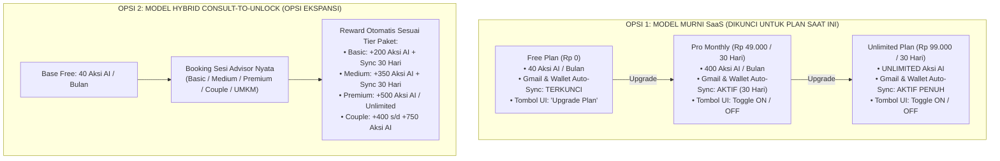
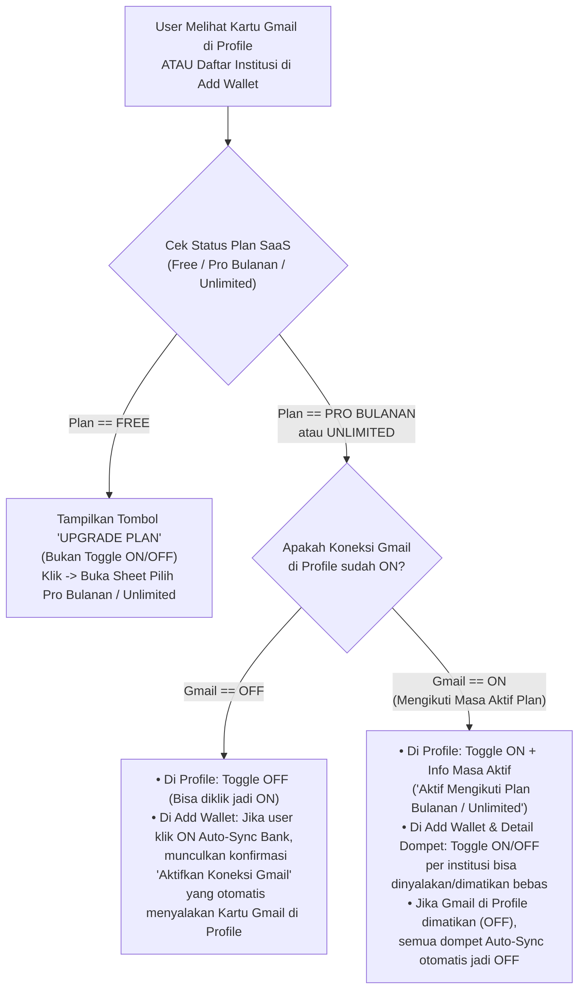

# Spesifikasi Model Bisnis Kuota AI, Langganan SaaS, & Integrasi Auto-Sync Gmail Clarafin

| Field | Value |
| --- | --- |
| Project | **Clarafin** |
| Document Version | 1.0 (AI Quota Business Models & Gmail Auto-Sync Entitlement Rules) |
| Status | Active Decision Document (**Opsi 1 SaaS Dikunci untuk Implementasi Saat Ini**) |
| Last Updated | 2026-11-03 |
| Related Docs | [`katalog-paket-dan-harga.md`](./katalog-paket-dan-harga.md), [`PRD.md`](./PRD.md), [`erd.md`](./tech/erd.md) |

---

## 1. Tujuan Dokumen

Dokumen ini mendefinisikan dua opsi model bisnis monetisasi **Kuota Asisten AI (`AiQuotaNotifier`)** dan **Sinkronisasi Otomatis Mutasi Email (`Gmail Read-Only Auto-Sync`)** pada Clarafin, serta mengunci aturan keterkaitan antara **Status Langganan SaaS**, **Kartu Koneksi Gmail di `ProfileScreen`**, dan **Tombol On/Off Auto-Sync pada Daftar Dompet (`AddWalletInstitutionScreen` & `WalletDetailScreen`)**.

---

## 2. Dua Opsi Model Bisnis Kuota AI Clarafin

Clarafin memiliki dua alternatif arsitektur bisnis untuk monetisasi penggunaan AI (Chat AI, Catat Transaksi Cepat via Teks/Suara, dan Scan Struk OCR) serta fitur Auto-Sync mutasi:

---

### 2.1 Opsi 1: Model Langganan SaaS Berjenjang (*Locked for Current Implementation*)

Pada model ini, fitur pencatatan pintar AI dan sinkronisasi otomatis mutasi bank/e-wallet via Gmail dijual sebagai langganan aplikasi mandiri (*Standalone FinTech SaaS*):

| Paket SaaS | Harga | Kuota Aksi AI | Status Koneksi Gmail & Auto-Sync Wallet | Perilaku Tombol di UI (`ProfileScreen` & `AddWallet`) |
| --- | --- | --- | --- | --- |
| **1. Free Plan (Starter)** | **Rp 0** *(Selamanya)* | **40 Aksi AI / bulan** *(reset tiap tanggal 1 pukul 00:00 WIB)* | **Terkunci (Tidak Aktif)** | Tombol On/Off tidak ditampilkan; diganti menjadi tombol CTA **`Upgrade Plan`** yang membuka sheet pilihan paket SaaS. |
| **2. Clarafin Pro (Bulanan)** | **Rp 49.000** / 30 Hari | **400 Aksi AI / 30 hari** | **Aktif mengikuti masa langganan bulanan (30 hari)** | Tombol **Toggle `ON / OFF`** aktif selama masa 30 hari belum berakhir. Saat masa aktif habis dan tidak diperpanjang, otomatis kembali ke *Free Plan* (`OFF`). |
| **3. Clarafin Unlimited (Max)** | **Rp 99.000** / 30 Hari *(atau Rp 799.000 / Tahun)* | **Unlimited (Tanpa Batas Aksi AI)** | **Aktif penuh mengikuti masa langganan Unlimited** | Tombol **Toggle `ON / OFF`** aktif penuh tanpa batas kuota pemindaian struk/chat AI maupun jumlah dompet yang disinkronkan. |

**Apa yang dihitung sebagai 1 Aksi AI (pada Free & Pro Bulanan):**
1. Satu pesan tanya-jawab ke AI Chat (`/ai-chat`) yang berhasil dijawab.
2. Satu pencatatan transaksi cepat via teks atau suara AI yang berhasil menghasilkan draf transaksi.
3. Satu pemindaian foto struk belanja (OCR) yang berhasil diekstrak menjadi draf transaksi.

**Sinkronisasi Satu Sumber Kuota AI (`aiQuotaProvider`) di Seluruh Titik UI:**
Agar angka kuota AI tidak pernah berbeda antara satu halaman dengan halaman lainnya, seluruh komponen berikut wajib membaca state tunggal `aiQuotaProvider`:
1. **Quick Action Bottom Sheet (`Tombol +` di Bottom Navbar):** Badge kuota di pojok atas sheet (`Sisa Kuota AI: 38/40`, `395/400 Pro`, atau `Unlimited`) langsung berkurang otomatis setiap kali user selesai melakukan aksi Voice, Chat Quick-Add, atau Scan OCR.
2. **Kartu Status Plan SaaS di `ProfileScreen`:** Menampilkan nama plan aktif (`STARTER FREE`, `CLARAFIN PRO BULANAN`, atau `CLARAFIN UNLIMITED`), progress bar sisa kuota AI yang identik dengan angka di Tombol `+` Navbar, serta tanggal reset/masa berlaku (`Reset tiap 1 bulan` atau `Aktif s/d [Tanggal]`).
3. **Header `AiChatScreen` (`/ai-chat`):** Menampilkan indikator sisa kuota yang sama persis secara *real-time*.

**Aturan Auto-Trigger Konfirmasi Draf Transaksi Gmail Saat Buka Aplikasi (`App Launch Gmail Draft Prompt`):**
- Ketika user berlangganan `Pro Bulanan` / `Unlimited` dan mengaktifkan **Koneksi Gmail Read-Only (`isGmailConnected == true`)**, sistem memindai email notifikasi mutasi bank/e-wallet terbaru.
- Begitu user membuka aplikasi Clarafin (`/home`), jika ditemukan transaksi baru hasil pembacaan Gmail yang belum dikonfirmasi (misalnya **2–3 transaksi baru** dari email BCA, BNI, Mandiri, atau GoPay), aplikasi otomatis memunculkan **Banner / Sheet Konfirmasi Draf Transaksi Gmail (`AiDraftReviewScreen`)** berisi tepat sejumlah transaksi yang baru ter-scrape tersebut agar user dapat langsung meninjau dan menekan **Konfirmasi** dalam sekali sentuh.

---

### 2.2 Opsi 2: Model *Consult-to-Unlock* (Bundling Kuota AI dari Konsultasi Advisor Nyata)

Pada model kedua ini, kuota AI dan fitur Auto-Sync tidak hanya dijual terpisah, melainkan menjadi **nilai tambah langsung (*value-add reward*) ketika pengguna memesan sesi konsultasi dengan Perencana Keuangan manusia**. Semakin tinggi tier paket atau jumlah sesi yang diambil (mengacu pada [`docs/katalog-paket-dan-harga.md`](./katalog-paket-dan-harga.md)), semakin besar kuota AI yang didapat pengguna untuk mengeksekusi saran konsultan:

| Kategori & Tier Paket Konsultasi | Harga Paket (Online 1 Sesi) | Bonus Kuota AI yang Didapat | Masa Aktif Kuota & Gmail Auto-Sync | Alasan Strategis Bisnis |
| --- | --- | --- | --- | --- |
| **Financial Check-Up • Basic** | Rp 149.000 | **+100 Aksi AI** | 30 Hari sejak sesi selesai | Memudahkan klien mencatat pengeluaran harian selama 30 hari pasca-diagnosa skor keuangan. |
| **Financial Check-Up • Medium** | Rp 279.000 | **+200 Aksi AI** | 30 Hari sejak sesi selesai | Mendukung pencatatan ulang portofolio dan premi pasca-audit. |
| **Financial Check-Up • Premium** | Rp 499.000 | **+400 Aksi AI** | 45 Hari sejak sesi selesai | Mendukung eksekusi *Master Financial Blueprint* tanpa khawatir kuota habis. |
| **Personal Advisory • Basic** *(Fondasi Arus Kas & Utang)* | Rp 199.000 | **+200 Aksi AI** | 30 Hari sejak sesi selesai | Klien Basic sedang fokus merapikan arus kas dan cicilan, sehingga butuh kuota AI untuk *tracking* ketat selama sebulan penuh. |
| **Personal Advisory • Medium** *(Optimalisasi Aset & Proteksi)* | Rp 299.000 | **+350 Aksi AI** | 30 Hari sejak sesi selesai | Klien Medium mendapatkan kuota hampir setara paket Pro untuk memantau alokasi aset dan anggaran barunya. |
| **Personal Advisory • Premium** *(Menuju Kebebasan Finansial)* | Rp 399.000 | **+500 Aksi AI** | 45 Hari sejak sesi selesai | Memberikan pengalaman VIP pasca-konsultasi bersama praktisi senior (`CFP®/CFA®`). |
| **Couple Advisory • Pre-Marriage** *(Siap Menikah Tanpa Drama Finansial)* | Rp 349.000 | **+400 Aksi AI** *(Shared / 200 per akun pasangan)* | 30 Hari sejak sesi selesai | Mendorong kedua calon pengantin langsung menggunakan Clarafin bersama untuk mencatat tabungan nikah. |
| **Couple Advisory • Marriage** *(Satu Visi Bangun Aset Keluarga)* | Rp 399.000 | **+500 Aksi AI** *(Shared / 250 per akun pasangan)* | 45 Hari sejak sesi selesai | Membantu suami-istri mencatat pengeluaran rumah tangga dan tabungan pendidikan anak bersama. |
| **Couple Advisory • Premium** *(Mapan Finansial Lintas Generasi)* | Rp 549.000 | **Unlimited AI (30 Hari)** untuk kedua pasangan | 30 Hari penuh | Paket tertinggi keluarga langsung membuka akses *Unlimited* selama sebulan penuh. |
| **UMKM Advisory • Basic / Medium / Premium** | Rp 349rb / 549rb / 849rb | **+400 / +650 / Unlimited (60 Hari)** | 30 – 60 Hari | Pelaku UMKM memiliki frekuensi transaksi harian yang jauh lebih tinggi dibanding individu. |

**Pengali Paket Multi-Sesi (`Pilih Paket: 2, 3, atau 8 Sesi`):**
- Mengambil **2 Sesi:** Bonus kuota AI dikalikan **2x** (masa aktif 60 hari).
- Mengambil **3 Sesi (`Lebih Hemat`):** Langsung mendapatkan akses **Unlimited AI & Gmail Auto-Sync selama 90 hari**.
- Mengambil **8 Sesi (`Pendampingan Intensif`):** Langsung mendapatkan akses **Unlimited AI & Gmail Auto-Sync selama 1 tahun penuh (365 hari)**.

> **Keputusan Implementasi Saat Ini:**
> Untuk gelombang pengembangan saat ini, aplikasi menggunakan **Opsi 1 (Model SaaS: Free 40 / Pro Bulanan 400 / Unlimited)**. Namun struktur `AiQuotaState` dirancang fleksibel agar ke depannya pemberian bonus kuota dari **Opsi 2** dapat diaktifkan kapan saja hanya dengan menambahkan fungsi `grantConsultationBonusQuota(tier, sessionCount)`.

---

## 3. Aturan Keterkaitan Logika: Plan SaaS <-> Kartu Koneksi Gmail (`ProfileScreen`) <-> Toggle Auto-Sync Dompet (`AddWallet`)

Sesuai arahan produk, fitur **Kartu Koneksi Gmail Read-Only (30 Hari)** di `ProfileScreen` dan **Tombol On/Off Auto-Sync** pada daftar institusi dompet (`AddWalletInstitutionScreen`, `WalletSyncChoiceSheet`, dan `WalletDetailScreen`) tidak boleh berjalan sendiri-sendiri, melainkan wajib terikat pada satu sumber kebenaran (*Single Source of Truth*):

### Rincian Aturan Perilaku UI & State:

1. **Saat User Berada di `Free Plan`:**
   - **Di `ProfileScreen` (Kartu Koneksi Gmail Read-Only):**
     - Tidak menampilkan switch `ON/OFF`.
     - Menampilkan badge `FITUR PRO` dan tombol **`Upgrade Plan`**.
     - Saat ditekan, muncul *Bottom Sheet Upgrade Plan* dengan 2 pilihan: **Pro Bulanan (Rp 49.000 — 400 Aksi AI + Gmail Sync Bulanan)** dan **Unlimited (Rp 99.000 — Unlimited Aksi AI + Gmail Sync Tanpa Batas)**.
   - **Di `AddWalletInstitutionScreen` (List Institusi Bank/E-Wallet) & `WalletSyncChoiceSheet`:**
     - Pada setiap baris institusi yang mendukung Auto-Sync (BCA, Mandiri, BRI, BNI, GoPay, OVO, dll.), tombol toggle Auto-Sync terkunci dengan label **`Upgrade Plan`**.
     - Jika user mengklik tombol tersebut, aplikasi membuka *Bottom Sheet Upgrade Plan* yang sama (user tetap bisa menambahkan dompet secara **Manual** kapan saja secara gratis).

2. **Saat User Berada di `Pro Bulanan` atau `Unlimited Plan`:**
   - **Masa Aktif Mengikuti Plan:**
     - Jika user mengambil **Pro Bulanan**, status aktivasi Gmail Auto-Sync berlaku mengikuti siklus **Bulanan (30 hari)**.
     - Jika user mengambil **Unlimited**, status aktivasi berlaku mengikuti siklus **Unlimited**.
   - **Sinkronisasi Dua Arah (`ProfileScreen` <-> `AddWalletInstitutionScreen`):**
     - **Dari `ProfileScreen` ke `Wallet`:** Jika user mematikan (`OFF`) toggle Kartu Koneksi Gmail di `ProfileScreen`, maka seluruh dompet yang sebelumnya berstatus `Auto-Sync: ON` otomatis dinonaktifkan menjadi `OFF (Manual)` karena izin pembacaan email mutasi telah dicabut.
     - **Dari `AddWalletInstitutionScreen` ke `ProfileScreen`:** Pada halaman `AddWalletInstitutionScreen`, setiap institusi yang mendukung sinkronisasi otomatis menampilkan switch **`ON / OFF`** langsung di sebelah kanan kartu institusi. Jika user menggeser switch institusi menjadi **`ON`** saat Kartu Gmail di `ProfileScreen` masih `OFF`, aplikasi otomatis menampilkan konfirmasi cepat *"Hubungkan Gmail Read-Only & Aktifkan Auto-Sync untuk [Nama Bank]"* yang sekaligus mengubah status Kartu Koneksi Gmail di `ProfileScreen` menjadi **`ON`** dan menambahkan/mengaktifkan dompet tersebut sebagai `Akun Otomatis`.

---

## 4. Pemisahan Ekosistem Mobile (Khusus Klien) vs Ekosistem Web (Landing Page, Portal Praktisi, & CMS Staff)

Untuk menjaga aplikasi mobile tetap ringan, fokus, dan mudah digunakan oleh masyarakat luas (mulai dari pelajar usia < 18 tahun hingga profesional dan keluarga):

1. **Aplikasi Mobile (`apps/mobile`) Murni untuk Klien / Pengguna:**
   - **Tidak ada batasan umur minimal 18 tahun saat registrasi:** Pelajar/remaja (misal usia 15–17 tahun) yang sudah memiliki penghasilan atau ingin belajar mengelola keuangan dapat mendaftar dan menggunakan aplikasi tanpa blokir tanggal lahir.
   - **Tidak ada Formulir Pendaftaran Praktisi maupun Mode Praktisi di Mobile App:** Seluruh fitur operasional praktisi dipindahkan sepenuhnya ke platform Web.
2. **Ekosistem Web Terpadu (3 Pintu Masuk Web):**
   - **Web 1 — Public Landing Page (`clarafin.id`):** Halaman informasi produk untuk publik sekaligus halaman **Pendaftaran & Pengajuan Sertifikasi Praktisi (`Daftar Sebagai Advisor Clarafin`)**.
   - **Web 2 — Practitioner / Advisor Portal (`advisor.clarafin.id`):** Dashboard kerja berbasis web khusus untuk konsultan/praktisi terverifikasi guna mengelola jadwal praktik, melayani sesi konsultasi, melihat ringkasan finansial klien yang telah menyetujui syarat sesi, mengisi **Catatan Penutup 3 Bagian**, dan memantau pencairan pendapatan (`payouts`).
   - **Web 3 — Internal Staff / Admin CMS (`cms.clarafin.id`):** Portal internal untuk Staff Clarafin memverifikasi berkas calon praktisi dari Landing Page, menetapkan tier (`Basic`, `Medium`, `Premium`) & komisi (`10%–35%`), mengelola lokasi `Venue` tatap muka, mengelola `Voucher`, serta memutuskan sengketa/keluhan sesi.
