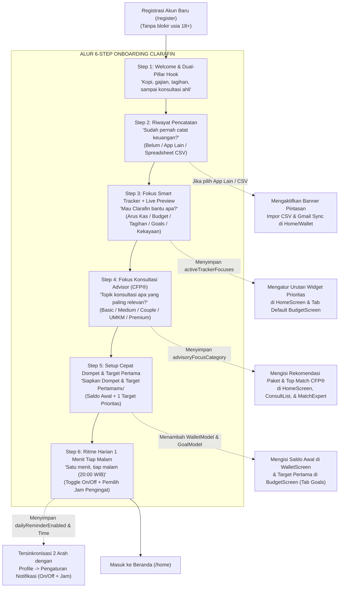
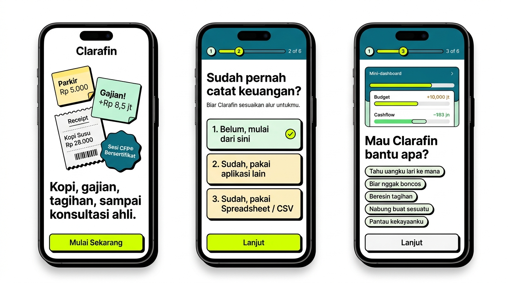
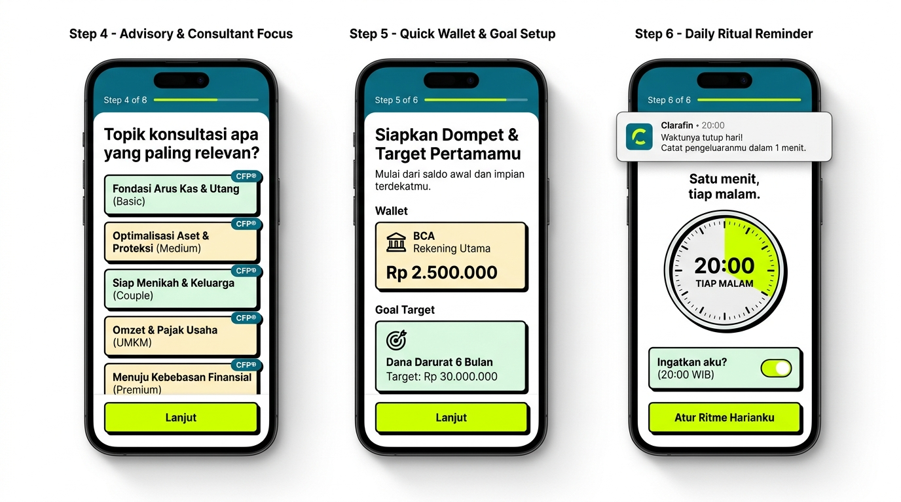

# Spesifikasi Rework Onboarding Clarafin (6-Step Smart Money Tracker + Financial Advisory)

| Field | Value |
| --- | --- |
| Project | **Clarafin** (`apps/mobile`) |
| Document Version | 1.0 (Unified Oyenza-Inspired Tracker Onboarding + Certified Advisor Matching) |
| Status | Active Specification Document |
| Last Updated | 2026-11-03 |
| Design System | [Clarafin Neo-Brutalism (`apps/mobile/docs/DESIGN_SYSTEM.md`)](../apps/mobile/docs/DESIGN_SYSTEM.md) |
| Related Docs | [`katalog-paket-dan-harga.md`](./katalog-paket-dan-harga.md), [`model-bisnis-ai-dan-saas.md`](./model-bisnis-ai-dan-saas.md), [`erd.md`](./tech/erd.md) |

---

## 1. Latar Belakang & Filosofi Desain Onboarding Baru

Onboarding lama Clarafin hanya terdiri dari 3 layar sederhana (*Welcome Carousel*, *Setup 1 Dompet*, dan *Pilih 1 Goal*) yang belum menggali kebiasaan pengguna, belum membentuk ritme harian, dan belum menghubungkan pengguna dengan kekuatan utama Clarafin: **Konsultasi Langsung bersama Perencana Keuangan Bersertifikasi (`CFP® / CFA® / QWP® / BKP`)**.

Melalui **Rework Onboarding 6-Step** ini, Clarafin memadukan:
1. **Keunggulan UX *Smart Money Tracker* (Adaptasi Referensi *Oyenza*):**
   - Visual pembuka yang hangat dan membumi (*kopi, gajian, tagihan, struk*).
   - Pemetaan riwayat pencatatan sebelumnya (*mulai dari nol*, *pindah dari aplikasi lain*, atau *impor Spreadsheet/CSV*).
   - Pemilih fokus fitur interaktif (*"Mau Clarafin bantu apa?"*) dengan **Live Mini-Dashboard Preview** yang menyala secara *real-time* saat dipilih.
   - Pembentukan kebiasaan harian (*"Satu menit, tiap malam"* pukul `20:00 WIB`) yang terhubung langsung ke pengaturan notifikasi di halaman Profil.
2. **Keunggulan Unik Clarafin (*Human-in-the-Loop Financial Advisory*):**
   - Menambahkan tahapan khusus pemetaan **Topik & Kebutuhan Konsultasi Finansial** yang langsung menyinkronkan profil pengguna dengan 5 kategori katalog resmi Clarafin (`Personal Advisory`, `Couple Advisory`, `UMKM Advisory`, `Corporate`, dan `Financial Check-Up`).
   - Hasil pilihan di onboarding tidak berhenti sebagai kuesioner pasif, melainkan **langsung mengubah isi Beranda (`HomeScreen`), rekomendasi pakar (`ConsultListScreen` & `MatchExpertScreen`), dompet awal (`WalletScreen`), target (`BudgetScreen`), dan jadwal pengingat malam (`NotificationSettingsScreen`)**.

---

## 2. Peta Alur 6 Tahap Onboarding & Relasi Fitur

---

## 3. Pratinjau Visual UI Onboarding (Gaya Clarafin Neo-Brutalism)

Seluruh layar onboarding dirancang mengikuti aturan **`DESIGN_SYSTEM.md`**: kanvas putih bersih (`#FFFFFF`), header `NeoBrutalism.brandGradient` (`#0F758A`), border hitam tegas `2px` (`#000000`), *hard shadow* `4px` tanpa blur, tombol utama *Electric Lime* (`#CCFF00`), serta kartu aksen *Mint* (`#DDF7E3`) dan *Warm Cream* (`#FEF3C7`).

### 3.1 Visualisasi Step 1, Step 2, dan Step 3

### 3.2 Visualisasi Step 4, Step 5, dan Step 6

---

## 4. Spesifikasi Detail Per Step (Tujuan, UI, State, & Dampak Fitur)

### Step 1: Welcome & Dual-Pillar Hook (`/onboarding`)
- **Tujuan Produk:** Menyambut pengguna baru dengan pesan yang merangkum dua kekuatan utama Clarafin dalam satu layar: kemudahan mencatat transaksi harian (suara, foto struk, teks AI) **dan** akses konsultasi langsung bersama konsultan keuangan lintas lisensi resmi (**`CFP®`, `CFA®`, `QWP®`, `AWP®`, `AEPP®`, `CPA`, & `BKP` Pajak**).
- **Komponen UI Neo-Brutalism:**
  - Kolase kartu visual berborder `2px` hitam: *sticky note* kuning (`Parkir Rp 5.000`), kartu *mint* (`Gajian! +Rp 8,5 jt`), potongan struk (`Kopi Susu Rp 28.000`), dan lencana *Teal* (`Konsultan Berlisensi CFP® • CFA® • QWP® • BKP`).
  - Headline: **"Kopi, gajian, tagihan, sampai konsultasi ahli."**
  - Subheadline: *"Ucapkan, foto struk, atau ketik pengeluaran harianmu. Butuh strategi lebih dalam? Diskusikan langsung bareng konsultan berlisensi resmi (CFP®, CFA®, QWP®, AWP®, CPA, & BKP)."*
  - Tombol CTA Utama (`#CCFF00` Lime): **`Mulai Sekarang`** -> lanjut ke Step 2.
- **Fitur yang Terkait:** Pintu masuk pasca-registrasi (`/register`) tanpa hambatan validasi umur 18+.

---

### Step 2: Pemetaan Riwayat Pencatatan Keuangan (`/onboarding/history`)
- **Tujuan Produk:** Mengetahui apakah pengguna adalah pemula murni atau pengguna pindahan dari aplikasi/spreadsheet lain sehingga Clarafin dapat menawarkan jalur migrasi data yang tepat.
- **Komponen UI Neo-Brutalism:**
  - Header progres `Step 2 of 6`.
  - Headline: **"Sudah pernah catat keuangan?"**
  - Subheadline: *"Biar Clarafin sesuaikan alur awal untukmu. Kalau sudah punya catatan, riwayatmu bisa ikut pindah."*
  - **3 Kartu Pilihan (Single-Select):**
    1. **`1. Belum, mulai dari sini`** *(Selama ini belum rutin atau masih catat di buku)*
    2. **`2. Sudah, pakai aplikasi lain`** *(Money Manager, Money Lover, Sribuu, dll.)*
    3. **`3. Sudah, pakai Spreadsheet / CSV`** *(Google Sheets, Excel, atau file CSV)*
- **State & Dampak Langsung ke Fitur yang Dirasakan User:**
  - Disimpan ke `userProfileProvider.trackingHistorySource` (`'fresh_start' | 'other_app' | 'spreadsheet'`).
  - **Dampak Fitur:**
    - Jika memilih **`fresh_start`**: Beranda menampilkan panduan singkat input transaksi pertama via tombol `+` (AI/Manual).
    - Jika memilih **`other_app`** atau **`spreadsheet`**: Beranda dan halaman `/export` menampilkan kartu aksi cepat **"Pindahkan Riwayat Transaksimu (Impor CSV / Sinkronisasi Resi Gmail 30 Hari)"** agar pengguna tidak perlu mengetik ulang dari nol.

---

### Step 3: Prioritas Smart Money Tracker + Live Mini-Dashboard (`/onboarding/tracker-focus`)
- **Tujuan Produk:** Memberikan pengalaman *instant gratification* (pengguna langsung melihat dasbor keuangannya menyala sesuai kebutuhan yang dicentang) sekaligus mempersonalisasi tata letak aplikasi.
- **Komponen UI Neo-Brutalism:**
  - Header progres `Step 3 of 6`.
  - **Kartu Live Mini-Dashboard Preview di bagian atas:** Menampilkan pratinjau komponen *Cashflow Bar*, *Budget Progress*, *Tagihan*, *Target Goals*, dan *Donut Kekayaan*. Bagian yang belum dipilih tampil redup (`MATI` / abu-abu), dan langsung menyala berwarna *Lime* `#CCFF00` & *Teal* `#0F758A` saat pil di bawahnya disentuh!
  - Headline: **"Mau Clarafin bantu apa?"**
  - **5 Pil Multi-Select Interaktif:**
    1. **`Tahu uangku lari ke mana`** -> Menyalakan grafik *Pengeluaran & Arus Kas*
    2. **`Biar nggak boncos`** -> Menyalakan bar *Anggaran Bulanan (`Budget`)*
    3. **`Beresin tagihan & langganan`** -> Menyalakan kalender *Tagihan (`Bills`)*
    4. **`Nabung buat sesuatu`** -> Menyalakan progres *Target Tabungan (`Goals`)*
    5. **`Pantau semua kekayaanku`** -> Menyalakan distribusi *Multi-Dompet & Investasi (`Wallet`)*
- **State & Dampak Langsung ke Fitur yang Dirasakan User:**
  - Disimpan ke `userProfileProvider.trackerFocuses` (`List<String>`).
  - **Dampak Fitur:**
    - Menentukan tab sub-menu mana yang terbuka pertama kali saat user menekan menu **`Budget`** di navigasi bawah (`Goals` jika fokus nabung, `Budget` jika fokus biar nggak boncos, atau `Bills` jika fokus beresin tagihan).
    - Jika **`Biar nggak boncos`** dipilih, sistem otomatis membuatkan draf anggaran bulanan awal (`totalBudgetProvider`) sebesar 70% dari estimasi saldo/pemasukan awal.

---

### Step 4: Fokus Konsultasi & Pendampingan Praktisi (`/onboarding/advisory-focus`)
- **Tujuan Produk:** Menjembatani pengguna dari sekadar pencatat keuangan menuju pengguna layanan konsultasi finansial dengan memetakan masalah utama mereka ke dalam 5 kategori paket di [`docs/katalog-paket-dan-harga.md`](./katalog-paket-dan-harga.md).
- **Komponen UI Neo-Brutalism:**
  - Header progres `Step 4 of 6`.
  - Headline: **"Topik konsultasi apa yang paling relevan buatmu?"**
  - Subheadline: *"Kami cocokkan dengan konsultan berlisensi resmi (QWP®, CFP®, CFA®, BKP) sesuai kondisimu."*
  - **5 Kartu Pilihan Ber-badge Lisensi (Single/Multi-Select):**
    1. **`Fondasi Arus Kas & Utang (Basic)`** — Badge `QWP® / AWP®` *(Gaji cepat habis, cicilan PayLater, & dana darurat)*
    2. **`Optimalisasi Aset & Proteksi (Medium)`** — Badge `CFP®` *(Mulai investasi, bedah polis asuransi, & simulasi KPR)*
    3. **`Siap Menikah & Keluarga (Couple)`** — Badge `CFP® Family` *(Keuangan pranikah, rumah tangga, & dana sekolah anak)*
    4. **`Omzet & Pajak Usaha (UMKM)`** — Badge `CFP® / BKP` *(Pisah uang pribadi vs toko/usaha, HPP, & pajak bisnis)*
    5. **`Menuju Kebebasan Finansial (Premium)`** — Badge `CFP® / CFA®` *(Peta jalan pensiun dini / FIRE, kekayaan, & waris)*
- **State & Dampak Langsung ke Fitur yang Dirasakan User:**
  - Disimpan ke `userProfileProvider.advisoryFocus` (`'basic' | 'medium' | 'couple' | 'umkm' | 'premium'`).
  - **Dampak Fitur:**
    - **Di `HomeScreen` (*Sorotan Untukmu*):** Kartu rekomendasi langsung menampilkan nama paket yang cocok (misal: *"Rekomendasi Untukmu: Couple Advisory • Siap Menikah Tanpa Drama Finansial"*).
    - **Di `ConsultListScreen` (`/consult`) & `MatchExpertScreen` (`/match-expert`):** Mengurutkan konsultan yang memiliki spesialisasi dan tier yang sesuai di urutan paling atas (misal: langsung menampilkan **Nadia Kusuma, CFP®, AEPP®** untuk *Couple*, atau **Budi Santoso, CPA, CFP®** untuk *UMKM*).
    - **Di `BookingFlowScreen` Step 1:** Paket yang relevan otomatis terpilih (*pre-selected*) saat pengguna membuka halaman pemesanan konsultan.

---

### Step 5: Setup Cepat Dompet Utama & Target Pertama (`/onboarding/wallet-goal`)
- **Tujuan Produk:** Memastikan begitu pengguna selesai onboarding dan mendarat di Beranda (`/home`), angka Total Saldo di `HomeScreen`, kartu di `WalletScreen`, dan progres di `BudgetScreen` sudah terisi dengan data riil milik pengguna.
- **Komponen UI Neo-Brutalism:**
  - Header progres `Step 5 of 6`.
  - Headline: **"Siapkan Dompet & Target Pertamamu"**
  - **Bagian 1 — Kartu Dompet Utama (`Wallet`):**
    - Pemilih cepat tipe akun (`Bank`, `E-Wallet`, `Cash`, `Investasi`), input nama dompet (default: `BCA Rekening Utama`), dan input nominal saldo saat ini (dengan pemformat titik ribuan otomatis, contoh: `Rp 2.500.000`).
  - **Bagian 2 — Kartu Target Pertama (`Goal Target`):**
    - Pilihan cepat target pertama yang otomatis menyesuaikan jawaban Step 4 (contoh: `Dana Darurat 6 Bulan — Rp 30.000.000`, `Tabungan Nikah & Rumah — Rp 50.000.000`, atau `Modal Ekspansi Usaha — Rp 25.000.000`).
- **State & Dampak Langsung ke Fitur yang Dirasakan User:**
  - Memanggil `walletsProvider.notifier.addWallet(...)` dan `goalsProvider.notifier.addGoal(...)` serta menyimpan ke `LocalStorageService`.
  - Menghilangkan kondisi *empty state* kosong saat pertama kali masuk ke Beranda.

---

### Step 6: Ritme Harian "Satu Menit, Tiap Malam" (`/onboarding/daily-ritual`)
- **Tujuan Produk:** Membangun retensi harian pengguna dengan menetapkan jam pengingat malam untuk membuka Clarafin selama 1 menit guna mengecek dan menutup catatan pengeluaran hari tersebut.
- **Komponen UI Neo-Brutalism:**
  - Header progres `Step 6 of 6`.
  - **Pratinjau Kartu Push Notification di Atas:** Menampilkan kartu notifikasi bergaya Neo-Brutalism:
    - Ikon Clarafin + `Clarafin • 20:00`
    - Judul: **"Waktunya tutup hari!"**
    - Isi: *"Catat pengeluaranmu dalam 1 menit sebelum istirahat."*
  - Headline: **"Satu menit, tiap malam."**
  - **Visual Jam Melingkar Interaktif (`20:00 TIAP MALAM`):**
    - Lingkaran jam bergaya Neo-Brutalism dengan busur warna *Electric Lime* (`#CCFF00`). Saat lingkaran jam atau angka `20:00` diketuk, pengguna dapat memilih jam pengingat sesuai rutinitasnya (misal `19:30`, `20:00`, `21:00`, atau `21:30 WIB`).
  - **Kartu Toggle Pengingat:**
    - Label: **`Ingatkan aku? (20:00 WIB)`** — *"Berhenti mengingatkan kalau transaksi hari ini sudah dicatat"* + Switch `ON / OFF` berwarna Lime.
  - Tombol CTA Utama: **`Atur Ritme Harianku`** (menyimpan pengaturan & masuk ke `/home`) + tombol teks **`Nanti saja`**.
- **State & Keterkaitan 2 Arah dengan `Profile -> Pengaturan Notifikasi` (`NotificationSettingsScreen`):**
  - Menyimpan `dailyReminderEnabled: bool` dan `dailyReminderTime: String` (format `'HH:mm'`, default `'20:00'`) pada `UserProfile` (`userProfileProvider` & `SharedPreferences`).
  - **Keterkaitan Langsung di `NotificationSettingsScreen` (`/profile/notifications`):**
    - Di halaman **Pengaturan Notifikasi** pada menu Profil, ditambahkan kartu paling atas bernama **"Pengingat Harian Buka Clarafin (Tutup Hari)"** yang menampilkan:
      1. **Toggle Switch `ON / OFF`** yang membaca dan mengubah `profile.dailyReminderEnabled`.
      2. **Tombol Pill Jam Pengingat (`⏰ 20:00 WIB — Ubah Jam`)** yang membuka `showTimePicker` untuk mengubah `profile.dailyReminderTime` kapan saja.

---

## 5. Ringkasan Pemetaan Data & State Baru di `UserProfile` (`apps/mobile`)

| Field di `UserProfile` (`user_profile_provider.dart`) | Tipe Data | Nilai Default | Halaman yang Membaca / Mengubah |
| --- | --- | --- | --- |
| `subscriptionPlan` | `String` | `'free'` (`'free' \| 'pro_monthly' \| 'unlimited'`) | **Diubah di:** Sheet Upgrade Plan. **Dibaca di:** `ProfileScreen` (Kartu Status Plan SaaS & Kartu Koneksi Gmail), `AddWalletInstitutionScreen` (Toggle Auto-Sync vs Tombol Upgrade Plan), `AiChatScreen`. |
| `aiQuotaRemaining` | `int` | `40` (`40` Free, `400` Pro, `-1` Unlimited) | **Dibaca & Dikurangi di:** `AiChatScreen`, Quick Add AI, Scan Struk OCR, & `ProfileScreen`. |
| `isGmailConnected` | `bool` | `false` | **Diubah & Disinkronkan 2 Arah di:** Kartu Koneksi Gmail (`ProfileScreen`) <-> Toggle Auto-Sync Institusi (`AddWalletInstitutionScreen` & `WalletDetailScreen`). |
| `trackingHistorySource` | `String` | `'fresh_start'` | **Diisi di:** Onboarding Step 2. **Dibaca di:** `HomeScreen` & `ExportDataScreen` (Banner Impor CSV). |
| `trackerFocuses` | `List<String>` | `['cashflow', 'budget', 'goals']` | **Diisi di:** Onboarding Step 3. **Dibaca di:** `HomeScreen` & `BudgetScreen`. |
| `advisoryFocus` | `String` | `'basic'` | **Diisi di:** Onboarding Step 4. **Dibaca di:** `HomeScreen` (*Sorotan Untukmu*), `ConsultListScreen`, `MatchExpertScreen`, & `BookingFlowScreen`. |
| `dailyReminderEnabled` | `bool` | `true` | **Diisi di:** Onboarding Step 6. **Diubah kapan saja di:** `NotificationSettingsScreen` (`/profile/notifications`). |
| `dailyReminderTime` | `String` | `'20:00'` | **Diisi di:** Onboarding Step 6. **Diubah kapan saja di:** `NotificationSettingsScreen` (`/profile/notifications` via TimePicker). |
