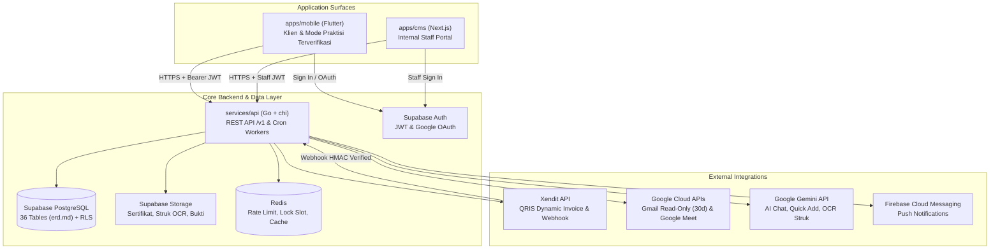
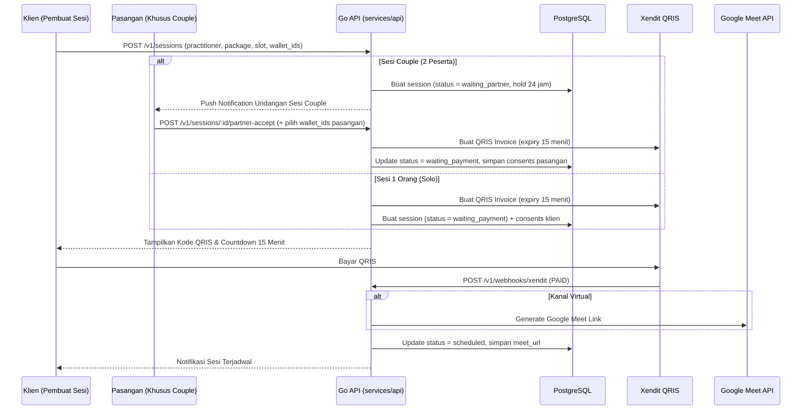
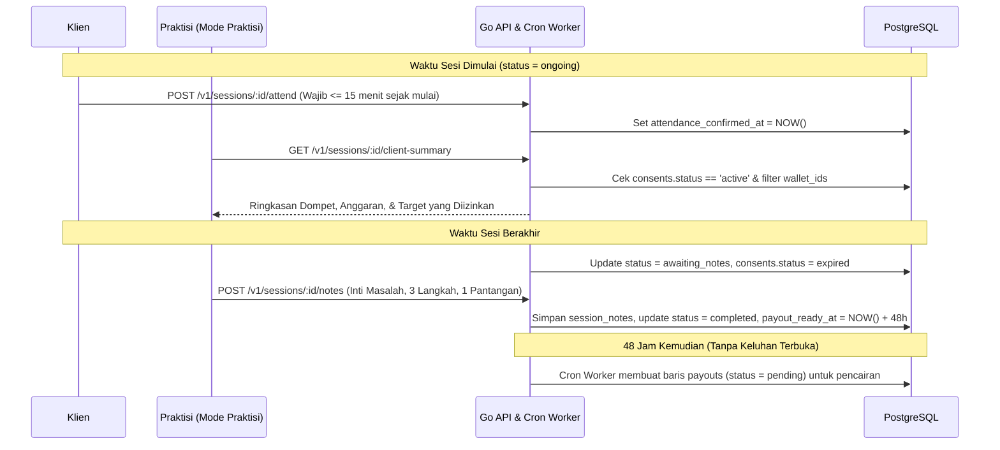
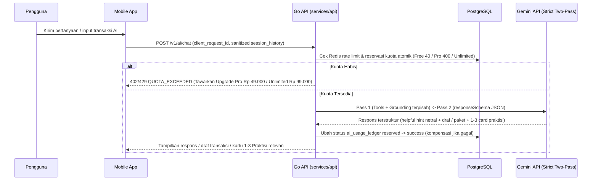

# System Architecture — Clarafin

| Field | Value |
| --- | --- |
| Project | **Clarafin** |
| Document Version | 3.0 (Rework Aligned + Frontend-First & Bottom Nav Override) |
| Status | Active |
| Last Updated | 2026-11-01 |

## Change Summary

| Date | Change |
| --- | --- |
| 2026-11-17 | Diselaraskan dengan `docs-rework-clarafin/06-sistem.md`, `erd.md` v2.0, dan `clarafin-ai-chatbot-blueprint.md`: topologi 2 permukaan aplikasi (`apps/mobile` untuk Klien + Praktisi terverifikasi, `apps/cms` untuk Staff internal), Go Application Service (`services/api`), Supabase Postgres (36 tabel kanonis mengacu `erd.md`), Redis rate limit (`10 req/min`), Xendit QRIS (Sesi & Pro/Unlimited), Google OAuth + Gmail Read-Only 30 hari + Google Meet API, dan Clarafin AI (Strict Two-Pass Gemini, *helpful hint* netral, `New Chat` *ephemeral*). Mempertahankan strategi **Frontend-First (`mobile_frontend`)** dan **Navigasi Bawah Eksisting**. |
| 2026-03-11 | Expanded system architecture v2.2 with sequence diagrams and NFRs. |

---

## 1. Ringkasan Topologi Sistem

Clarafin menggunakan arsitektur terpusat dengan **2 permukaan aplikasi (App Surfaces)** dan **1 Backend API Service**:

1. **`apps/mobile` (Flutter — Android & iOS):**
   - Digunakan oleh seluruh pengguna terdaftar (**Klien**).
   - Pengguna yang pengajuan praktisinya telah diverifikasi oleh Staff (`practitioner_profiles.status = 'verified'`) secara otomatis membuka **Mode Praktisi** di dalam aplikasi mobile yang sama (untuk mengelola jadwal, menerima sesi, melihat ringkasan dompet klien yang diizinkan, menulis Catatan Penutup 3 bagian, dan memantau pencairan dana).
2. **`apps/cms` (Next.js — Web Internal Staff):**
   - Digunakan khusus oleh **Staff Clarafin** untuk memverifikasi dokumen sertifikasi praktisi (`CFP`, `QWP`, `AEPP`, `Brevet`), mengatur persentase komisi per praktisi (`10%–35%`, default `20%`), mengelola lokasi fisik (`venues`) untuk sesi Tatap Muka, menyelesaikan keluhan sesi (`session_complaints`), dan memproses pencairan dana (`payouts`).
3. **`services/api` (Go Application Service):**
   - Menangani seluruh logika bisnis, siklus hidup pemesanan & pembayaran QRIS Xendit, penegakan kuota AI (40 gratis / 400 Pro) & pemanggilan Gemini API, pemindaian mutasi email 30 hari via Gmail Read-Only OAuth, pembuatan tautan Google Meet untuk sesi Virtual, serta *background cron jobs*.

---

## 2. Strategi Delivery: `Frontend-First` (`mobile_frontend` -> `mobile_backend_integration`)

Sesuai keputusan arsitektur proyek, pengembangan dieksekusi dengan disiplin **Frontend-First**:

### 2.1 Fase Aktif Saat Ini: `mobile_frontend`
1. **Fokus Utama:** Menyelesaikan, memoles, dan mengunci seluruh UI/UX Neo-Brutalism (`DESIGN_SYSTEM.md`), alur navigasi (`go_router`), dan pengelolaan state lokal (`Riverpod` + `SharedPreferences`) di `apps/mobile`.
2. **Navigasi Bawah yang Dikunci:** Mempertahankan 4 tab utama + tombol tengah: **`Home` (`/home`)**, **`Consult` (`/consult`)**, **`FAB (+)`** (Quick Action / Input Transaksi), **`Wallet` (`/wallet`)**, dan **`Budget` (`/budget` dengan sub-tab *Goals*, *Budget*, *Bills*)**, serta **Floating Session Button** di kanan bawah `Home` menuju **`/session`**.
3. **Kontrak Data (`erd.md`):** Skema database **36 tabel** telah dikunci di [erd.md](./erd.md) berdasarkan UI yang sudah ada ditambah aturan bisnis rework & blueprint AI Chatbot, sehingga ketika seluruh layar mobile selesai divalidasi, tim dapat langsung membangun Go API dan migrasi Supabase tanpa merombak struktur state di Flutter.

### 2.2 Fase Berikutnya: `mobile_backend_integration` & `cms_staff`
1. Inisialisasi skema PostgreSQL di Supabase sesuai [erd.md](./erd.md) dan [database.md](./database.md).
2. Implementasi endpoint `/v1/*` di `services/api` (Go) sesuai [api-design.md](./api-design.md).
3. Penggantian bertahap repositori lokal (`LocalStorageService`) di Flutter ke HTTP client (`Dio`) yang terhubung ke `services/api`.
4. Pembangunan `apps/cms` untuk operasional Staff.

---

## 3. Alur Arsitektur Utama (Canonical Sequence Flows)

### 3.1 Alur Pemesanan Sesi (Solo 15 Menit vs Couple 24 Jam + 15 Menit)

### 3.2 Alur Pelaksanaan Sesi, Kehadiran (`Hadir`), Catatan Penutup 3 Bagian, & Pencairan (48 Jam)

### 3.3 Alur Asisten AI Berkuota, *Helpful Hint* Netral, & Reservasi Atomik

---

## 4. Pekerjaan Latar Belakang Otomatis (Background Cron Workers)

Di dalam `services/api`, terdapat 5 *background worker* terjadwal:

| Worker | Interval | Tugas Utama |
| --- | --- | --- |
| **Payment & Invite Expiry Worker** | Setiap **1 menit** | Membatalkan sesi `waiting_payment` yang lewat **15 menit** dan sesi `waiting_partner` yang lewat **24 jam**, lalu membuka kembali slot praktisi. |
| **Attendance & No-Show Worker** | Setiap **5 menit** | Mengevaluasi sesi `ongoing` yang sudah lewat **15 menit** sejak waktu mulai: jika klien belum menekan `Hadir`, ubah status ke `no_show_client` (50% refund, 50% praktisi). |
| **Closing Note Reminder Worker** | Setiap **1 jam** | Mengirim peringatan ke praktisi (dan menandai untuk Staff CMS) bila sesi `awaiting_notes` belum memiliki Catatan Penutup 3 bagian setelah **24 jam**. |
| **Payout Release Worker** | Setiap **15 menit** | Memindahkan sesi `completed` yang sudah melewati `payout_ready_at` (**48 jam**) dan tidak memiliki `session_complaints` berstatus `open` ke antrean pencairan `payouts`. |
| **Gmail Receipt Scanner Worker** | Setiap **6 jam** (atau manual sync) | Memindai email mutasi bank/resi pembayaran baru (maksimal jendela **30 hari terakhir**) untuk pengguna dengan `gmail_connections.status = 'active'` dan menyimpannya sebagai `ai_drafts` (`pending_review`). |
