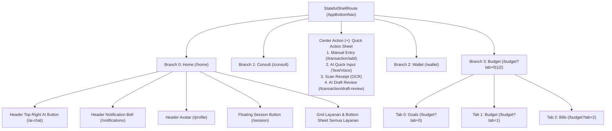

# Frontend Mobile Specification — Clarafin (`apps/mobile`)

| Field | Value |
| --- | --- |
| Project | **Clarafin** |
| Document Version | 3.0 (Rework Aligned + Existing Bottom Nav Preserved) |
| Status | Active Baseline (`mobile_frontend`) |
| Design System | [Clarafin Neo-Brutalism (`apps/mobile/docs/DESIGN_SYSTEM.md`)](../../apps/mobile/docs/DESIGN_SYSTEM.md) |
| Code Guidelines | [Feature-First Clean Architecture (`apps/mobile/docs/CODE_GUIDELINES.md`)](../../apps/mobile/docs/CODE_GUIDELINES.md) |

---

## 1. Standar Identitas Visual (Clarafin Neo-Brutalism)

Seluruh layar di `apps/mobile` wajib mematuhi aturan visual di `apps/mobile/docs/DESIGN_SYSTEM.md`:

1. **Garis Tepi & Bayangan Tegas (Tactile Geometry):**
   - Semua kartu, tombol, input, badge, dan kontainer interaktif wajib menggunakan **`2.0px` solid `#000000` border** (`NeoBrutalism.standardBorder`).
   - Bayangan selalu vertikal tanpa blur (`blurRadius: 0`): `Offset(0, 4)` untuk kartu utama, `Offset(0, 2)` untuk kartu sekunder/chip, dan `Offset(0, 6)` untuk modal/FAB.
2. **Palet Warna & Permukaan Berkarakter (Anti-Polos):**
   - **Dilarang membuat layar yang seluruhnya putih/abu-abu polos (`#F8F9FA`) tanpa identitas brand.**
   - Setiap layar wajib menerapkan minimal salah satu pola permukaan berikut:
     - **Signature Pinned Header (`NeoBrutalism.brandGradient`):** Gradasi lembut dari `#E1F598` (Lime Tint) -> `#F3FADC` -> `#FFFFFF` di area header atas dengan transisi kanvas putih melengkung (`borderRadius: 24px` di bagian atas konten) dan garis pemisah `2px` hitam.
     - **Aksen Permukaan Kartu (`Surface Accents`):** Menggunakan kombinasi permukaan `NeoBrutalism.primary` (`#CCFF00` Lime), `NeoBrutalism.mint` (`#A8E6CF`), `NeoBrutalism.surfaceWarm` (`#FFFCE6`), `NeoBrutalism.primaryLight` (`#E3F5C8`), `NeoBrutalism.secondary` (`#0F758A` Dark Teal), dan `NeoBrutalism.coral` (`#FF8B94`) untuk membedakan hierarki informasi secara fungsional.
3. **Tipografi:**
   - **Plus Jakarta Sans** untuk seluruh teks UI (`w500`–`w800`).
   - **Quicksand (`w700`)** khusus untuk wordmark logo `"Clarafin"`.

---

## 2. Arsitektur Navigasi Bawah (Locked Override)

Sesuai arahan arsitektur yang dikunci, aplikasi mobile mempertahankan struktur **Bottom Navigation** eksisting (`AppBottomNav`) yang terdiri dari 4 cabang utama + tombol aksi tengah (`+`), ditambah **Floating Session Button** di layar Beranda:

---

## 3. Peta Rute Lengkap (`go_router` di `app_router.dart`)

| Route Path | Screen Widget | Keterangan & Query Params |
| --- | --- | --- |
| `/` | `SplashScreen` | Memeriksa sesi login & mengarahkan ke `/login` atau `/home`. |
| `/login` | `AuthLoginScreen` | Masuk dengan email/kata sandi atau Google OAuth. |
| `/register` | `AuthRegisterScreen` | Pendaftaran pengguna baru (**Tanggal Lahir opsional / inklusif tanpa blokir usia 18+**) -> lanjut ke `/onboarding` (syarat usia/kelengkapan dicek sebelum booking konsultasi). |
| `/onboarding` | `OnboardingWelcomeScreen` | Pengenalan Clarafin. |
| `/onboarding/wallet` | `OnboardingWalletSetupScreen` | Membuat dompet pertama dan menyimpannya ke `walletsProvider`. |
| `/onboarding/goal` | `OnboardingSetGoalScreen` | Membuat target tabungan pertama dan menyimpannya ke `goalsProvider` -> lanjut ke `/home`. |
| `/home` | `HomeScreen` | Dashboard utama, kartu total saldo, grid layanan cepat, sesi aktif, sorotan, ringkasan anggaran, dan transaksi terbaru. |
| `/consult` | `ConsultListScreen` | Direktori praktisi terverifikasi. Mendukung query `?category=` (`All`, `Individu`, `Pasangan`, `Keluarga`, `UMKM`, `Pajak`, `Investasi`, `Utang`, `Proteksi`). |
| `/consult/:id` | `ConsultDetailScreen` | Profil lengkap praktisi, sertifikasi, ulasan, dan tombol pilih paket. |
| `/booking/:id` | `BookingFlowScreen` | Pemilihan paket (**Basic**, **Medium**, **Premium**), kanal (**Chat 3 Hari**, **Virtual 60m**, **Tatap Muka**), peserta (**1 Orang**, **Couple**), jadwal, dan **persetujuan tunggal (`terms_and_data_consent_accepted` & dompet `consents`)**. Mendukung pengisian otomatis dari Clarafin AI melalui **`bookingProvider.notifier.prefillFromAi(...)`** (dengan `reset()` dipanggil hanya saat masuk lewat jalur booking organik, serta hidrasi controller & topik Step 3 dari state provider). |
| `/booking/:id/payment` | `BookingPaymentScreen` | Rincian harga transparan (tanpa biaya tambahan tersembunyi) & pembayaran **QRIS Xendit (15 menit)**. |
| `/session` | `BranchSessionScreen` | Kotak masuk seluruh sesi pengguna (tab Aktif & Riwayat dengan filter interaktif `Terbaru` / `Semua Jadwal`). |
| `/consult/:id/chat` | `ConsultChatScreen` | Ruang sesi aktif: tombol konfirmasi **`Hadir` (15 menit pertama)**, tautan Google Meet, pengelolaan izin dompet, tampilan **Catatan Penutup 3 Bagian**, keluhan, dan ulasan. |
| `/wallet` | `WalletScreen` | Donut chart distribusi aset, tombol urutkan nilai (*Sort by Value*), filter tipe dompet, dan grid dompet. |
| `/wallet/add` | `AddWalletInstitutionScreen` | Pemilihan institusi bank/e-wallet/investasi. |
| `/wallet/add/manual` | `ManualWalletEntryScreen` | Form pembuatan dompet manual. |
| `/wallet/:id` | `WalletDetailScreen` | Rincian saldo dompet, riwayat mutasi dompet tersebut, dan edukasi alokasi aset. |
| `/budget` | `BudgetScreen` | Mendukung query `?tab=0` (*Goals*), `?tab=1` (*Budget*), `?tab=2` (*Bills*). |
| `/budget/add` | `AddEditBudgetScreen` | Tambah/ubah anggaran kategori. |
| `/goal/add` | `AddEditGoalScreen` | Tambah/ubah target tabungan. |
| `/goal/:id` | `GoalDetailScreen` | Progres target tabungan dan pencatatan setoran tabungan. |
| `/bill/add` | `AddEditBillScreen` | Tambah/ubah pengingat tagihan jatuh tempo. |
| `/transaction/add` | `TransactionEntryScreen` | Pencatatan transaksi manual, shortcut duplikat transaksi lalu, upload struk OCR, dan pintasan AI. |
| `/transaction/success` | `TransactionSuccessScreen` | Bukti transaksi berhasil dicatat. |
| `/transaction/history` | `TransactionHistoryScreen` | Riwayat seluruh transaksi dengan pencarian, filter kategori/tipe, dan ringkasan arus kas. |
| `/transaction/draft-review` | `AiDraftReviewScreen` | Peninjauan dan konfirmasi draf transaksi dari AI atau pindai email Gmail ke `transactionsProvider`. |
| `/ai-chat` | `AiChatScreen` | Clarafin AI terpadu (2-Card Neo-Brutalist, sinkron dengan Quick Action Sheet) lengkap dengan tombol **`New Chat`** (reset sesi *ephemeral* permanen di memori), indikator kuota (**Free 40 / Pro 400 / Unlimited** via `aiQuotaProvider`), Strict Two-Pass Gemini (*helpful hint* netral tanpa berlebih + *soft boundary* rekomendasi 1–3 praktisi & paket), serta CTA `Pilih & Jadwalkan` yang memanggil **`bookingProvider.notifier.prefillFromAi(...)`**. |
| `/notifications` | `NotificationScreen` | Pusat notifikasi dengan header `brandGradient`, filter kategori berwarna, dan aksi tandai dibaca. |
| `/profile` | `ProfileScreen` | Profil pengguna, statistik bento interaktif, kartu **Clarafin Pro / Unlimited** (`Free` 40, `Pro` Rp 49.000 / 400 aksi, `Unlimited` Rp 99.000; selaras dengan `aiQuotaProvider`), koneksi **Gmail Read-Only (30 Hari)**, status **Pengajuan Praktisi / Mode Praktisi**, pengaturan, dan **Hapus Akun**. |
| `/profile/edit` | `EditProfileScreen` | Ubah nama, email, nomor telepon, dan tanggal lahir. |
| `/profile/security` | `SecuritySettingsScreen` | Pengaturan PIN 6 digit, biometrik, dan manajemen sesi perangkat. |
| `/profile/notifications` | `NotificationSettingsScreen` | 4 toggle preferensi notifikasi yang tersimpan penuh ke `UserProfile` & `LocalStorageService`. |
| `/profile/help` | `HelpSupportScreen` | Pusat bantuan interaktif, pengiriman tiket keluhan/CS, dan FAQ Clarafin. |
| `/financial-health` | `FinancialHealthScreen` | Skor kesehatan finansial (rasio tabungan, dana darurat, utang, anggaran) beserta CTA konsultasi praktisi. |
| `/report` | `ReportDashboardScreen` | Analitik arus kas bulanan/tahunan, tren pemasukan vs pengeluaran, dan rincian kategori. |
| `/export` | `ExportDataScreen` | Ekspor laporan keuangan (PDF/CSV/Excel) ke email pengguna aktif di `userProfileProvider`. |
| `/voucher` | `VoucherScreen` | Informasi program kuota AI & paket layanan transparan Clarafin. |
| `/match-expert` | `MatchExpertScreen` | Kuis pencocokan kebutuhan finansial pengguna dengan praktisi bersertifikat yang tepat. |
